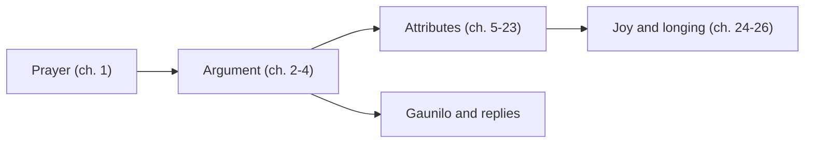

# Anselm, *Proslogion*

**Prerequisites:** [[anselm|Anselm]]; helpful: [[faith-and-reason|Faith and reason]]

@@IMG@@

## Dating and purpose

Written in Latin by [[anselm|Anselm]] in 1077–1078 at the abbey of Bec, shortly after the *Monologion*. In the preface he explains that the earlier book had used a long chain of arguments, and he wanted instead to find a single argument that would need nothing but itself to show that God truly exists and is the supreme good. He says the idea came to him after long searching, when he had almost given up. He first titled it *Faith Seeking Understanding*. "Proslogion" means "an address", because it is spoken to God.

## Outline

- **Chapter 1.** A prayer, ending with the principle that he believes in order to understand.
- **Chapters 2–4.** The argument. God is "something than which nothing greater can be thought". Even the fool of Psalm 14 understands this; what exists in reality is greater than what exists only in thought; therefore that than which nothing greater can be thought exists in reality (ch. 2). It cannot even be thought not to exist (ch. 3). How then can the fool say there is no God? Because one can think a word without thinking the thing it signifies (ch. 4).
- **Chapters 5–26.** What follows from the definition: God is whatever it is better to be than not to be; just, merciful, impassible, eternal, everywhere, and greater than can be thought. The book ends in praise and longing for the joy of God.
- **Appendix.** Gaunilo's *Reply on Behalf of the Fool* and Anselm's *Reply to Gaunilo* were circulated with the work, at Anselm's request.

## Reading notes

Most modern readers meet chapters 2–4 alone, as a puzzle in logic. Read in full, the work is a meditation in which argument is a form of prayer. That does not make the argument less philosophical, but it changes its purpose: Anselm seeks to understand what he already believes. The argument has been interpreted in many ways: as a reductio, as an argument about the concept of necessary existence (ch. 3), or as an expression of religious experience.

## Reception

[[thomas-aquinas|Aquinas]] rejected the argument; [[rene-descartes|Descartes]] offered a version in the Fifth Meditation; [[gottfried-wilhelm-leibniz|Leibniz]] tried to complete it by proving that God's concept is consistent; [[immanuel-kant|Kant]] named and criticized it; [[georg-wilhelm-friedrich-hegel|Hegel]] defended a version. Twentieth-century modal versions by Charles Hartshorne, Norman Malcolm and Alvin Plantinga renewed the debate. The standard English translation is in *Anselm: Basic Writings* (Thomas Williams) or *The Major Works* (Oxford World's Classics, ed. Brian Davies and G. R. Evans).

## Key ideas

- A short prayerful treatise built around one argument for God's existence.
- God as "that than which nothing greater can be thought" exists in reality and cannot be thought not to exist.
- Gaunilo's reply and Anselm's response were published with it.

## Where this leads

- Next text: [[guide-for-the-perplexed|*The Guide for the Perplexed*]]
- Glossary: [[g:ontological-argument|ontological argument]]
- Forward: [[meditations-on-first-philosophy|Descartes's *Meditations*]], [[critique-of-pure-reason|Kant's *Critique of Pure Reason*]]
