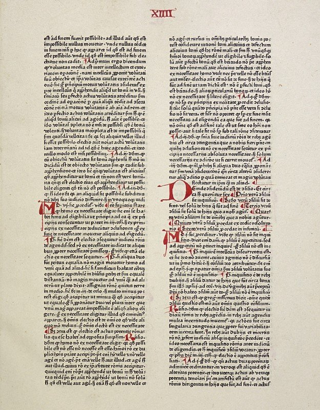
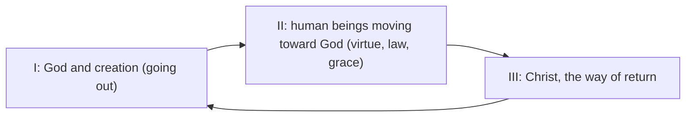

# Thomas Aquinas, *Summa Theologiae*

**Prerequisites:** [Thomas Aquinas](../thinkers/thomas-aquinas.md), [Scholasticism](../02-scholasticism.md)

*A page from an early printed edition of the *Summa Theologiae*. Credit: Credit as given on Wikimedia Commons. License: Public domain. Source: [File:SummaTheologiae.jpg](https://commons.wikimedia.org/wiki/File:SummaTheologiae.jpg).*

## Dating and purpose

Written in Latin by [Aquinas](../thinkers/thomas-aquinas.md) between about 1265 and 1273, and left unfinished when he stopped writing in December 1273. Followers completed the third part with a "Supplement" drawn from his earlier commentary on the *Sentences*. In the prologue he says he writes for beginners in theology, who are confused by the multiplication of useless questions and the disorder of existing textbooks. It is a summary ordered by the logic of the subject rather than by the order of a commentary.

## Structure

The work is divided into parts, questions and articles, about 512 questions and over 2,600 articles. Each article follows the [scholastic](../02-scholasticism.md) form: objections, *sed contra*, *respondeo*, replies.

- **First Part (Prima Pars):** God (existence, attributes, the Trinity) and creation (angels, the material world, human beings).
- **Second Part:** the movement of rational creatures toward God. *Prima Secundae*: happiness, human acts, passions, habits, virtues and vices in general, law (including natural law, q. 90–108), and grace. *Secunda Secundae*: the virtues one by one (faith, hope, charity, prudence, justice, fortitude, temperance) and states of life.
- **Third Part:** Christ, who is the way back to God, and the sacraments.

The overall shape is often described as *exitus–reditus*: all things come forth from God and return to God.

## Famous passages

- **I, q. 2, a. 3:** the Five Ways for God's existence.
- **I, q. 13:** analogy and how we speak of God.
- **I, q. 75–76:** the soul as form of the body.
- **I–II, q. 1–5:** happiness, ending in the vision of God, in dialogue with Aristotle's [*Nicomachean Ethics*](../../ancient/greek/texts/nicomachean-ethics.md).
- **I–II, q. 94:** natural law and its first precept.
- **II–II, q. 40:** whether it is always sinful to wage war, the classical formulation of just-war criteria.
- **II–II, q. 66, a. 7:** that in urgent need, taking another's property to survive is not theft.

## Reception

The *Summa* became the textbook of the Dominican order and, after the Council of Trent and especially Leo XIII's 1879 encyclical, of Catholic seminaries generally. It is a primary source for natural-law theory and just-war theory far outside Catholicism. Read selections first: Timothy McDermott's *Summa Theologiae: A Concise Translation* or Peter Kreeft's *Summa of the Summa*. The English Dominican Fathers' complete translation is freely available online.

## Key ideas

- An unfinished, systematic summary of theology for beginners, built from thousands of disputed-question articles.
- Organized as going out from God and returning to God.
- Its treatises on happiness, law, virtue and war are landmarks of moral and political philosophy.

## Where this leads

- Back: [*Nicomachean Ethics*](../../ancient/greek/texts/nicomachean-ethics.md), [*Metaphysics*](../../ancient/greek/texts/metaphysics.md)
- Next: [Universals and nominalism](../04-universals-and-nominalism.md) and [Ockham](../thinkers/william-of-ockham.md)
- Forward: [Machiavelli's *The Prince*](../../modern/early-modern/texts/the-prince.md), which breaks with this moral-political tradition
