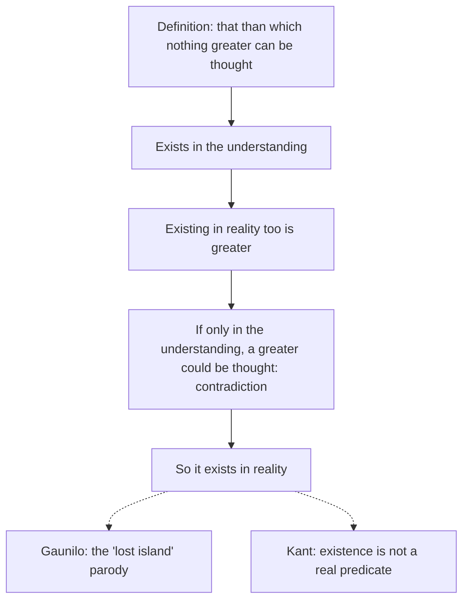

# Anselm of Canterbury

**Prerequisites:** [Faith and reason](../01-faith-and-reason.md), [Augustine](augustine.md)

@@IMG@@

## Life and context

Anselm (1033–1109) was born in Aosta, in the Alps of northern Italy. As a young man he crossed into Normandy and entered the abbey of Bec, drawn by the teacher Lanfranc. He became prior and then abbot, and in 1093 succeeded Lanfranc as Archbishop of Canterbury. His time as archbishop was dominated by quarrels with the Norman kings William II and Henry I over the rights of the Church, and he twice went into exile. He was canonized and named a Doctor of the Church in 1720.

## Method: faith seeking understanding

Anselm wrote before the universities and before the recovery of Aristotle. His sources were scripture, Augustine, and Boethius's logic. His method was meditation that tries to grasp, by reason alone, what the believer already holds. The original title of the [*Proslogion*](../texts/proslogion.md) was *Faith Seeking Understanding* (*Fides quaerens intellectum*), and in that work he says he does not seek to understand in order to believe, but believes in order to understand. Yet he deliberately argues *without* appeal to scripture's authority, so that the reasoning stands on its own.

## The ontological argument

In the *Proslogion* (1077–78) Anselm offers a single argument for God's existence. In outline:

1. God is "that than which nothing greater can be thought".
2. Even the fool who says in his heart "there is no God" (Psalm 14:1) understands this phrase, so it exists in his understanding.
3. What exists in reality as well as in the understanding is greater than what exists only in the understanding.
4. So if that than which nothing greater can be thought existed only in the understanding, something greater could be thought, namely the same thing existing in reality. That is a contradiction.
5. Therefore it exists both in the understanding and in reality.

In chapter 3 he adds a stronger version: such a being cannot even be *thought* not to exist.

A monk named Gaunilo replied at once, "on behalf of the fool": by the same reasoning one could prove the existence of a perfect lost island. Anselm answered that the argument works only for the one being whose greatness is unlimited.

The argument is called "ontological" (a label from [Kant](../../modern/early-modern/thinkers/immanuel-kant.md)) because it moves from the concept of a being to its existence. [Aquinas](thomas-aquinas.md) rejected it, arguing that we do not know God's essence well enough. [Descartes](../../modern/early-modern/thinkers/rene-descartes.md) and [Leibniz](../../modern/early-modern/thinkers/gottfried-wilhelm-leibniz.md) revived versions; Kant's objection that "being is not a real predicate", that existence adds nothing to a concept, became the standard criticism. In the twentieth century, logicians such as Alvin Plantinga reformulated it with modal logic, and debate continues.

## Other contributions

In the *Monologion* Anselm gave other arguments from degrees of goodness. *Why God Became Man* (*Cur Deus Homo*) argued that the Incarnation was necessary because only one who was both God and man could make satisfaction for human sin; this "satisfaction theory" deeply shaped Western ideas of atonement. *On Truth* and *On Free Choice* define truth as "rightness perceivable by the mind alone" and freedom as the power to keep rightness of will for its own sake.

## Key ideas

- "Faith seeking understanding": reason explores and tries to demonstrate what faith holds.
- The ontological argument infers God's existence from the concept of the greatest conceivable being.
- Gaunilo's island and Kant's "existence is not a predicate" are the classic objections.
- *Why God Became Man* framed Western atonement theology.

## Where this leads

- Text: [*Proslogion*](../texts/proslogion.md)
- Next thinkers: [Avicenna](avicenna.md), [Thomas Aquinas](thomas-aquinas.md)
- Glossary: [ontological argument](../../../glossary/modern/ontological-argument.md)
- Forward: [Descartes](../../modern/early-modern/thinkers/rene-descartes.md)' Fifth Meditation; [Kant](../../modern/early-modern/thinkers/immanuel-kant.md)'s critique
