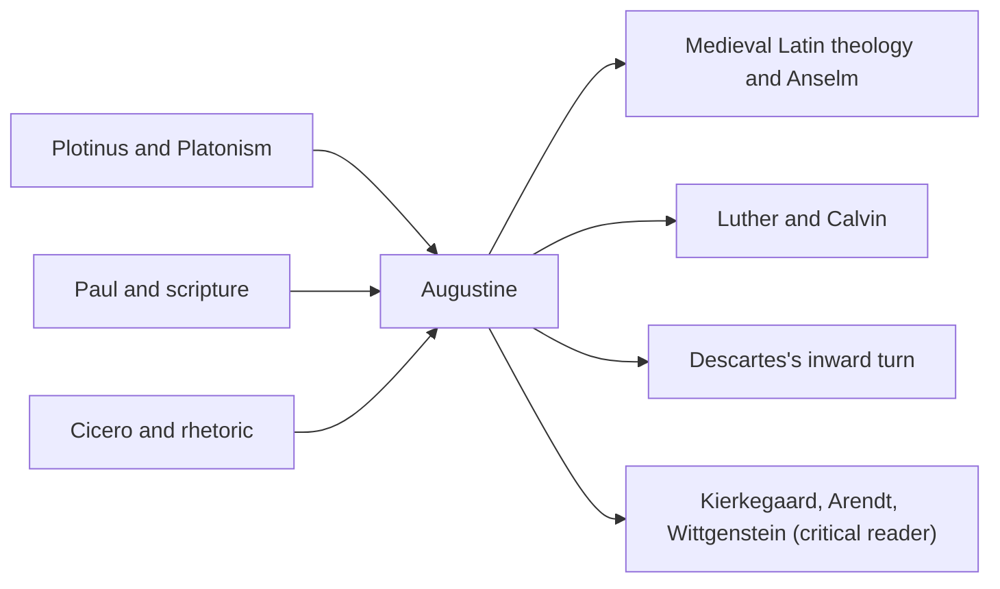

# Augustine of Hippo

**Prerequisites:** [Faith and reason](../01-faith-and-reason.md); helpful: [Plotinus](../../ancient/greek/thinkers/plotinus.md), [Paul's letter to the Romans](../../../../religion/abrahamic/christianity/bible/new-testament/books/pauline-epistles/romans.md)

@@IMG@@

## Life and context

Aurelius Augustinus (354–430) was born in Thagaste in Roman North Africa (modern Souk Ahras, Algeria) to a pagan father and a Christian mother, Monica. He trained in rhetoric, taught it in Carthage, Rome and Milan, and spent about nine years as a "hearer" among the Manichaeans, a dualist religion that explained evil as a substance at war with good. In Milan he read "books of the Platonists" (probably Plotinus and Porphyry in Latin) and heard the bishop Ambrose preach. In 386 he converted, was baptized in 387, returned to Africa, and in 395 or 396 became bishop of Hippo Regius, where he served until his death during the Vandal siege of the city. His own account of the path to conversion is the [*Confessions*](../texts/augustine-confessions.md).

## Core ideas

**Evil as privation.** Against the Manichaeans, Augustine took from Platonism the idea that evil is not a thing at all but a lack, a privation of good, as blindness is the lack of sight. Everything God made is good insofar as it exists. Moral evil arises when a will turns from a higher good to a lower one.

**The inward turn.** Augustine taught that truth is found by turning inward and then upward: "do not go outside, return into yourself; truth dwells in the inner man" (from *On True Religion*). Against the Academic skeptics he argued that even if I am deceived, I must exist to be deceived (*si fallor, sum*, "if I am mistaken, I am"), an argument often compared with [Descartes](../../modern/early-modern/thinkers/rene-descartes.md)' cogito, though it plays a different role.

**Illumination.** Unchanging truths, such as those of mathematics, cannot come from changing sense experience. Augustine held that the mind sees them in a divine light, a Christian reworking of Plato's [recollection](../../../concepts/epistemology/anamnesis.md).

**Time.** In Book XI of the *Confessions* he asks what time is and finds that the past no longer exists and the future does not yet exist. His proposal is that time is a "distension" of the mind: memory, attention and expectation.

**Will, grace and sin.** Augustine gave the Western tradition its concept of the will as a power that can love wrongly. In controversy with Pelagius, who stressed human ability to choose the good, Augustine argued that after the Fall human beings cannot will the good without God's grace, and he developed the doctrine of original sin from his reading of Paul.

**The two cities.** In [*The City of God*](../texts/city-of-god.md) human history is the story of two loves: the earthly city, built on love of self, and the heavenly city, built on love of God. They are mixed in every institution until the end of time.

## Key works

[*Confessions*](../texts/augustine-confessions.md) (c. 397–400); *On Free Choice of the Will*; *On the Trinity*; [*The City of God*](../texts/city-of-god.md) (413–426); *On Christian Doctrine*; many sermons and letters. Over five million words survive.

## Influence and criticism

No thinker shaped Latin Christianity more. Medieval theology is largely a dialogue with Augustine; both Luther and Calvin read him as their ally. Outside theology, the *Confessions* is often called the first autobiography in the modern sense. Hannah Arendt wrote her dissertation on his concept of love; Wittgenstein opens the *Philosophical Investigations* with a passage from the *Confessions* about learning words, which he then criticizes.

Critics have attacked his doctrines of predestination and original sin as harsh, and his views on sexuality as having shaped Western suspicion of the body. Others defend them as a realistic psychology of desire. Historians also debate how far his early writings are Platonist and how far his mature thought broke with Platonism.

## Key ideas

- Evil is a privation of good, not a substance; sin is disordered love.
- Truth is found by turning inward and upward; certainty of one's own existence resists skepticism.
- Time is a stretching of the mind across memory, attention and expectation.
- History is the story of two cities defined by two loves.

## Where this leads

- Texts: [*Confessions*](../texts/augustine-confessions.md), [*The City of God*](../texts/city-of-god.md)
- Next thinker: [Boethius](boethius.md)
- Forward: [Descartes](../../modern/early-modern/thinkers/rene-descartes.md), [Kierkegaard](../../modern/nineteenth-century/thinkers/soren-kierkegaard.md), [Arendt](../../modern/twentieth-century/thinkers/hannah-arendt.md)
- Back: [Plotinus](../../ancient/greek/thinkers/plotinus.md); [Paul](../../../../religion/abrahamic/christianity/bible/glossary/people/paul.md)
