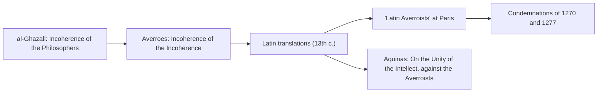

# Averroes (Ibn Rushd)

**Prerequisites:** [Islamic and Jewish philosophy](../03-islamic-and-jewish-philosophy.md), [Avicenna](avicenna.md)

@@IMG@@

## Life and context

Abu al-Walid Muhammad ibn Ahmad ibn Rushd (1126–1198), Latinized as Averroes, was born in Córdoba in al-Andalus (Islamic Spain) into a family of distinguished jurists. He was himself a judge (*qadi*) in Seville and Córdoba, a physician to the Almohad caliphs, and the author of a major work of comparative Islamic law. According to a well-known account, the philosopher Ibn Tufayl introduced him to the caliph Abu Yaqub Yusuf, who wanted someone to explain Aristotle clearly; that request launched his commentaries. Late in life he fell briefly out of favour, his books were reportedly burned and he was banished to Lucena, but he was restored before his death in Marrakesh.

## The Commentator

Averroes wrote commentaries on almost all of Aristotle, often in three sizes: short epitomes, middle commentaries, and long commentaries that quote the text section by section and explain it. His aim was to recover the genuine Aristotle from Neoplatonic additions, including those he found in [Avicenna](avicenna.md). In Latin translation these commentaries became so authoritative that Latin authors simply called him "the Commentator", as they called Aristotle "the Philosopher".

## Core ideas

**Philosophy is commanded, not merely allowed.** In the *Decisive Treatise* (*Fasl al-Maqal*) he argues as a jurist that the Qur'an commands reflection on creation, that demonstration is the best kind of reflection, and therefore that those capable of it are obliged to study philosophy. Truth does not contradict truth; where a demonstrated conclusion conflicts with the apparent sense of scripture, the passage should be interpreted.

**Three kinds of people, three kinds of argument.** People are persuaded by demonstration, by dialectical argument, or by rhetoric. Scripture speaks to all three. Philosophers should not publish allegorical interpretations to those unable to grasp them, since that would unsettle their faith without giving them understanding.

**Reply to al-Ghazali.** In *The Incoherence of the Incoherence* (*Tahafut al-Tahafut*) he answers al-Ghazali point by point. He defends causation: to deny that things have their own natures and powers would make knowledge impossible, since knowing something is knowing its causes. He argues that the eternity of the world, rightly understood, is compatible with its dependence on God.

**The intellect.** In his long commentary on *On the Soul* he argued that the "material intellect", the capacity by which humans grasp universal truths, is one and the same for all human beings. This "unity of the intellect" seemed to many Latin readers to rule out personal immortality.

## Influence and criticism

His impact in the Islamic world was limited for some time; his reputation there revived in the nineteenth and twentieth centuries, when reformers saw him as a champion of reason. In Jewish philosophy his commentaries were translated into Hebrew and studied widely. In the Latin West he was decisive: Paris masters such as Siger of Brabant read Aristotle his way and were accused of teaching a "double truth", one for philosophy and one for faith. Historians now think no one actually held a double-truth doctrine in that crude form. [Aquinas](thomas-aquinas.md) wrote *On the Unity of the Intellect against the Averroists*. Raphael's *School of Athens* includes a figure traditionally identified as Averroes.

## Key ideas

- Averroes is "the Commentator" whose line-by-line explanations of Aristotle shaped Latin, Jewish and later Islamic study.
- He argued that Islamic law obliges the capable to do philosophy, and that scripture must be interpreted where it conflicts with demonstration.
- He defended natural causation and the world's eternity against al-Ghazali.
- His thesis of a single intellect for all humans provoked the Latin controversy over "Averroism".

## Where this leads

- Next thinker: [Maimonides](maimonides.md)
- Forward: [Thomas Aquinas](thomas-aquinas.md); [Scholasticism](../02-scholasticism.md) and the 1277 condemnation
- Back: [Aristotle](../../ancient/greek/thinkers/aristotle.md), [the four causes](../../../concepts/metaphysics/the-four-causes.md)
