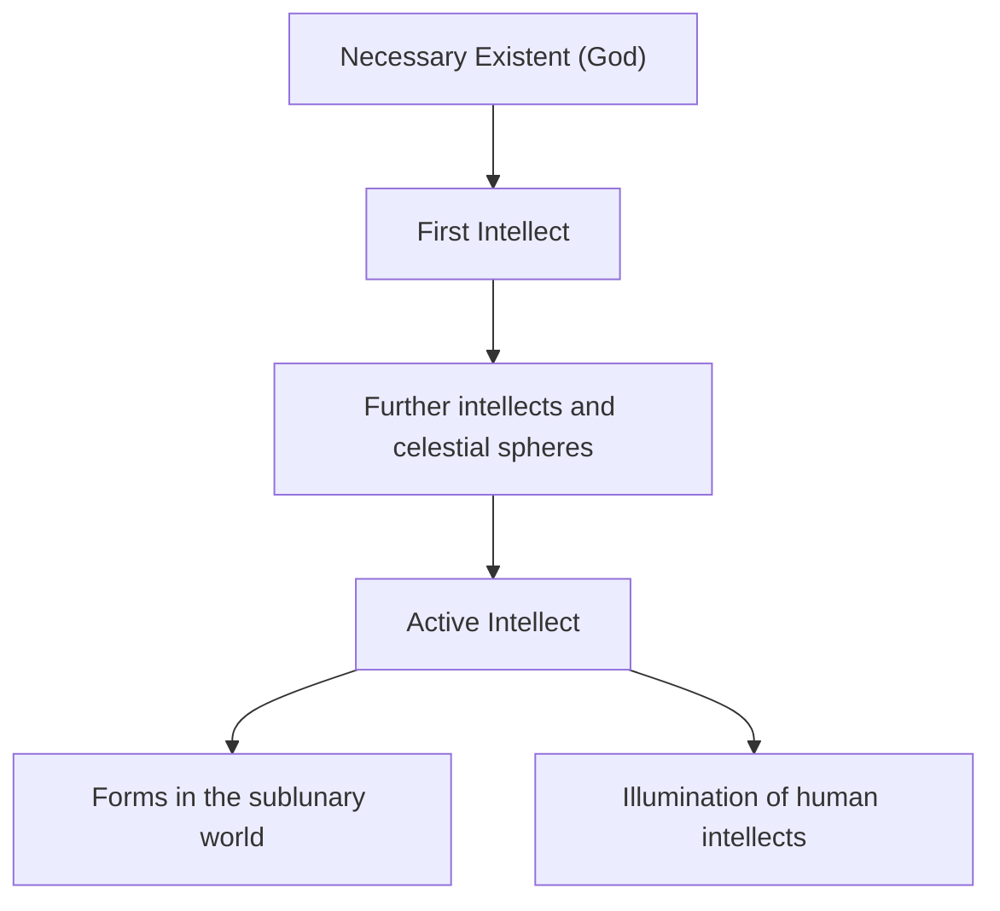

# Avicenna (Ibn Sina)

**Prerequisites:** [[islamic-and-jewish-philosophy|Islamic and Jewish philosophy]]; helpful: [[gk:aristotle.md|Aristotle]], [[c:metaphysics/potentiality-and-actuality.md|potentiality and actuality]]

@@IMG@@

## Life and context

Abu Ali al-Husayn ibn Abd Allah ibn Sina (980–1037), known in Latin as Avicenna, was born near Bukhara in Central Asia, then under the Samanid dynasty. By his own account, preserved in an autobiography completed by his student al-Juzjani, he mastered logic, mathematics and medicine as a teenager and read Aristotle's *Metaphysics* forty times without understanding it until a commentary by al-Farabi opened it for him. He served several Persian rulers as physician and sometimes vizier, often moving because of political upheaval, and died in Hamadan. He wrote mostly in Arabic, with some works in Persian.

## Two great books

*The Canon of Medicine* (*al-Qanun fi al-Tibb*) systematized Greek and Islamic medicine and was a standard textbook in Europe and the Islamic world for centuries. *The Healing* (*al-Shifa'*) is a philosophical encyclopedia of logic, natural philosophy, mathematics and metaphysics, organized around Aristotle but rethought throughout. Shorter summaries, such as *The Salvation* and the late *Pointers and Reminders*, circulated widely.

## Core ideas

**Essence and existence.** When I understand what a triangle is, I have not yet learned whether any triangle exists. Avicenna made this distinction fundamental. For anything whose essence does not include existence, existence must come from outside: it is *possible in itself* and *necessary through another*. A chain of such beings cannot explain itself, so there must be a being that is **necessary in itself**, whose essence just is to exist. That being is God. This "proof of the truthful" reasons about existence as such rather than from motion, and it influenced [[thomas-aquinas|Aquinas]]'s third way and his own essence–existence distinction.

**Emanation.** From the Necessary Existent, which is perfectly one, the world proceeds by necessity through a series of intellects associated with the heavenly spheres, ending with the Active Intellect, which gives forms to our world and illuminates human minds. This is [[c:metaphysics/the-one-and-emanation.md|Neoplatonic emanation]] fused with Aristotelian astronomy. It implied an eternal world, one of the points al-Ghazali condemned.

**The floating man.** Imagine a man created all at once, in the air, eyes covered, limbs apart, so that he senses nothing, not even his own body. Avicenna argues that he would still affirm his own existence. Since what is affirmed differs from what is not affirmed, the self is not the body. The thought experiment anticipates [[rene-descartes|Descartes]], though Avicenna's soul remains Aristotelian in other respects.

**The soul and immortality.** Each human rational soul is an individual immaterial substance that comes into existence with its body but does not perish with it.

## Influence and criticism

In the Islamic world Avicenna became *the* philosopher; later centuries of philosophy and theology, Sunni and Shia, are largely debates with him. Al-Ghazali's *Incoherence of the Philosophers* targets mainly his system. In Latin translation from the twelfth century his metaphysics and psychology shaped Albert the Great, Aquinas and Duns Scotus. [[averroes|Averroes]] criticized him for departing from Aristotle and for conceding too much to the theologians. Modern scholars debate how far his emanation scheme is compatible with a creating God, and whether the floating man proves what he wanted.

## Key ideas

- Essence and existence are distinct in everything except God, the Necessary Existent.
- The world emanates necessarily from God through a hierarchy of intellects.
- The floating-man thought experiment argues that self-awareness does not depend on bodily awareness.
- His *Canon* and *Healing* shaped medicine and metaphysics in both Islamic and Latin worlds.

## Where this leads

- Next thinkers: [[averroes|Averroes]], [[maimonides|Maimonides]]
- Forward: [[thomas-aquinas|Aquinas]]; [[rene-descartes|Descartes]]
- Glossary: [[g:essence-and-existence|essence and existence]]
- Back: [[gk:plotinus.md|Plotinus]], [[gk:aristotle.md|Aristotle]]
