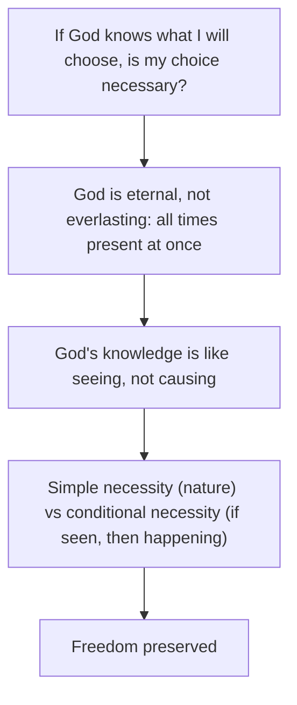

# Boethius

**Prerequisites:** [Faith and reason](../01-faith-and-reason.md); helpful: [Aristotle](../../ancient/greek/thinkers/aristotle.md), [Seneca](../../ancient/greek/thinkers/seneca.md)

@@IMG@@

## Life and context

Anicius Manlius Severinus Boethius (c. 477–524) belonged to an old Roman senatorial family in Italy, then ruled by the Ostrogothic king Theodoric. He was consul in 510 and later Master of Offices, one of the highest posts at court. Around 523 he was accused of treason, apparently for defending a senator suspected of conspiring with the Eastern Roman emperor, and of sacrilege. He was imprisoned near Pavia and executed, probably in 524. In prison he wrote [*The Consolation of Philosophy*](../texts/consolation-of-philosophy.md).

## The translation project

Boethius planned to translate all of Plato and Aristotle into Latin and show that they agreed. He completed only part: Aristotle's *Categories* and *On Interpretation* (with commentaries), Porphyry's *Isagoge*, and probably other logical works. These translations were nearly all the Aristotle the Latin West possessed until the twelfth century, so medieval logic for six hundred years was largely Boethian. His commentary on the *Isagoge* passed on Porphyry's unanswered questions about genera and species, which started the debate over [universals](../04-universals-and-nominalism.md).

He also wrote textbooks on arithmetic and music, and short theological treatises on the Trinity that helped fix Latin philosophical vocabulary. His definition of a person, "an individual substance of a rational nature", was used throughout the Middle Ages.

## Core ideas of the *Consolation*

The *Consolation* is a dialogue between the imprisoned Boethius and Lady Philosophy, alternating prose and verse. It argues, using largely Platonic and Stoic resources and without appeal to Christian revelation, that:

- **Fortune** is by nature changeable; anyone who stakes happiness on her gifts (wealth, office, fame) has misunderstood what they were given. The image of Fortune's wheel became a medieval commonplace.
- **True happiness** is the complete good, which is God; partial goods disappoint because they are fragments of it.
- **Evil people are powerless** in the deepest sense, because they fail to reach the good all humans desire.
- **Providence and fate** differ: providence is the single divine plan seen from eternity; fate is that plan unfolded in time.
- **Divine foreknowledge does not destroy freedom.** God is eternal, which Boethius defines as "the complete, simultaneous and perfect possession of unending life". God does not foresee our future choices as if from before them; God sees all times in one present, as we see a person walking without making them walk.

## Influence

The *Consolation* was one of the most copied and translated books of the Middle Ages. Alfred the Great, Chaucer and Elizabeth I all translated it. Dante placed Boethius among the wise in Paradise. His solution to the foreknowledge problem was taken up by [Aquinas](thomas-aquinas.md) and is still discussed in philosophy of religion.

## Criticisms and questions

Readers have long asked why a Christian facing death wrote a consolation that never mentions Christ. Answers vary: that he deliberately showed what reason alone could reach; that philosophy and faith were for him continuous; or, less commonly, that his Christianity was shallow (his authorship of the theological treatises makes this unlikely). Philosophers also question whether the "eternal present" solution works: critics argue that if God's knowledge is infallible, the problem of necessity simply returns in another form.

## Key ideas

- Boethius's translations transmitted Aristotle's logic and the problem of universals to the Latin Middle Ages.
- The *Consolation* teaches that fortune's gifts are not true goods and that happiness is the complete good, God.
- God's eternity as timeless presence is his answer to the clash between foreknowledge and free will.
- His definition of person and his vocabulary shaped medieval thought.

## Where this leads

- Text: [*The Consolation of Philosophy*](../texts/consolation-of-philosophy.md)
- Next thinker: [Anselm](anselm.md)
- Lesson: [Universals and nominalism](../04-universals-and-nominalism.md)
- Back: [Seneca](../../ancient/greek/thinkers/seneca.md) and [Epictetus](../../ancient/greek/thinkers/epictetus.md) on what is in our power
