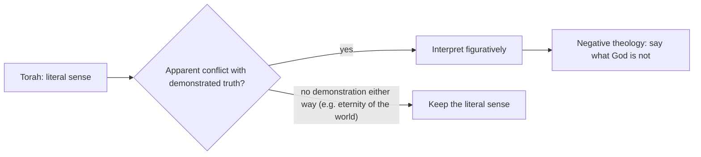

# Maimonides (Moses ben Maimon)

**Prerequisites:** [Islamic and Jewish philosophy](../03-islamic-and-jewish-philosophy.md); helpful: [Genesis](../../../../religion/abrahamic/christianity/bible/old-testament/books/law-torah/genesis.md)

@@IMG@@

## Life and context

Moses ben Maimon (1138–1204), known in Hebrew by the acronym Rambam and in Latin as Maimonides, was born in Córdoba. When the Almohads took the city around 1148 and pressured non-Muslims to convert, his family left, eventually reaching Fez and then, after a stay in the Land of Israel, Fustat (Old Cairo) in Egypt. After his brother David, a merchant, drowned in the Indian Ocean, Maimonides supported the family as a physician and became a court physician to the vizier of Saladin. He was also the leading figure of Egyptian Jewry. A popular Jewish saying runs: "From Moses to Moses there arose none like Moses."

## Two great works

His **legal** masterpiece, the *Mishneh Torah* (completed around 1180), written in clear Hebrew, organized the whole of Jewish law into fourteen books. Its first book opens with philosophical principles about God and the world. His **philosophical** masterpiece is [*The Guide for the Perplexed*](../texts/guide-for-the-perplexed.md) (around 1190), written in Judeo-Arabic (Arabic in Hebrew letters) for a student trained in philosophy who was troubled by the apparent conflict between the Torah's literal sense and reason. In his commentary on the Mishnah he also formulated thirteen principles of faith, later widely used in Jewish liturgy.

## Core ideas

**Interpreting scripture.** The Torah "speaks in the language of human beings". When it speaks of God's hand, face or anger, it uses figures suited to ordinary people. The first part of the *Guide* goes through biblical terms one by one to show their figurative senses.

**Negative theology.** We cannot say positively what God is, because God is utterly simple and unlike anything else. Saying "God is wise" should be understood as denying a lack ("God is not ignorant"). Each negation brings us closer to God by ruling out a false idea. Many statements are best read as describing God's actions, not God's essence.

**Creation.** Aristotle held the world to be eternal. Maimonides argues that neither eternity nor creation can be demonstrated. Since the arguments are inconclusive, and creation fits the Torah and makes miracles and prophecy intelligible, it is reasonable to accept creation. This careful middle path deeply impressed [Aquinas](thomas-aquinas.md), who took a similar line.

**Prophecy and politics.** Prophecy is a natural perfection of intellect and imagination, granted by God's will. The Law aims at the welfare of the body (a just society) and of the soul (true beliefs). Like al-Farabi, Maimonides treats the lawgiver as one who communicates truth through laws and images.

## Influence and criticism

The *Guide* provoked fierce controversy among Jews in Provence and Spain in the thirteenth century; at one point his philosophical works were banned in some communities, and there are reports of copies being burned. Over time his authority became immense. Translated into Hebrew and then Latin, the *Guide* was read by Aquinas, Meister Eckhart and later [Spinoza](../../modern/early-modern/thinkers/baruch-spinoza.md), who criticized his method of reading scripture in the *Theological-Political Treatise*. Twentieth-century scholars, notably Leo Strauss, argued that the *Guide* is written esoterically, hiding its most radical views; others reject that reading.

## Key ideas

- Maimonides was both the leading codifier of Jewish law and the leading Jewish philosopher of the Middle Ages.
- Scripture's anthropomorphic language is figurative; we know God mainly by negation.
- Neither creation nor eternity is demonstrable, so creation may reasonably be accepted on the Torah's authority.
- His *Guide* influenced Aquinas and Spinoza and remains disputed as to how esoteric it is.

## Where this leads

- Text: [*The Guide for the Perplexed*](../texts/guide-for-the-perplexed.md)
- Next thinker: [Thomas Aquinas](thomas-aquinas.md)
- Forward: [Spinoza](../../modern/early-modern/thinkers/baruch-spinoza.md)
- Related: [Genesis](../../../../religion/abrahamic/christianity/bible/old-testament/books/law-torah/genesis.md), whose creation account is at stake
