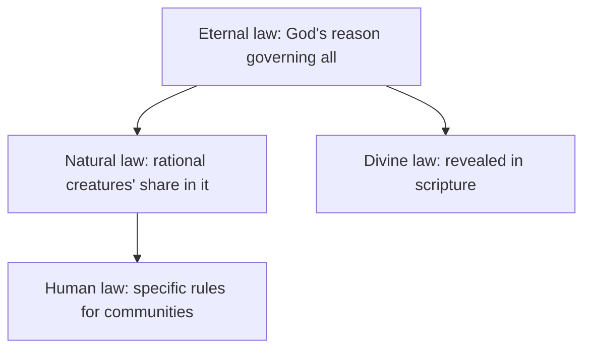

# Thomas Aquinas

**Prerequisites:** [Scholasticism](../02-scholasticism.md), [Aristotle](../../ancient/greek/thinkers/aristotle.md), [potentiality and actuality](../../../concepts/metaphysics/potentiality-and-actuality.md)

@@IMG@@

## Life and context

Thomas Aquinas (c. 1225–1274) was born at Roccasecca, in the Kingdom of Sicily, to a noble family who sent him as a boy to the Benedictine abbey of Monte Cassino, hoping he would become its abbot. Instead, at Naples, he joined the Dominicans, a new mendicant order of preachers. His family reportedly detained him for about a year to change his mind. He studied under Albert the Great in Paris and Cologne, became a master of theology at Paris, and taught there and in Italy. In December 1273 he stopped writing, reportedly saying that everything he had written seemed like straw compared to what he had seen. He died in March 1274 on his way to the Council of Lyon. He was canonized in 1323.

## Core ideas

**Reason and revelation.** Some truths about God (that God exists, that God is one) can be reached by natural reason; others (the Trinity, the Incarnation) only by revelation. Revelation also teaches the first group, because few people have the time and ability to work them out. Since both come from God, a true conclusion of reason can never contradict faith; apparent conflicts mean a mistake in reasoning.

**The Five Ways.** In the [*Summa Theologiae*](../texts/summa-theologiae.md) (I, q. 2, a. 3) Aquinas gives five short arguments that God exists, each starting from something observed: (1) motion, which requires a first unmoved mover; (2) efficient causes, requiring a first cause; (3) contingent beings, requiring a necessary being; (4) degrees of perfection, requiring a maximum; (5) the directedness of non-intelligent things to ends, requiring an intelligence that directs them. He rejected [Anselm](anselm.md)'s ontological argument because we do not know God's essence directly.

**Being and essence.** Following and transforming [Avicenna](avicenna.md), Aquinas taught that in every creature essence and existence (*esse*) are really distinct; God alone is subsisting existence itself (*ipsum esse subsistens*). Creatures *have* being; God *is* being.

**Analogy.** Words like "good" and "wise" are used of God neither in exactly the same sense as of creatures nor in a completely different sense, but analogically.

**The soul.** Against both Plato and the Averroists, the human soul is the form of the body (so a human is one substance, not a soul using a body), yet it is subsistent and can survive death because its intellectual activity is not the act of a bodily organ.

**Natural law.** Ethics rests on human nature. The first precept of natural law is that good is to be done and pursued and evil avoided; particular precepts follow our natural inclinations to preserve life, to raise children, to know the truth about God and to live in society. Human laws that contradict natural law are not true laws but corruptions of law.

## Key works

[*Summa Theologiae*](../texts/summa-theologiae.md) (1265–1274, unfinished); *Summa contra Gentiles*; *On Being and Essence*; *Disputed Questions on Truth*; commentaries on Aristotle, on scripture and on Lombard's *Sentences*; *On the Unity of the Intellect against the Averroists*.

## Influence and criticism

Some of his positions were caught up in the Paris condemnation of 1277. In 1879 Pope Leo XIII's encyclical *Aeterni Patris* promoted his thought as the model for Catholic philosophy, and "Thomism" became a major school. In secular philosophy, Elizabeth Anscombe and Alasdair MacIntyre drew on him in reviving virtue ethics and natural law. Critics have objected that the Five Ways depend on an Aristotelian physics modern science abandoned, that the first three ways need premises against infinite regress, and that, as [Kant](../../modern/early-modern/thinkers/immanuel-kant.md) argued, cosmological arguments rely tacitly on the ontological one. Defenders reply that the regress at issue is a hierarchy of present dependence, not a series in time.

## Key ideas

- Reason and revelation are two harmonious paths; some truths about God are reachable by reason.
- The Five Ways argue from observed features of the world to a first cause.
- God alone is existence itself; in creatures essence and existence differ.
- Natural law grounds ethics and politics in human nature.

## Where this leads

- Text: [*Summa Theologiae*](../texts/summa-theologiae.md)
- Next thinker: [William of Ockham](william-of-ockham.md)
- Glossary: [natural law](../../../glossary/modern/natural-law.md), [cosmological argument](../../../glossary/modern/cosmological-argument.md)
- Back: [Aristotle](../../ancient/greek/thinkers/aristotle.md), [the four causes](../../../concepts/metaphysics/the-four-causes.md)
