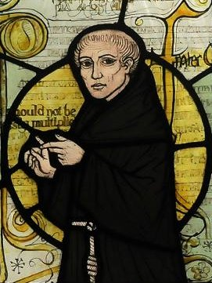
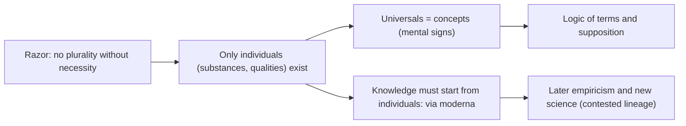

# William of Ockham

**Prerequisites:** [Universals and nominalism](../04-universals-and-nominalism.md), [Thomas Aquinas](thomas-aquinas.md)

*William of Ockham as imagined in a modern stained-glass window in a church in Surrey, England. Credit: self-created (Moscarlop). License: [CC BY-SA 3.0](https://creativecommons.org/licenses/by-sa/3.0). Source: [File:William of Ockham.png](https://commons.wikimedia.org/wiki/File:William_of_Ockham.png).*

## Life and context

William of Ockham (c. 1287–1347) was probably born in the village of Ockham in Surrey, England. He joined the Franciscans and studied and lectured at Oxford on Lombard's *Sentences*, but never became a full master (hence the old nickname *venerabilis inceptor*, "venerable beginner"). In 1324 he was summoned to the papal court at Avignon to answer charges of unorthodox teaching. While there he became involved in the dispute between the Franciscan leadership and Pope John XXII over apostolic poverty: whether Christ and the apostles owned property. Ockham concluded that the pope was a heretic. In 1328 he fled with the minister general of the order to the protection of Emperor Louis of Bavaria and was excommunicated. He spent the rest of his life in Munich writing political works, and died there, probably in 1347, perhaps of the Black Death.

## Core ideas

**Nominalism.** Only individual things exist. There are no real common natures shared by individuals. A universal is a concept in the mind, a natural sign that signifies many individuals. Most of the [Aristotelian](../../../concepts/metaphysics/form-and-matter.md) categories also lose their status as distinct things: Ockham argued that only substances and qualities are real entities; quantity, relation, motion and the rest are ways of talking about substances and qualities.

**The razor.** Ockham repeatedly invokes the rule that plurality should not be posited without necessity. Later called **Ockham's razor**, it is a principle of economy: explain with as few kinds of entity as possible. He used it to cut away entities his predecessors had posited, such as intelligible species in perception.

**Mental language.** Thought itself has a grammar: a "mental language" of concepts, prior to any spoken language, with its own terms and propositions. His *Summa of Logic* develops a detailed theory of how terms stand for things in propositions (the theory of supposition), an important chapter in the history of logic and semantics.

**God's absolute power.** Ockham distinguished God's *absolute* power, what God can do without contradiction, from God's *ordained* power, what God has chosen to do. Because God can do directly anything a created cause does, God could make us perceive a star that does not exist. Some later readers saw this as opening a door to skepticism; whether Ockham himself drew skeptical conclusions is disputed.

**Will and ethics.** He emphasized divine will and freedom, and many interpreters read him as holding a form of divine command ethics, though scholars debate how far right reason also grounds morality in his view.

**Politics.** His political writings defend limits on papal power, the independence of secular rulers, and a theory of natural rights that some historians see as an important step toward modern rights theory.

## Influence and criticism

Ockham's followers formed the "modern way" (*via moderna*), contrasted with the "old way" of Aquinas and Scotus, and it dominated many universities in the fourteenth and fifteenth centuries. Martin Luther was trained by teachers in this tradition. Some historians have blamed Ockham's voluntarism and nominalism for the fragmentation of medieval synthesis and for modern secularism; others regard such grand narratives as overblown and see him mainly as a rigorous logician.

## Key ideas

- Only individuals exist; universals are mental signs.
- The razor bids us not to multiply entities without necessity.
- God's absolute power is limited only by contradiction, making created order contingent.
- His logic and political theory were as influential as his metaphysics.

## Where this leads

- Forward: [Renaissance and humanism](../../modern/early-modern/01-renaissance-and-humanism.md) opens the early modern period
- Forward: [Empiricism](../../modern/early-modern/04-empiricism.md), [Hume](../../modern/early-modern/thinkers/david-hume.md)
- Glossary: [nominalism](../../../glossary/modern/nominalism.md), [Ockham's razor](../../../glossary/modern/ockhams-razor.md)
- Back: [Universals and nominalism](../04-universals-and-nominalism.md)
