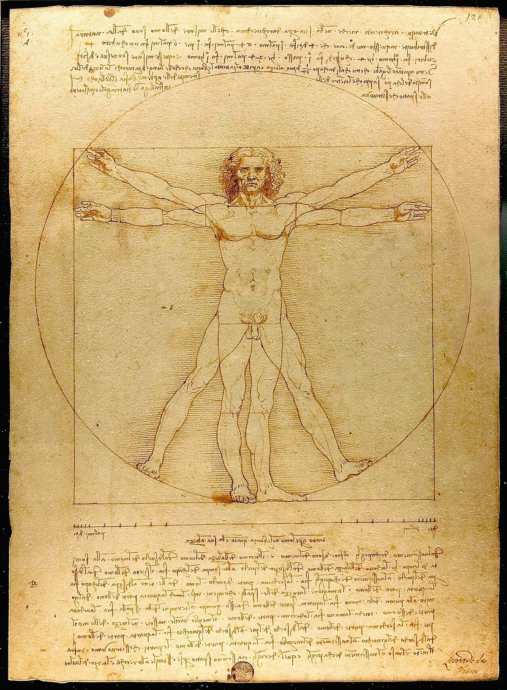
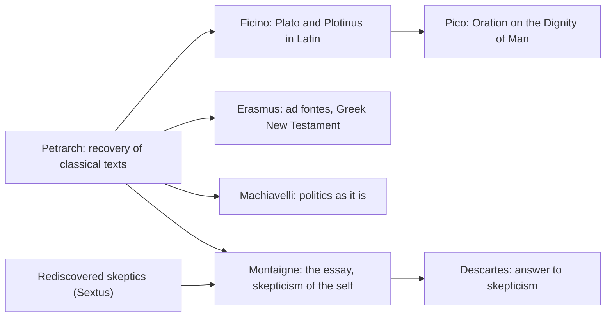

# Renaissance and humanism: the return to sources

**Prerequisites:** [Scholasticism](../../medieval/02-scholasticism.md), [Universals and nominalism](../../medieval/04-universals-and-nominalism.md)

*Leonardo da Vinci, *Vitruvian Man* (c. 1490). Credit: Leonardo da Vinci. License: Public domain. Source: [File:Da Vinci Vitruve Luc Viatour.jpg](https://commons.wikimedia.org/wiki/File:Da_Vinci_Vitruve_Luc_Viatour.jpg).*

## What changed, from first principles

A culture's philosophy depends on three things: which texts it can read, which institutions support thinking, and which questions feel urgent. Between roughly 1350 and 1600 all three shifted in Europe.

**Texts.** Italian scholars, beginning with Petrarch (1304–1374), went hunting in monastery libraries for lost classical works, and after Byzantine scholars came west (a movement that accelerated around the fall of Constantinople in 1453) Greek was taught again in Italy. Marsilio Ficino translated the complete works of Plato and of Plotinus into Latin for the Medici in Florence. Lucretius's Epicurean poem *On the Nature of Things* was rediscovered in 1417; Sextus Empiricus's skeptical writings were printed in Latin in 1562. Suddenly there were alternatives to Aristotle: Plato, Epicurus, the Stoics, the skeptics.

**Technology and institutions.** Gutenberg's movable-type press (c. 1450) made texts cheap and identical. Courts, city republics, academies and printing houses joined the universities as places where learned people met.

**Questions.** The Reformation from 1517 split Western Christianity, and with it the shared authority by which disputes were settled. Wars of religion followed. European voyages brought news of peoples and customs that no ancient author had described.

## Humanism

"Humanism" here does not mean secularism. It names a programme of education, the *studia humanitatis*: grammar, rhetoric, poetry, history and moral philosophy, studied through classical texts in good Latin and Greek. Humanists wanted eloquence joined to wisdom and believed the scholastic textbooks had lost both. Their key slogan was *ad fontes*, "to the sources": go back to the original texts and read them in their own languages.

That slogan had a critical edge. Lorenzo Valla used philology in 1440 to show that the "Donation of Constantine", a document supporting papal territorial claims, could not have been written in Constantine's time. Erasmus produced a Greek New Testament (1516) that let readers check the Latin Vulgate. Philology became a tool of criticism, and with it the habit of asking where a text came from.

## Key figures and themes

- **Human dignity.** Pico della Mirandola's *Oration* (1486) imagines God telling Adam that he alone has no fixed place in creation and may shape himself into what he chooses. The text became an emblem of Renaissance self-understanding.
- **Political realism.** [Machiavelli](thinkers/niccolo-machiavelli.md) studied politics not as it ought to be but as it is, separating the ruler's practical success from traditional virtue. See [*The Prince*](texts/the-prince.md).
- **Utopia.** Thomas More's *Utopia* (1516) used an imagined island to criticize European society.
- **Skepticism revived.** The printed Sextus Empiricus, together with religious disagreement and travellers' reports of diverse customs, produced a "skeptical crisis". [Montaigne](thinkers/michel-de-montaigne.md) made doubt into a literary and moral practice. See [ancient skepticism](../../../concepts/epistemology/skepticism-and-epoche.md) for the background.
- **Nature.** Thinkers such as Giordano Bruno, burned in Rome in 1600 for heresy, speculated about an infinite universe.

## Why it matters for what came next

The Renaissance did not invent a new systematic philosophy to replace scholasticism. It loosened the hold of a single authority, multiplied the ancient options, and put doubt back on the table. The next generation, [Bacon](thinkers/francis-bacon.md) and [Descartes](thinkers/rene-descartes.md), tried to rebuild knowledge on a new foundation precisely because the old foundations now seemed uncertain. That is the story of the [next lesson](02-scientific-revolution-and-method.md).

## Key ideas

- New texts (Plato, Epicurus, the skeptics), the printing press, the Reformation and the voyages transformed European thought between 1350 and 1600.
- Humanism was an educational programme centred on classical languages, rhetoric and moral philosophy, with the motto *ad fontes*.
- Philology became a critical tool, and revived skepticism undermined confidence in inherited authorities.
- Machiavelli's realism and Montaigne's skepticism set problems the seventeenth century tried to solve.

## Where this leads

- Next: [The scientific revolution and the problem of method](02-scientific-revolution-and-method.md)
- Thinkers: [Machiavelli](thinkers/niccolo-machiavelli.md), [Montaigne](thinkers/michel-de-montaigne.md)
- Back: [skepticism and epoché](../../../concepts/epistemology/skepticism-and-epoche.md); [Epicurus](../../ancient/greek/thinkers/epicurus.md)
- Glossary: [humanism](../../../glossary/modern/humanism.md)
