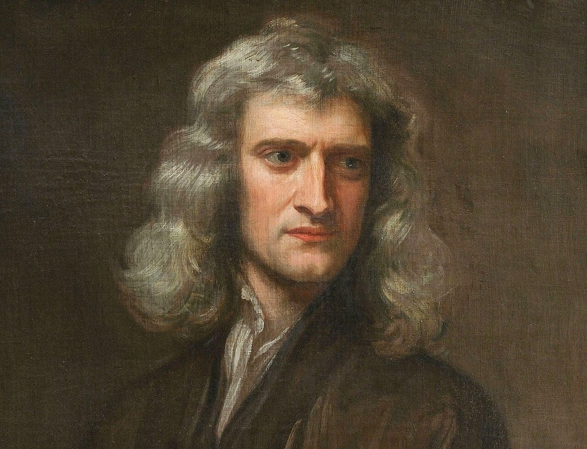
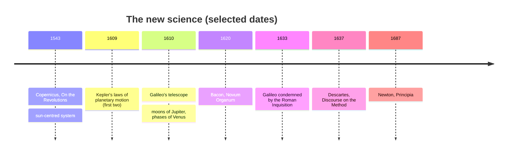
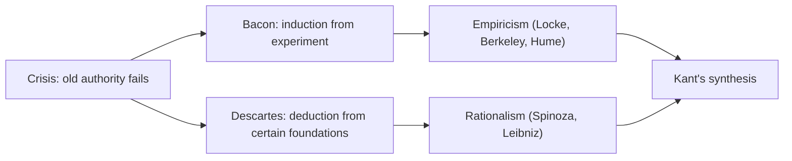

# The scientific revolution and the problem of method

**Prerequisites:** [Renaissance and humanism](01-renaissance-and-humanism.md); helpful: [Aristotle's four causes](../../../concepts/metaphysics/the-four-causes.md)

*Godfrey Kneller, portrait of Isaac Newton (1689), detail. Credit: Godfrey Kneller. License: Public domain. Source: [File:Portrait of Sir Isaac Newton, 1689 (head shot crop).jpg](https://commons.wikimedia.org/wiki/File:Portrait_of_Sir_Isaac_Newton,_1689_(head_shot_crop).jpg).*

## The old picture

For most of the Middle Ages, educated Europeans explained nature with Aristotle's framework. Things have natures (forms) that make them behave as they do. A stone falls because earth naturally seeks the centre of the universe; fire rises because its natural place is above. Explanation means naming [four causes](../../../concepts/metaphysics/the-four-causes.md), including the final cause, the purpose something tends toward. The heavens are made of a different, unchanging substance and move in perfect circles around a stationary earth.

This picture was coherent and fitted everyday experience well. It also tied physics, cosmology, biology and theology together. That is why replacing it was not just a scientific event but a philosophical crisis.

## What broke

- **Astronomy.** Copernicus put the sun at the centre; Kepler showed that planets move in ellipses; Galileo's telescope showed mountains on the moon, spots on the sun and moons orbiting Jupiter. The heavens were not perfect or unchanging.
- **Motion.** Galileo described falling bodies mathematically and argued that motion does not need a continuous mover. Inertia replaced natural places.
- **Mechanism.** Many thinkers began to treat nature as a machine: matter in motion, governed by mathematical laws, with no purposes inside it. Final causes were banished from physics.
- **Quantity over quality.** Galileo distinguished properties that belong to bodies themselves (size, shape, motion, number) from those that exist only in the perceiver (colours, tastes, smells). Locke later called these [primary and secondary qualities](../../../glossary/modern/primary-and-secondary-qualities.md).

## The philosophical question: method

If the inherited authority was wrong about the heavens, what can be trusted? Two great answers appeared within twenty years of each other.

**[Francis Bacon](thinkers/francis-bacon.md)** argued for a new method of induction. Start not from definitions but from careful, organized observation and experiment; build tables of instances; climb gradually from particulars to general laws; watch out for the "idols" of the mind that distort judgment. Knowledge is power: its aim is the relief of the human condition. See [*Novum Organum*](texts/novum-organum.md).

**[René Descartes](thinkers/rene-descartes.md)** argued for a method modelled on geometry. Doubt everything that can be doubted, find a foundation that cannot be doubted, and deduce from clear and distinct ideas. Mathematics gives certainty; the physical world is extension (geometrical space) and can be understood mathematically. See [*Discourse on the Method*](texts/discourse-on-method.md).

Newton's *Principia* (1687) combined mathematical deduction with experimental testing so successfully that it became the model of knowledge for the following century. His refusal to "feign hypotheses" about the cause of gravity, while describing its laws precisely, also showed that science might describe *how* without explaining *why*.

## Why this matters for philosophy

The new science posed problems philosophy has worked on ever since:

- **Mind and matter.** If matter is only extension in motion, where do colours, feelings and thoughts fit? This became the [mind–body problem](../../../glossary/modern/mind-body-problem.md).
- **Knowledge.** How do we know our ideas match a world we only perceive through senses? That question drives [rationalism](03-rationalism.md) and [empiricism](04-empiricism.md).
- **Value and purpose.** If nature has no purposes, where do purposes and values come from? A question that runs through [Hume](thinkers/david-hume.md) to [Nietzsche](../nineteenth-century/thinkers/friedrich-nietzsche.md).
- **Religion.** Is God a watchmaker, a necessary being, or unnecessary to explanation?

## Key ideas

- The scientific revolution replaced Aristotelian natures and purposes with mathematical laws of matter in motion.
- The collapse of the old picture made method the central question of philosophy.
- Bacon championed induction and experiment; Descartes championed doubt and deduction.
- The new science created the modern problems of mind and body, of knowledge of an external world, and of value in a purposeless nature.

## Where this leads

- Next: [Rationalism: reason as the source of knowledge](03-rationalism.md)
- Then: [Empiricism: experience as the source of knowledge](04-empiricism.md)
- Thinkers: [Bacon](thinkers/francis-bacon.md), [Descartes](thinkers/rene-descartes.md)
- Forward: [Philosophy of science: Popper and Kuhn](../twentieth-century/06-philosophy-of-science.md)
