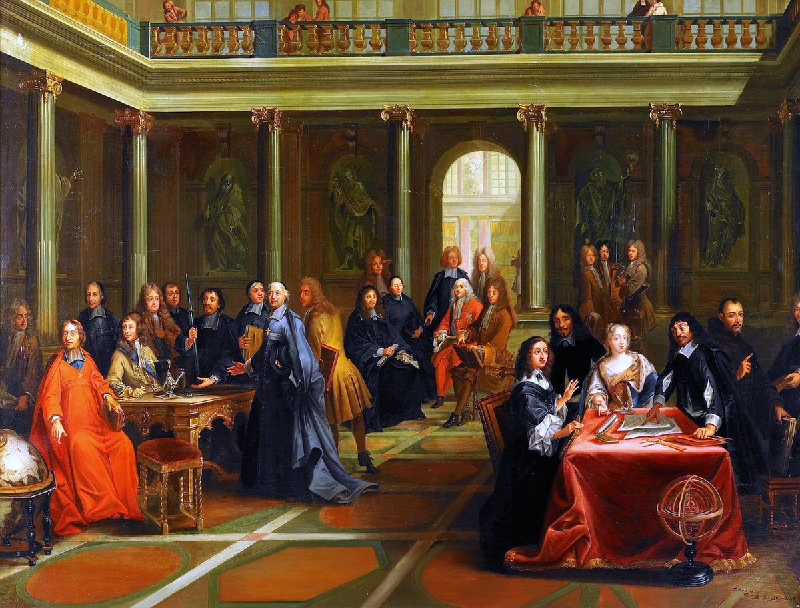
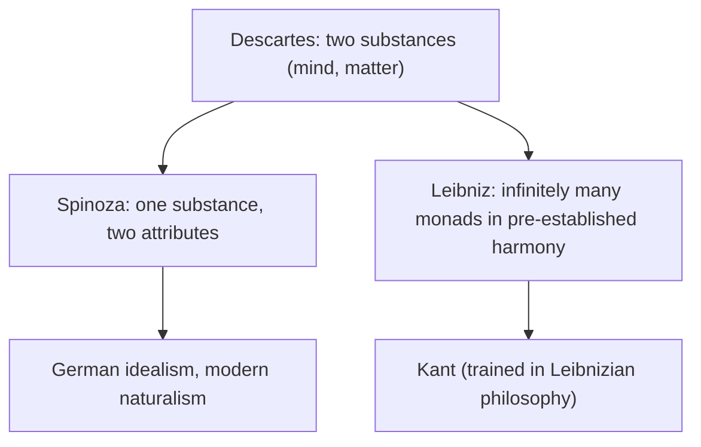

# Rationalism: reason as the source of knowledge

**Prerequisites:** [The scientific revolution](02-scientific-revolution-and-method.md); [a priori](../../../glossary/general/a-priori.md), [rationalism](../../../glossary/general/rationalism.md)

*Nils Forsberg, painting of René Descartes in discussion with Queen Christina of Sweden at her court in Stockholm. Credit: Nils Forsberg. License: Public domain. Source: [File:Dispute of Queen Cristina Vasa and Rene Descartes.png](https://commons.wikimedia.org/wiki/File:Dispute_of_Queen_Cristina_Vasa_and_Rene_Descartes.png).*

## The question

Where does knowledge come from? Two plain answers suggest themselves. Either from the senses, by observing, or from the mind itself, by thinking. Consider "7 + 5 = 12", "every triangle has angles summing to two right angles", or "every event has a cause". We seem to know these without counting every collection of objects or measuring every triangle. Their truth seems necessary and universal, and no finite number of observations could show that. That suggests some knowledge comes from reason alone, **[a priori](../../../glossary/general/a-priori.md)**.

**Rationalism** is the family of views that give reason this leading role. The "continental rationalists" of the seventeenth century, [Descartes](thinkers/rene-descartes.md), [Spinoza](thinkers/baruch-spinoza.md) and [Leibniz](thinkers/gottfried-wilhelm-leibniz.md), shared three tendencies:

1. **Innate ideas.** Some concepts (God, substance, number, self) are not derived from experience but are found in the mind.
2. **Deductive system.** Knowledge should be built like geometry, from self-evident principles by valid steps.
3. **Reality is intelligible.** The structure of the world mirrors the structure of reason, so pure reasoning can tell us about what exists.

The labels "rationalist" and "empiricist" were applied later and simplify a great deal. Descartes did experiments; Leibniz was a working scientist; Locke used reasoning constantly. They mark tendencies, not teams.

## Descartes: doubt and foundations

[Descartes](thinkers/rene-descartes.md) decided to doubt everything he could, to see if anything survived. The senses sometimes deceive; I might be dreaming; an evil demon might deceive me even about mathematics. But in doubting I am thinking, and if I think I exist: *I think, therefore I am*. From this foundation he argues for a God who is no deceiver, and so for the general reliability of clear and distinct ideas. He concluded that the world contains two kinds of substance: thinking substance (mind) and extended substance (matter). See [*Meditations*](texts/meditations-on-first-philosophy.md).

## Spinoza: one substance

[Spinoza](thinkers/baruch-spinoza.md) took Descartes' definition of substance (that which exists in itself and is conceived through itself) and drew a radical conclusion: there can be only one substance, which he called "God or Nature" (*Deus sive Natura*). Mind and body are two attributes of this one substance, two ways of expressing the same reality. Everything follows necessarily from God's nature; there is no free will in the sense of uncaused choice. Freedom is understanding the necessity of things. He wrote his [*Ethics*](texts/spinoza-ethics.md) in geometrical form with definitions, axioms and propositions.

## Leibniz: many simple substances

[Leibniz](thinkers/gottfried-wilhelm-leibniz.md) went the other way: infinitely many simple substances, **monads**, each a centre of perception reflecting the whole universe from its own point of view. They do not interact; their harmony is pre-established by God. Two principles govern his system: the **principle of contradiction** (what implies a contradiction is false) and the **[principle of sufficient reason](../../../glossary/modern/principle-of-sufficient-reason.md)** (nothing happens without a reason why it is so and not otherwise). God chose to create the best of all possible worlds. See [*Monadology*](texts/monadology.md).

## The shared problem

All three faced the same question: how do mind and matter relate? Descartes said they interact, notoriously via the pineal gland, but could not explain how an unextended mind moves an extended body (Princess Elisabeth of Bohemia pressed him hard on this). Spinoza dissolved the problem by making them two aspects of one thing. Leibniz denied that they interact at all. Each solution is a way of keeping the new mechanical science while preserving mind.

## Criticism

[Empiricists](04-empiricism.md) objected that there are no innate ideas (Locke), and that reason alone cannot tell us what exists (Hume). [Voltaire](thinkers/voltaire.md) mocked Leibnizian optimism in [*Candide*](texts/candide.md). [Kant](thinkers/immanuel-kant.md) argued that rationalists overreached: pure reason, used beyond possible experience, produces contradictions.

## Key ideas

- Rationalism holds that reason, not sense experience, is the main source of knowledge, including knowledge of what exists.
- Descartes grounded knowledge in the certainty of the thinking self and argued for two substances.
- Spinoza argued for one substance, God or Nature; Leibniz for infinitely many monads.
- Each tried to fit mind into the new mechanical science; empiricists and Kant attacked their confidence in pure reason.

## Where this leads

- Next: [Empiricism](04-empiricism.md)
- Texts: [*Meditations*](texts/meditations-on-first-philosophy.md), [*Ethics*](texts/spinoza-ethics.md), [*Monadology*](texts/monadology.md)
- Back: [substance](../../../concepts/metaphysics/substance.md), [Anselm's argument](../../medieval/thinkers/anselm.md)
- Forward: [Kant's Copernican revolution](07-kants-copernican-revolution.md)
