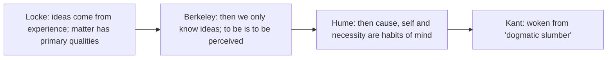

# Empiricism: experience as the source of knowledge

**Prerequisites:** [Rationalism](03-rationalism.md); [empiricism](../../../glossary/general/empiricism.md), [a posteriori](../../../glossary/general/a-posteriori.md)

@@IMG@@

## The opposite starting point

Take any idea you have: red, hot, horse, cause, self, God. Ask where it came from. The empiricist answer is that every idea is ultimately built from experience: from sensation (seeing, touching) or reflection (noticing the operations of your own mind). The mind at birth is, in John Locke's image, like "white paper, void of all characters" (the old Latin phrase is *[tabula rasa](../../../glossary/modern/tabula-rasa.md)*, blank tablet). Knowledge of matters of fact is **[a posteriori](../../../glossary/general/a-posteriori.md)**, dependent on experience.

The British empiricists, [Locke](thinkers/john-locke.md), [Berkeley](thinkers/george-berkeley.md) and [Hume](thinkers/david-hume.md), followed this principle with increasing rigour. Their story is one of the most instructive in philosophy, because each took the previous one's principle more seriously and arrived at more surprising conclusions. [Hobbes](thinkers/thomas-hobbes.md) and [Bacon](thinkers/francis-bacon.md) belong to the background.

## Locke: the plain historical method

In the [*Essay Concerning Human Understanding*](texts/essay-concerning-human-understanding.md) (1689) Locke attacked innate ideas: if they were innate, children and everyone else would know them, and they do not. He divided ideas into simple ones, received passively, and complex ones, built by the mind. He accepted the scientific distinction between **[primary qualities](../../../glossary/modern/primary-and-secondary-qualities.md)** (shape, size, motion, number, solidity), which resemble something in the object, and **secondary qualities** (colour, taste, sound), which are powers in objects to produce ideas in us that do not resemble anything in them. Behind the qualities lies a "substance", a something "I know not what" that supports them.

## Berkeley: to be is to be perceived

[Berkeley](thinkers/george-berkeley.md) pushed on Locke's own principle. If all we ever perceive are ideas, how could we know that ideas resemble anything that is not an idea? The arguments that showed colours are mind-dependent work just as well for shapes. And "material substance" is a word with no idea attached. So Berkeley concluded that physical objects are collections of ideas: their being is to be perceived (*esse est percipi*). This is **immaterialism**. Things continue to exist when we do not perceive them because God perceives them and causes the orderly ideas we call nature. He saw this as a defence of common sense and religion against skeptics and materialists.

## Hume: the science of man

[Hume](thinkers/david-hume.md) followed experience further still. He divided perceptions into vivid **impressions** and fainter **ideas** copied from them, and he adopted a test: for any philosophical term, ask from what impression it is derived. Applied to three central notions, it produced radical results.

- **Cause.** We see one billiard ball strike another and the second move. We see sequence and contiguity; we never see a "necessary connection". After repeated experience the mind simply expects the effect. Necessity is a feeling of expectation projected onto the world.
- **Induction.** Our belief that the future will resemble the past cannot be justified by reasoning without circularity: any argument would assume the very uniformity it was meant to prove. We rely on custom, not reason. This is the [problem of induction](../../../glossary/modern/problem-of-induction.md).
- **Self.** When I look inward I find particular perceptions (heat, cold, love, hatred), never a self apart from them. The self is "a bundle or collection of different perceptions".

He also argued that reason alone cannot motivate action; that is the work of passions. And he observed that many moral writers move without explanation from statements about what *is* to what *ought* to be, a move later called the [is–ought gap](../../../glossary/modern/is-ought-gap.md).

## Two kinds of knowledge

Hume's "fork" sorts all reasoning into **relations of ideas** (mathematics and logic, certain but saying nothing about what exists) and **matters of fact** (known through experience, never certain). Any book that contains neither, he wrote at the close of the [*Enquiry*](texts/treatise-of-human-nature.md), should be committed to the flames.

## What was achieved, and the problem left

Empiricism grounded knowledge in experience and trimmed metaphysical claims that could not be traced to it. It also seemed to leave science without necessary laws and the self without unity. [Kant](thinkers/immanuel-kant.md) said that Hume interrupted his "dogmatic slumber" and set out to show how experience could yield necessary knowledge after all.

## Key ideas

- Empiricism traces all ideas to experience; the mind begins as a blank tablet.
- Locke distinguished primary and secondary qualities and posited an unknown substance beneath them.
- Berkeley argued that objects are collections of ideas and that matter is an empty notion.
- Hume showed that causation, induction and the self cannot be derived from experience as philosophers had assumed.

## Where this leads

- Next: [The social contract](05-social-contract-and-the-state.md)
- Texts: [Locke's *Essay*](texts/essay-concerning-human-understanding.md), [Hume's *Treatise*](texts/treatise-of-human-nature.md)
- Forward: [Kant's Copernican revolution](07-kants-copernican-revolution.md); [logical empiricism and the analytic turn](../twentieth-century/02-analytic-turn.md)
- Back: [ancient skepticism](../../../concepts/epistemology/skepticism-and-epoche.md)
