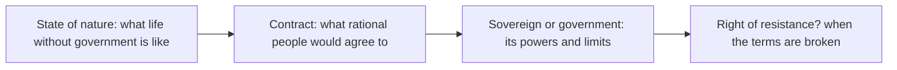

# The social contract: why obey anyone?

**Prerequisites:** [[c:political/the-polis-and-political-animal.md|The polis and the political animal]]; helpful: [[the-prince|*The Prince*]]

@@IMG@@

## The question beneath politics

Why should anyone obey a government? Older answers appealed to nature (humans are [[c:political/the-polis-and-political-animal.md|political animals]] who flourish only in a city), to divine appointment (rulers rule by God's will), or to tradition. By the seventeenth century, religious war and civil war in England and on the Continent had shaken each of these. Kings claiming divine right fought rival Christians claiming the same God.

The **social contract** tradition starts from a thought experiment. Imagine people without any government: a **[[g:state-of-nature|state of nature]]**. Ask what life would be like, and what rational people would agree to in order to escape it. Legitimate authority is whatever they would consent to. The point is not usually that such a contract actually happened, but that legitimacy depends on what free and equal people could accept.

The three classic versions differ at every step.

## Hobbes: fear and the sovereign

[[thomas-hobbes|Thomas Hobbes]], writing during and after the English Civil War, argued that humans are roughly equal in their ability to kill one another, competitive for scarce goods, distrustful and eager for glory. Without a common power to keep them in awe they are in a condition of war of every man against every man, in which there is no industry, no culture, no society, and the life of man is "solitary, poor, nasty, brutish, and short". Rational fear of death leads people to give up their right to everything and authorize a sovereign with nearly absolute power: the [[leviathan|*Leviathan*]]. The sovereign is not a party to the contract and so cannot break it, but subjects keep the right to defend their own lives.

## Locke: rights and limited government

[[john-locke|John Locke]]'s state of nature is governed by a natural law, knowable by reason, that forbids harming others in their life, health, liberty or possessions. People acquire property by mixing their labour with what is unowned. The problem is enforcement: everyone is judge in his own case. So people consent to form a society and a government whose job is to protect [[g:natural-rights|natural rights]]. Government is a trust; if it violates the rights it exists to protect, the people may resist and replace it. His [[second-treatise-of-government|*Second Treatise*]] influenced the American Declaration of Independence.

## Rousseau: the general will

[[jean-jacques-rousseau|Jean-Jacques Rousseau]] accused both of projecting social vices back into nature. In his account, natural humans were solitary, peaceful and moved by self-love and pity; property and comparison corrupted them. "Man is born free, and everywhere he is in chains," opens [[the-social-contract|*The Social Contract*]]. His solution is a contract in which each person gives himself wholly to the community, so that, obeying the **[[g:general-will|general will]]**, which aims at the common good, each obeys only himself. Sovereignty belongs to the people and cannot be delegated.

## Comparing the three

| | Hobbes | Locke | Rousseau |
|---|---|---|---|
| State of nature | War of all against all | Peaceful but insecure; natural law | Solitary, innocent; corrupted by society |
| Why contract | Fear of violent death | Secure rights and property | Recover freedom in a new form |
| Resulting authority | Absolute sovereign | Limited government by consent | Sovereign people, general will |
| Resistance | Only to save one's life | When government breaks trust | Sovereignty never transferred |

## Criticisms and afterlife

[[david-hume|Hume]] objected that almost no government began with consent, and that tacit consent through residence is like saying a press-ganged sailor consents to the ship. Feminist critics, notably Carole Pateman in *The Sexual Contract*, argued that the theory assumed a prior subordination of women. Marx saw contract theory as an expression of market society. Yet the idea revived in the twentieth century with [[john-rawls|John Rawls]], who asked what principles people would choose behind a "veil of ignorance".

## Key ideas

- The social contract grounds political legitimacy in what free and equal people would agree to.
- Hobbes: fear leads to an absolute sovereign; Locke: rights lead to limited government and a right of resistance; Rousseau: freedom is regained through the general will.
- Hume and later critics challenged the idea of consent; Rawls revived contract reasoning.

## Where this leads

- Next: [[enlightenment|The Enlightenment]]
- Texts: [[leviathan|*Leviathan*]], [[second-treatise-of-government|*Second Treatise*]], [[the-social-contract|*The Social Contract*]]
- Forward: [[political-philosophy-after-catastrophe|Arendt and Rawls]]
- Related: [[eco:01-adam-smith.md|Adam Smith]] and the moral foundations of market society
