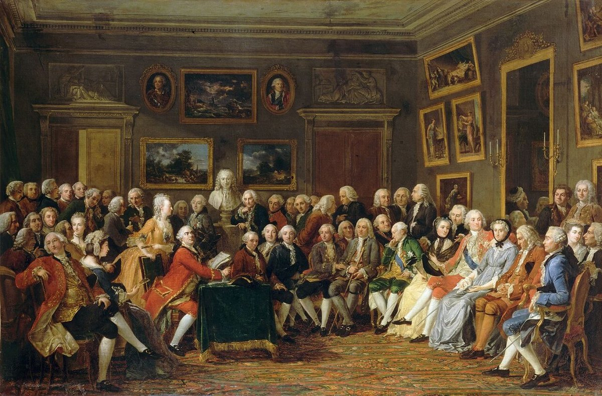
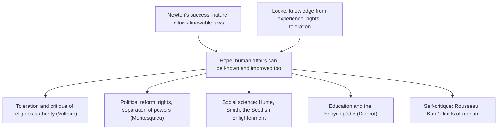

# The Enlightenment: reason in public

**Prerequisites:** [The scientific revolution](02-scientific-revolution-and-method.md), [The social contract](05-social-contract-and-the-state.md)

*Anicet Charles Gabriel Lemonnier, *A Reading of Voltaire's Tragedy L'Orphelin de la Chine in the Salon of Madame Geoffrin* (1812). Credit: Anicet Charles Gabriel Lemonnier. License: Public domain. Source: [File:Les salons au XVIIIe siècle - Histoire Image.jpg](https://commons.wikimedia.org/wiki/File:Les_salons_au_XVIIIe_siècle_-_Histoire_Image.jpg).*

## What the word claims

In 1784 a Berlin journal printed Immanuel Kant's answer to the question "What is Enlightenment?" His answer: enlightenment is humanity's emergence from its self-incurred immaturity, the inability to use one's own understanding without another's guidance. The motto he gave it, from the Roman poet Horace, is *Sapere aude*: dare to know, have courage to use your own understanding.

That definition captures the movement's core idea better than any list of doctrines. The Enlightenment, roughly from the late seventeenth century to the end of the eighteenth, was a broad European and transatlantic movement whose members shared an attitude: that human reason, applied in public and freed from unexamined authority, could improve knowledge, morals, law and government.

## How it worked

Ideas spread through new institutions: scientific academies, salons (often hosted by women such as Madame Geoffrin), coffee houses, Masonic lodges, periodicals and, above all, books. The great monument was the *Encyclopédie* (1751–1772), edited by Denis Diderot and Jean le Rond d'Alembert, which aimed to gather all knowledge, including the mechanical arts, and in doing so to "change the common way of thinking".

## Main themes

- **Toleration and critique of religion.** [Voltaire](thinkers/voltaire.md) campaigned against the persecution of Protestants in France (the Calas affair). Many Enlightenment figures were deists, believing in a creator known by reason but rejecting revelation and miracles; some, like the Baron d'Holbach, were atheists; many others, especially in Scotland, Germany and America, were believers who sought a reasonable faith.
- **Rights and reform.** Montesquieu's *The Spirit of the Laws* (1748) argued for the separation of powers. Cesare Beccaria's *On Crimes and Punishments* (1764) attacked torture and the death penalty. These ideas fed into the American and French revolutions.
- **Science of human nature.** The Scottish Enlightenment, including [David Hume](thinkers/david-hume.md), Francis Hutcheson and [Adam Smith](thinkers/adam-smith.md), studied morals, society and economics as natural phenomena. Smith's *Wealth of Nations* (1776) is one fruit.
- **Progress.** Condorcet's *Sketch for a Historical Picture of the Progress of the Human Mind* (published 1795) imagined indefinite improvement through reason.

## Inner tensions

The Enlightenment criticized itself from the start. [Rousseau](thinkers/jean-jacques-rousseau.md) argued that the progress of the arts and sciences had corrupted morals. Hume argued that reason is "the slave of the passions". [Kant](thinkers/immanuel-kant.md) made the critique of reason's own limits the centre of his philosophy.

Later critics charged it with more. Romantics accused it of coldness. Conservatives like Edmund Burke defended tradition against abstract rights. In the twentieth century, Max Horkheimer and Theodor Adorno's *Dialectic of Enlightenment* argued that instrumental reason could become a new form of domination; others pointed out that many Enlightenment thinkers defended rights while accepting slavery or colonial hierarchy. Defenders reply that the standards by which these failures are condemned are themselves largely Enlightenment standards.

## Key ideas

- Kant defined Enlightenment as leaving self-incurred immaturity: *Sapere aude*.
- The movement spread through academies, salons, periodicals and the *Encyclopédie*.
- Its themes were toleration, rights, reform, a science of human nature and progress.
- It contained its own critics (Rousseau, Hume, Kant) and has been criticized by Romantics, conservatives and twentieth-century theorists.

## Where this leads

- Next: [Kant's Copernican revolution](07-kants-copernican-revolution.md)
- Thinkers: [Voltaire](thinkers/voltaire.md), [Rousseau](thinkers/jean-jacques-rousseau.md), [Adam Smith](thinkers/adam-smith.md)
- Text: [*Candide*](texts/candide.md)
- Related branch: [history of economic thought](../../../../economics/microeconomics/10-history-of-thought/README.md)
