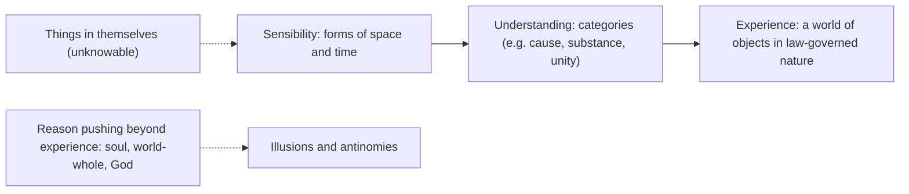

# Kant's Copernican revolution

**Prerequisites:** [[rationalism|Rationalism]], [[empiricism|Empiricism]]; [[g:a-priori|a priori]]

@@IMG@@

## The impasse Kant inherited

By the 1770s European philosophy seemed stuck between two failures. [[rationalism|Rationalists]] claimed to know by pure reason that God exists, that the soul is simple, that the world has a first cause. But their systems contradicted one another, and pure reason seemed able to prove opposite conclusions. [[empiricism|Empiricists]] limited knowledge to experience, and [[david-hume|Hume]] showed that experience alone cannot justify the necessity of causal laws. Yet Newtonian physics seemed to give exactly such necessary and universal knowledge.

[[immanuel-kant|Immanuel Kant]] asked how that was possible.

## Two distinctions

Kant sorted judgments in two ways:

- **[[g:analytic-and-synthetic|Analytic vs synthetic]].** In an analytic judgment the predicate is contained in the subject ("all bachelors are unmarried"); it is true by meaning alone. A synthetic judgment adds something ("all bodies are heavy").
- **A priori vs a posteriori.** Known independently of experience, or through it.

Analytic judgments are a priori; most synthetic judgments are a posteriori. The crucial question is whether there are **synthetic a priori** judgments: substantive claims about the world that are nonetheless necessary and known independently of experience. Kant argued that mathematics ("7 + 5 = 12" on his analysis) and the basic principles of physics ("every event has a cause") are exactly that. The question of the [[critique-of-pure-reason|*Critique of Pure Reason*]] (1781) is how they are possible.

## The revolution

Copernicus explained the apparent motion of the stars by supposing that the observer moves. Kant proposed a parallel reversal. Instead of assuming that our knowledge must conform to objects, suppose that objects, as we experience them, must conform to the structure of our knowing.

- **Space and time** are forms of our sensibility, the way anything must appear to us, not properties of things in themselves.
- The **categories** (including substance and cause) are concepts the understanding brings to experience; it is only by applying them that we experience a world of objects at all.
- So "every event has a cause" is necessary and universal for any possible experience, because experience is structured that way. Hume was answered.
- The price is that we know only **appearances** (phenomena), never [[g:thing-in-itself|things as they are in themselves]] (noumena). This is **transcendental idealism**.

When reason tries to go beyond any possible experience, it falls into illusions: arguments about the soul, contradictory proofs about the world as a whole (the **antinomies**, such as that the world has a beginning in time and that it does not), and attempted proofs of God, including [[anselm|Anselm]]'s, which fail because existence is not a real predicate.

## Room for faith and freedom

Kant wrote that he had to deny knowledge in order to make room for faith. Because the self as it is in itself is not bound by the causal laws of appearances, freedom is at least possible. In the [[groundwork-of-the-metaphysics-of-morals|*Groundwork*]] (1785) and the *Critique of Practical Reason* (1788) he argued that morality rests on the autonomy of rational will, expressed in the **[[g:categorical-imperative|categorical imperative]]**: act only on that maxim through which you can at the same time will that it become a universal law. A further formulation: treat humanity, in yourself and others, always as an end and never merely as a means.

## After Kant

Kant's successors found the unknowable thing in itself unstable. If we cannot know it, how can we know it exists, or that it affects us? [[german-idealism|German idealism]] (Fichte, Schelling, [[georg-wilhelm-friedrich-hegel|Hegel]]) tried to remove it. [[arthur-schopenhauer|Schopenhauer]] claimed to have found it: the will. Kant's split between facts and values, nature and freedom, shaped almost everything after him, analytic and continental alike.

## Key ideas

- Kant sought to explain synthetic a priori knowledge, which rationalism assumed and empiricism could not justify.
- His Copernican revolution: objects of experience conform to the forms of our sensibility and the categories of our understanding.
- We know appearances, not things in themselves; reason beyond experience falls into illusion.
- Morality rests on autonomy and the categorical imperative.

## Where this leads

- Next era: [[dir:philosophy/history/modern/nineteenth-century|The nineteenth century]], starting with [[german-idealism|German idealism]]
- Thinker: [[immanuel-kant|Immanuel Kant]]
- Texts: [[critique-of-pure-reason|*Critique of Pure Reason*]], [[groundwork-of-the-metaphysics-of-morals|*Groundwork*]]
- Forward: [[arthur-schopenhauer|Schopenhauer]]'s will as the thing in itself
