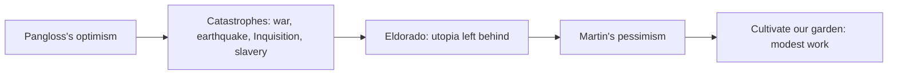

# Voltaire, *Candide, or Optimism*

**Prerequisites:** [Voltaire](../thinkers/voltaire.md); helpful: [Leibniz](../thinkers/gottfried-wilhelm-leibniz.md)

@@IMG@@

## Dating and form

Published in January 1759, simultaneously in several cities, as a translation "from the German of Dr. Ralph". Nobody was fooled for long; it was condemned in Geneva and Paris and sold enormously. It is a *conte philosophique*, a short philosophical tale, about thirty brisk chapters of absurd catastrophe.

## Story

Candide, a naive young man raised in a Westphalian castle, is taught by the tutor Pangloss that all is for the best in the best of all possible worlds. Kicked out for kissing the baron's daughter Cunégonde, he is press-ganged into the Bulgar army, witnesses a massacre, survives a shipwreck and the Lisbon earthquake, is flogged by the Inquisition while Pangloss is hanged (he survives), finds and loses Cunégonde, travels to South America, discovers the utopian land of Eldorado where gold is pebbles and there are no priests or courts, leaves it, is robbed and cheated, and meets in Suriname an enslaved man who has lost a hand and a leg to the sugar mill: "it is at this price that you eat sugar in Europe". Through it all Pangloss, and for a long time Candide, insist that everything is for the best. The pessimist Martin offers the opposite view. In the end the reunited company settles on a small farm near Constantinople. When Pangloss still argues that all events are linked in the best of possible worlds, Candide replies: "That is well said, but we must cultivate our garden."

## Target and themes

The target is philosophical optimism, the thesis that this is the best possible world, associated with [Leibniz](../thinkers/gottfried-wilhelm-leibniz.md) (as popularized by Christian Wolff) and with Alexander Pope's *Essay on Man*. Leibniz's actual view is more sophisticated than Pangloss's slogans: he never denied that evils are real, only that a better whole was possible. Voltaire's real target is the attitude that turns suffering into a proof of order and thereby excuses doing nothing about it. Other targets: religious fanaticism, war, aristocratic pride, colonial slavery, literary vanity.

The ending is much debated. Is "cultivate our garden" a call for practical work over speculation, a retreat into private life, an image of modest Enlightenment reform, or all three?

## Reception

*Candide* became the best-known work of the French Enlightenment and a model of satire. Leonard Bernstein turned it into an operetta (1956). It remains the liveliest introduction to the [problem of evil](../../../../glossary/modern/problem-of-evil.md). Translations: Roger Pearson (Oxford World's Classics), Theo Cuffe (Penguin), Burton Raffel (Yale).

## Key ideas

- A comic tale demolishing the optimism of "the best of all possible worlds".
- Suffering is real, and philosophical justifications of it can become complacency.
- "We must cultivate our garden": practical, modest work as the answer.

## Where this leads

- Next text: [Rousseau's *The Social Contract*](the-social-contract.md)
- Back: [*Monadology*](monadology.md)
- Related: [Job](../../../../../religion/abrahamic/christianity/bible/old-testament/books/wisdom-poetry/job.md), an older confrontation with suffering
- Forward: [*The Brothers Karamazov*](../../nineteenth-century/texts/the-brothers-karamazov.md), Ivan's rebellion against theodicy
