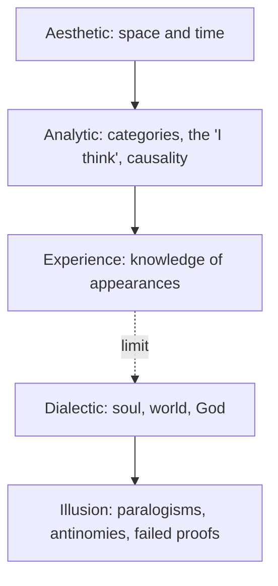

# Kant, *Critique of Pure Reason*

**Prerequisites:** [Kant's Copernican revolution](../07-kants-copernican-revolution.md), [Immanuel Kant](../thinkers/immanuel-kant.md)

@@IMG@@

## Dating and editions

Published in Riga in 1781 (the "A edition") after more than a decade of near silence, and substantially revised in 1787 (the "B edition"), with a new preface, a rewritten Transcendental Deduction and a "Refutation of Idealism". Scholars cite it by the page numbers of both editions (e.g. A51/B75). Early readers found it nearly impenetrable; Kant wrote the *Prolegomena to Any Future Metaphysics* (1783) as a shorter guide.

## Structure

The book follows the architecture of a logic textbook of the time.

- **Transcendental Aesthetic.** Space and time are a priori forms of intuition (sensibility). This explains how geometry can be both synthetic and a priori.
- **Transcendental Analytic.** The twelve categories (including substance, cause, unity, plurality) are a priori concepts of the understanding. The Transcendental Deduction argues they necessarily apply to all possible experience, because the unity of self-consciousness ("the 'I think' must be able to accompany all my representations") requires them. The Principles include the Second Analogy: every event has a cause. "Thoughts without content are empty, intuitions without concepts are blind" (A51/B75).
- **Transcendental Dialectic.** Reason seeks the unconditioned and produces illusions: **Paralogisms** about the soul (that it is a simple, persisting substance); **Antinomies**, four pairs of equally strong contradictory proofs about the world (finite or infinite; simple parts or infinite divisibility; freedom or determinism; a necessary being or none); and the **Ideal** of pure reason, where the ontological, cosmological and physico-theological proofs of God are refuted.
- **Doctrine of Method.** The discipline, canon and history of pure reason; what we may hope.

## Key ideas

- We have synthetic a priori knowledge because objects of experience conform to our forms of intuition and categories.
- We know appearances, not things in themselves (transcendental idealism).
- Reason beyond experience generates unavoidable illusions; metaphysics as a science of the supersensible is impossible.
- "I had to deny knowledge in order to make room for faith" (B preface).

## Reception

The book divided the history of philosophy into before and after. Reinhold, Fichte, Schelling and Hegel responded; neo-Kantians made it the foundation of epistemology and philosophy of science; [Husserl](../../twentieth-century/thinkers/edmund-husserl.md) and [Heidegger](../../twentieth-century/thinkers/martin-heidegger.md) reinterpreted it; P. F. Strawson's *The Bounds of Sense* (1966) brought it back into analytic philosophy. Translations: Norman Kemp Smith (classic), Paul Guyer and Allen Wood (Cambridge Edition), Werner Pluhar (Hackett). Sebastian Gardner's *Routledge Philosophy Guidebook to Kant and the Critique of Pure Reason* is a good companion.

## Where this leads

- Next text: [*Groundwork of the Metaphysics of Morals*](groundwork-of-the-metaphysics-of-morals.md)
- Forward: [Hegel's *Phenomenology of Spirit*](../../nineteenth-century/texts/phenomenology-of-spirit.md), [Schopenhauer's *World as Will and Representation*](../../nineteenth-century/texts/world-as-will-and-representation.md)
- Glossary: [synthetic a priori](../../../../glossary/modern/synthetic-a-priori.md), [transcendental idealism](../../../../glossary/modern/transcendental-idealism.md)
