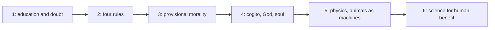

# Descartes, *Discourse on the Method*

**Prerequisites:** [René Descartes](../thinkers/rene-descartes.md)

@@IMG@@

## Dating and form

Published anonymously in Leiden in 1637, in French rather than Latin so that people of "good sense" without scholarly training could read it. Its full title is *Discourse on the Method of Rightly Conducting One's Reason and Seeking Truth in the Sciences*. It served as a preface to three scientific essays: *Optics*, *Meteorology* and *Geometry*, the last of which introduced analytic geometry. Descartes had withheld his larger treatise *The World* after Galileo's condemnation in 1633; the *Discourse* presents some of its results cautiously.

## Outline (six parts)

1. **Autobiography of a mind.** Good sense is the best distributed thing in the world; the problem is method. His education left him with doubts; he resolved to study "the great book of the world" and himself.
2. **The four rules.** Accept nothing as true unless clearly and distinctly known; divide each difficulty into parts; proceed in order from simple to complex; make complete enumerations. The image of a city planned by one architect versus an old town built piecemeal.
3. **Provisional morality.** While rebuilding, live by moderate maxims: obey the laws and customs of one's country; be resolute once decided; change one's desires rather than the world; devote one's life to cultivating reason.
4. **Metaphysics.** Doubt, and the first appearance of "I think, therefore I am" (*je pense, donc je suis*); the existence of God; the distinction of mind and body. A compressed version of what the [*Meditations*](meditations-on-first-philosophy.md) would develop.
5. **Physics and physiology.** A summary of *The World*, the circulation of the blood (crediting William Harvey, while disagreeing on the heart's mechanism), animals as machines, and two tests that distinguish humans from machines: language and flexible reason.
6. **Why publish.** The project of a practical science that would make us "masters and possessors of nature", especially through medicine.

## Reception

The *Discourse* is one of the founding documents of modern philosophy and of French prose. Its rules became a model of rational method, and its picture of the lone thinker rebuilding knowledge from scratch has been both admired and criticized as unrealistic about how knowledge depends on communities and traditions. The test for distinguishing humans from machines through language has been compared to Turing's test. Translations: Ian Maclean (Oxford World's Classics); John Cottingham, Robert Stoothoff and Dugald Murdoch in *The Philosophical Writings of Descartes* (Cambridge).

## Key ideas

- A method of four rules for reasoning, offered in a personal intellectual autobiography.
- A provisional morality for living while doubting.
- The first public statement of the cogito.

## Where this leads

- Next text: [*Meditations on First Philosophy*](meditations-on-first-philosophy.md)
- Back: [*Novum Organum*](novum-organum.md), the rival method
- Glossary: [cogito](../../../../glossary/modern/cogito.md)
