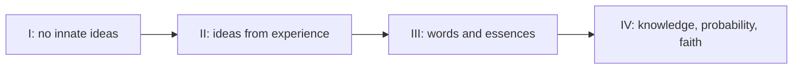

# Locke, *An Essay Concerning Human Understanding*

**Prerequisites:** [[john-locke|John Locke]]; [[empiricism|Empiricism]]

@@IMG@@

## Dating and origin

Published in December 1689 (dated 1690) in London, after nearly twenty years of work. In the "Epistle to the Reader" [[john-locke|Locke]] explains its origin: five or six friends meeting in his room found themselves stuck on a difficult question (reportedly on morality and revealed religion) and he proposed that before going further they should examine their own abilities and see what objects our understandings were or were not fitted to deal with. He describes his role modestly as "an under-labourer in clearing the ground a little, and removing some of the rubbish that lies in the way to knowledge", in an age of master-builders like Boyle, Huygens and "the incomparable Mr. Newton". Four editions appeared in his lifetime, with significant additions, including the chapter on personal identity (1694).

## Outline (four books)

1. **Of innate notions.** Neither speculative principles ("whatever is, is") nor practical moral principles are innate; universal consent does not exist and would not prove innateness anyway.
2. **Of ideas.** All ideas come from sensation or reflection. Simple ideas; primary and secondary qualities (ch. 8); complex ideas of modes, substances and relations; power and freedom; substance as "something, I know not what" (ch. 23); identity and diversity, including personal identity (ch. 27).
3. **Of words.** Words signify ideas in the mind of the speaker. General words and abstract ideas; real and nominal essences; the imperfection and abuse of words.
4. **Of knowledge and opinion.** Knowledge is the perception of agreement or disagreement of ideas: intuitive, demonstrative or sensitive. Its extent is narrow; most of life runs on probability and judgment. Faith and reason; against "enthusiasm" (claims to private inspiration).

## Key ideas

- The mind starts empty; ideas arise from sensation and reflection.
- Real essences of substances are unknown; we classify by nominal essences.
- Personal identity consists in continuity of consciousness, not of substance.
- Knowledge is limited; reasonable belief proportioned to evidence must fill the gap.

## Reception

The *Essay* was among the most influential books of the eighteenth century, setting the agenda for [[george-berkeley|Berkeley]], [[david-hume|Hume]] and the French Enlightenment, and shaping psychology and educational theory. [[gottfried-wilhelm-leibniz|Leibniz]] wrote a long dialogue in reply, the *New Essays on Human Understanding*, defending innate ideas ("nothing is in the intellect that was not first in the senses, except the intellect itself"), published only in 1765. The Clarendon edition (ed. Peter Nidditch) is standard; Roger Woolhouse's Penguin edition and Kenneth Winkler's Hackett abridgment are good for students.

## Where this leads

- Next text: [[second-treatise-of-government|*Second Treatise of Government*]]
- Forward: [[treatise-of-human-nature|Hume's *Treatise*]]
- Glossary: [[g:tabula-rasa|tabula rasa]], [[g:primary-and-secondary-qualities|primary and secondary qualities]]
