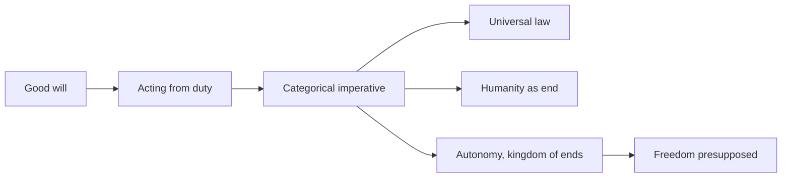

# Kant, *Groundwork of the Metaphysics of Morals*

**Prerequisites:** [[immanuel-kant|Immanuel Kant]]; helpful: [[c:ethics/virtue-and-arete.md|virtue and arete]] for contrast

@@IMG@@

## Dating and purpose

Published in Riga in 1785, between the two editions of the [[critique-of-pure-reason|*Critique of Pure Reason*]]. It is short, about 80 pages in most editions, and its aim is narrow: "the search for and establishment of the supreme principle of morality". It is a groundwork (*Grundlegung*) for a fuller *Metaphysics of Morals*, which appeared in 1797.

## Outline

- **Preface.** Ethics must have a pure part, independent of empirical facts about human nature, because moral law must hold for all rational beings with absolute necessity.
- **Section I: from common moral knowledge to philosophy.** "It is impossible to think of anything at all in the world, or indeed even beyond it, that could be considered good without limitation except a good will." Talents and fortune can be misused; the good will shines like a jewel by itself. Actions have moral worth when done from duty, not merely in accordance with duty: the shopkeeper who gives correct change only because honesty is good for business acts rightly but without moral worth. Duty is the necessity of an action from respect for law.
- **Section II: from popular moral philosophy to a metaphysics of morals.** Imperatives are hypothetical (if you want X, do Y) or categorical (do Y, full stop). The categorical imperative's formulations:
  1. **Universal law:** act only according to that maxim through which you can at the same time will that it become a universal law. (Example: a lying promise, universalized, would destroy the practice of promising.)
  2. **Humanity:** act so that you treat humanity, whether in your own person or in that of another, always at the same time as an end and never merely as a means.
  3. **Autonomy and the kingdom of ends:** the will of every rational being as universally legislating; act as a member of a realm of ends. Things have a price; rational beings have dignity.
- **Section III: from metaphysics of morals to critique of practical reason.** Morality presupposes freedom; we must regard ourselves as free, as members of the intelligible world, though we cannot explain how freedom is possible.

## Key ideas

- Only a good will is unconditionally good; moral worth lies in acting from duty.
- Moral requirements are categorical and derive from reason, not desire.
- Persons have dignity, not price; never use anyone merely as a means.
- Morality is autonomy, rational self-legislation, and presupposes freedom.

## Reception

The *Groundwork* is the founding text of deontological ethics. Hegel criticized the universal-law test as empty formalism; [[john-stuart-mill|Mill]] argued that its applications covertly rely on consequences; Schopenhauer and Nietzsche attacked its notion of duty. Twentieth-century Kantians such as [[john-rawls|Rawls]], Onora O'Neill and Christine Korsgaard revived and reinterpreted it. Translations: Mary Gregor and Jens Timmermann (Cambridge); Allen Wood (Yale); H. J. Paton's *The Moral Law* (classic).

## Where this leads

- Next era: [[dir:philosophy/history/modern/nineteenth-century|The nineteenth century]]
- Forward: [[on-liberty|Mill's *On Liberty*]] and [[utilitarianism-and-liberalism|utilitarianism]]; [[a-theory-of-justice|Rawls]]
- Glossary: [[g:categorical-imperative|categorical imperative]], [[g:autonomy|autonomy]]
