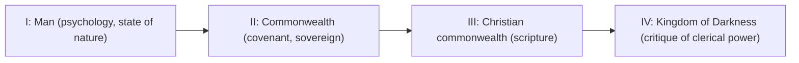

# Hobbes, *Leviathan*

**Prerequisites:** [Thomas Hobbes](../thinkers/thomas-hobbes.md); [The social contract](../05-social-contract-and-the-state.md)

@@IMG@@

## Dating and context

Published in London in 1651, in English, two years after the execution of Charles I and while [Hobbes](../thinkers/thomas-hobbes.md) was still in Paris; a Latin version appeared in 1668. The full title is *Leviathan, or The Matter, Forme and Power of a Common-Wealth Ecclesiasticall and Civil*. Leviathan is the sea monster of the book of [Job](../../../../../religion/abrahamic/christianity/bible/old-testament/books/wisdom-poetry/job.md) (chapter 41), "king over all the children of pride". The famous frontispiece, designed with the etcher Abraham Bosse, shows a giant crowned figure rising over a landscape, holding a sword and a bishop's crozier, his body composed of hundreds of tiny people.

## Outline

- **Part I, "Of Man."** Sensation, imagination, language, reason, passions, power. The natural condition of mankind (ch. 13): equality, competition, diffidence, glory; the war of all against all. The laws of nature (ch. 14–15): seek peace; lay down your right to all things if others do too; perform covenants (justice); and others.
- **Part II, "Of Commonwealth."** The generation of the commonwealth by covenant (ch. 17); the rights of the sovereign, which are indivisible (ch. 18); kinds of commonwealth (monarchy preferred); liberty of subjects (ch. 21); civil law, crime, punishment; things that weaken a commonwealth.
- **Part III, "Of a Christian Commonwealth."** A long reading of scripture arguing that the sovereign has authority over religion and that the church has no independent power.
- **Part IV, "Of the Kingdom of Darkness."** An attack on scholastic philosophy, the papacy and what Hobbes regarded as superstitious doctrines.

## Key ideas

- Life without a common power is "solitary, poor, nasty, brutish, and short".
- "Covenants, without the sword, are but words."
- The sovereign is authorized by all and is the representative of all; its rights cannot be divided.
- Subjects keep liberty where the law is silent and the right to preserve their own lives.

## Reception

Royalists thought Hobbes justified submission to Cromwell, since authority follows effective protection; clergy denounced his materialism and Erastianism. Modern readers mostly read Parts I and II and skip III and IV, though recent scholarship argues the religious parts are essential to his project. Editions: Noel Malcolm's three-volume Clarendon edition (scholarly); Richard Tuck (Cambridge Texts); Edwin Curley (Hackett), which includes variants from the Latin version.

## Where this leads

- Next text: [*Pensées*](pensees.md)
- Forward: [Locke's *Second Treatise*](second-treatise-of-government.md), [Rousseau's *Social Contract*](the-social-contract.md)
- Related: [Job](../../../../../religion/abrahamic/christianity/bible/old-testament/books/wisdom-poetry/job.md), source of the title
