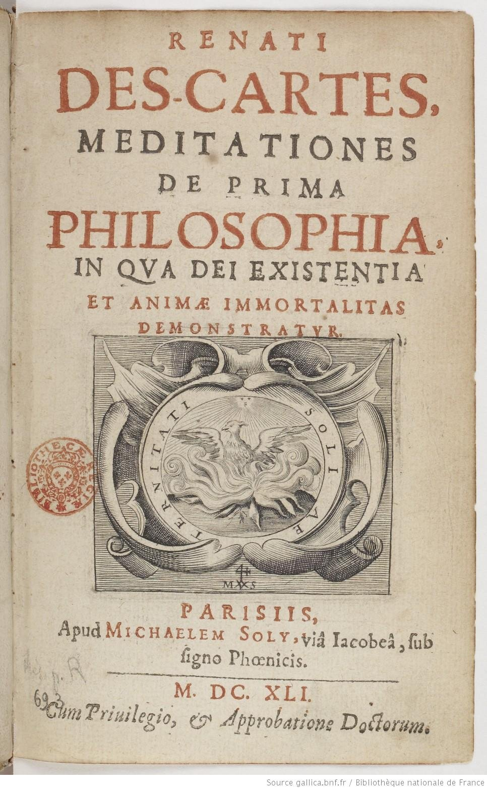
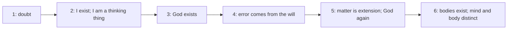

# Descartes, *Meditations on First Philosophy*

**Prerequisites:** [René Descartes](../thinkers/rene-descartes.md), [*Discourse on the Method*](discourse-on-method.md)

*Title page of the first edition of Descartes's *Meditationes de prima philosophia* (1641). Credit: Bibliothèque Nationale de France. License: Public domain. Source: [File:Meditationes de prima philosophia 1641.jpg](https://commons.wikimedia.org/wiki/File:Meditationes_de_prima_philosophia_1641.jpg).*

## Dating and form

Published in Latin in Paris in 1641 (second edition Amsterdam 1642), with a French translation approved by Descartes in 1647. Before publication, Marin Mersenne circulated the manuscript to leading thinkers; their objections and Descartes' replies were printed with it. The objectors included [Hobbes](../thinkers/thomas-hobbes.md) (third set), Antoine Arnauld (fourth set), Pierre Gassendi (fifth set) and others. The six meditations are written as six days of first-person reflection, a form that echoes religious spiritual exercises.

## Outline

1. **What can be called into doubt.** Senses deceive; dreaming; an evil demon (*genius malignus*) deceiving me in everything.
2. **The nature of the human mind.** "I am, I exist" is necessarily true whenever I conceive it. What am I? A thing that thinks: doubts, understands, affirms, denies, wills, imagines and senses. The wax example: a piece of wax melted by the fire changes every sensory quality, yet I judge it is the same wax; so I grasp it by the mind, not the senses.
3. **God's existence (first argument).** I have an idea of an infinite, perfect being. An idea must have a cause with at least as much reality as the idea represents. Only an actually infinite being could cause it. So God exists.
4. **Truth and falsity.** If God does not deceive, why do I err? Because my will extends beyond my limited understanding; error comes from judging what I do not clearly perceive.
5. **The essence of material things, and God again.** The essence of body is extension, studied by geometry. A version of the ontological argument: existence belongs to God's essence as having angles equal to two right angles belongs to a triangle.
6. **Material things and mind–body distinction.** I clearly conceive mind without body and body without mind, so they are really distinct. Since God is no deceiver and I have a strong inclination to believe my sensations come from bodies, bodies exist. Mind and body are closely joined; I am not in my body like a pilot in a ship.

## Key objections

- **The Cartesian circle** (Arnauld): Descartes relies on clear and distinct perceptions to prove God, then on God to guarantee clear and distinct perception.
- **Interaction** (Princess Elisabeth in letters, Gassendi): how can an unextended mind move a body?
- **What the cogito proves** (Gassendi, later Lichtenberg): perhaps only "there is thinking", not that there is a thinking substance.
- **The idea of God** (Hobbes): we have no real idea of an infinite being.

## Reception

The *Meditations* is perhaps the most taught text in modern philosophy courses, because in a few pages it raises skepticism, the self, God, error and the mind–body problem. Translations: John Cottingham (Cambridge), with selections from the Objections and Replies; Donald Cress (Hackett).

## Key ideas

- Six days of meditation move from total doubt to the existence of self, God and the world.
- The wax argument shows bodies are grasped by the intellect, not the senses.
- The Objections and Replies, published with the work, are part of the text.

## Where this leads

- Next text: [*Leviathan*](leviathan.md)
- Back: [Anselm's *Proslogion*](../../../medieval/texts/proslogion.md); [Augustine](../../../medieval/thinkers/augustine.md)
- Forward: [Heidegger's *Being and Time*](../../twentieth-century/texts/being-and-time.md), which attacks the Cartesian starting point
- Glossary: [methodic doubt](../../../../glossary/modern/methodic-doubt.md), [mind–body problem](../../../../glossary/modern/mind-body-problem.md)
