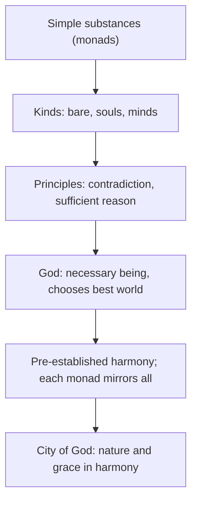

# Leibniz, *Monadology*

**Prerequisites:** [Gottfried Wilhelm Leibniz](../thinkers/gottfried-wilhelm-leibniz.md); [Rationalism](../03-rationalism.md)

@@IMG@@

## Dating and form

Written in French in Vienna in 1714, two years before [Leibniz](../thinkers/gottfried-wilhelm-leibniz.md)'s death, as a compact summary of his metaphysics. It was untitled; the name *Monadologie* comes from a German translation published in 1720. It consists of 90 short numbered paragraphs, many with references to his *Theodicy*. A companion piece of the same year, *Principles of Nature and Grace, Based on Reason*, covers similar ground for Prince Eugene of Savoy.

## Outline

- **§1–17: what monads are.** A monad is a simple substance, without parts, so without extension, shape or divisibility. Monads can begin only by creation and end only by annihilation. They have "no windows" through which anything could come in or go out. Each differs from every other. Their internal states are perceptions; the principle of change is appetition. §17 offers the "mill argument": if a thinking machine were enlarged so we could walk inside, we would find only parts pushing one another, never a perception; so perception cannot be explained mechanically.
- **§18–30: kinds of monads.** Bare monads with unconscious perceptions; souls with memory; rational minds capable of reflection and knowledge of necessary truths.
- **§31–37: two great principles.** Contradiction and sufficient reason; truths of reasoning and truths of fact.
- **§38–48: God.** The sufficient reason of the series of contingent things must be outside it, in a necessary being.
- **§49–60: pre-established harmony and the mirror.** Each monad expresses the whole universe from its point of view, as one town looks different from different sides.
- **§61–81: bodies and organisms.** Every portion of matter is like a garden full of plants or a pond full of fish; organisms are machines to their smallest parts.
- **§82–90: the city of God.** Minds form a moral community with God as monarch; the kingdom of nature and the kingdom of grace are in harmony.

## Key ideas

- Reality consists of windowless, perceiving simple substances.
- Perception cannot be explained by mechanism (the mill argument).
- Everything has a sufficient reason; God chose the best possible world.

## Reception

The *Monadology* became the standard short statement of Leibniz's system, and through Christian Wolff's textbooks shaped German philosophy until [Kant](../thinkers/immanuel-kant.md). The mill argument is still cited in debates about consciousness and the "hard problem". Translations: Roger Ariew and Daniel Garber in *Philosophical Essays* (Hackett); Nicholas Rescher's edition with commentary; Lloyd Strickland's *Leibniz's Monadology: A New Translation and Guide*.

## Where this leads

- Next text: [Hume's *Treatise*](treatise-of-human-nature.md)
- Forward: [*Candide*](candide.md), the satire
- Glossary: [monad](../../../../glossary/modern/monad.md), [principle of sufficient reason](../../../../glossary/modern/principle-of-sufficient-reason.md)
