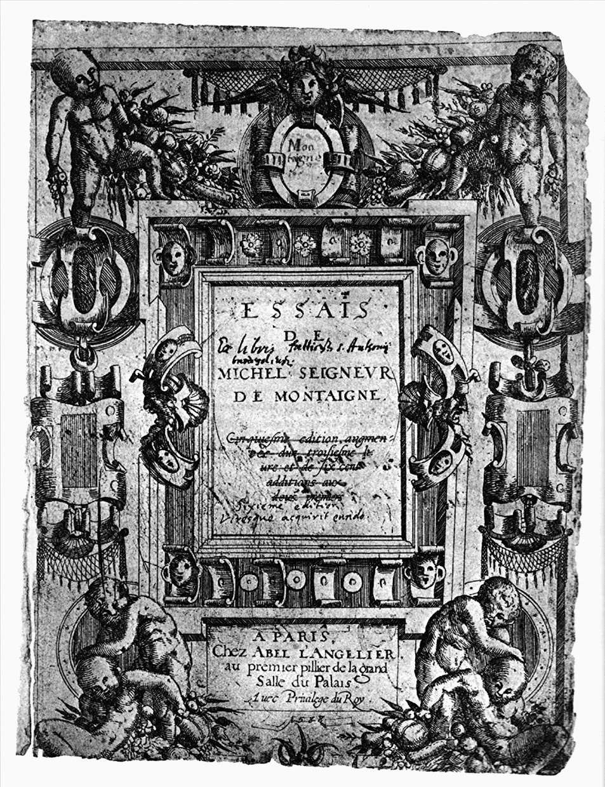
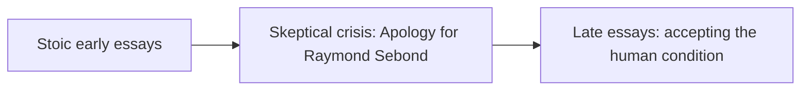

# Montaigne, *Essays*

**Prerequisites:** [Montaigne](../thinkers/michel-de-montaigne.md)

*Title page of the 1588 edition of Montaigne's *Essais*, from the 'Bordeaux copy' that Montaigne annotated by hand. Credit: Michel de Montaigne († 1592). License: Public domain. Source: [File:Essais Titelblatt (1588).png](https://commons.wikimedia.org/wiki/File:Essais_Titelblatt_(1588).png).*

## Dating and editions

[Montaigne](../thinkers/michel-de-montaigne.md) published the first two books of *Essais* in Bordeaux in 1580, a revised edition in 1582, and a new edition with a third book and hundreds of additions to the first two in Paris in 1588. He kept adding notes in the margins of his own copy (the "Bordeaux Copy") until his death in 1592; his adoptive daughter Marie de Gournay published a posthumous edition in 1595. Modern editions mark the three layers (often A, B, C) so readers can see how his thought grew.

## Form

The 107 essays vary from a page to over a hundred pages. Their titles often mislead: "Of Coaches" turns into a meditation on the Spanish conquest of the Americas; "Of Cripples" into a reflection on witchcraft trials and the limits of evidence. The essays digress, quote ancient authors constantly, contradict themselves and revise. That is the method: thought shown in motion.

## Essays to start with

- **"To the Reader."** The book's subject is himself, "this is a book written in good faith".
- **"That to Philosophize Is to Learn to Die" (I.20).** Early Stoic advice on facing death.
- **"Of Friendship" (I.28).** On La Boétie: "because it was he, because it was I".
- **"Of Cannibals" (I.31).** On custom and barbarism.
- **"Of Cruelty" (II.11).**
- **"Apology for Raymond Sebond" (II.12).** The great skeptical essay.
- **"Of Repentance" (III.2).** On a self "in perpetual motion".
- **"Of Experience" (III.13).** The final essay and his mature wisdom about the body, habits, and living well.

## Themes

Self-knowledge as knowledge of human variability; the power of custom; skepticism about reason, medicine and law; hostility to cruelty; friendship; the body; death. Many readers trace a development from Stoicism through skepticism to an Epicurean acceptance of life, while others think this neat story oversimplifies a book that never stopped changing.

## Reception

Florio's English translation (1603) shaped Shakespeare and Bacon, who took the title "Essays" for his own collection. Pascal and Descartes argued with him; Emerson wrote of Montaigne in *Representative Men*; Nietzsche admired his honesty. Virginia Woolf wrote an essay on him. M. A. Screech's complete Penguin translation and Donald Frame's (Stanford/Everyman) are standard; Sarah Bakewell's *How to Live: A Life of Montaigne* is a delightful introduction.

## Key ideas

- The essay is a trial of one's judgment, self-portrait as a method of inquiry.
- Custom shapes what each society calls natural or barbaric.
- Skepticism leads Montaigne to modesty, tolerance and acceptance of ordinary life.

## Where this leads

- Next text: [*Novum Organum*](novum-organum.md)
- Forward: [Pascal's *Pensées*](pensees.md), [*Discourse on the Method*](discourse-on-method.md)
- Back: [Sextus Empiricus](../../../ancient/greek/thinkers/sextus-empiricus.md), [Seneca's letters](../../../ancient/greek/texts/letters-to-lucilius.md)
