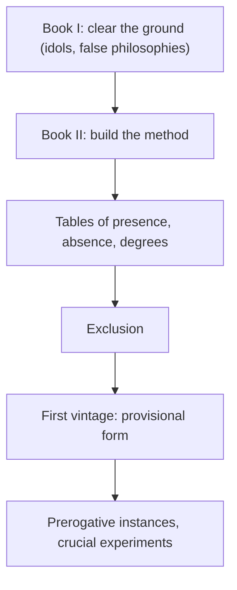

# Bacon, *Novum Organum*

**Prerequisites:** [Francis Bacon](../thinkers/francis-bacon.md); [The scientific revolution](../02-scientific-revolution-and-method.md)

@@IMG@@

## Dating and purpose

Published in Latin in 1620 as the second part of [Bacon](../thinkers/francis-bacon.md)'s unfinished *Instauratio Magna*. The title, "New Organon", challenges Aristotle's logical works, collectively called the [*Organon*](../../../ancient/greek/texts/organon.md) ("instrument"). Bacon offers a new instrument for the mind. The engraved title page shows a ship sailing out past the Pillars of Hercules, the traditional limit of the known world, with a motto from the book of Daniel: "Many shall run to and fro, and knowledge shall be increased."

## Structure

Written as numbered aphorisms, in two books.

- **Book I (130 aphorisms): the destructive part.** Why knowledge has made so little progress: reliance on syllogism, hasty generalization, and the four **idols** (tribe, cave, marketplace, theatre). Signs and causes of error in past philosophy. Grounds for hope that a new method would succeed. Aphorism 3: human knowledge and human power meet in one, for where the cause is not known the effect cannot be produced. Nature to be commanded must be obeyed.
- **Book II (52 aphorisms): the constructive part.** The method of true induction illustrated with the "form" of heat: tables of presence, absence and degrees; exclusion of what is not the form; a "first vintage" (provisional conclusion) that heat is a kind of expansive motion of small particles. Then 27 "prerogative instances", privileged types of case, including the "instance of the fingerpost" (*instantia crucis*) that decides between two explanations, the ancestor of the crucial experiment.

## Reception

The book inspired the Royal Society and later the Encyclopédistes. John Stuart Mill's methods of experimental inquiry in *A System of Logic* (1843) develop Bacon's tables. Critics, from William Whewell to [Popper](../../twentieth-century/thinkers/karl-popper.md), argued that real science depends on bold hypotheses, often mathematical, that Bacon's method underrated. His insight into cognitive biases (the idols) looks remarkably modern. The edition by Lisa Jardine and Michael Silverthorne (Cambridge Texts in the History of Philosophy) is the standard student translation.

## Key ideas

- A "new instrument" to replace Aristotelian logic as the method of discovery.
- The mind must first be cleared of idols.
- True induction climbs gradually from organized observations, using exclusion and crucial instances.

## Where this leads

- Next text: [*Discourse on the Method*](discourse-on-method.md)
- Forward: [Popper's *Logic of Scientific Discovery*](../../twentieth-century/texts/the-logic-of-scientific-discovery.md)
- Back: [Aristotle's *Organon*](../../../ancient/greek/texts/organon.md)
