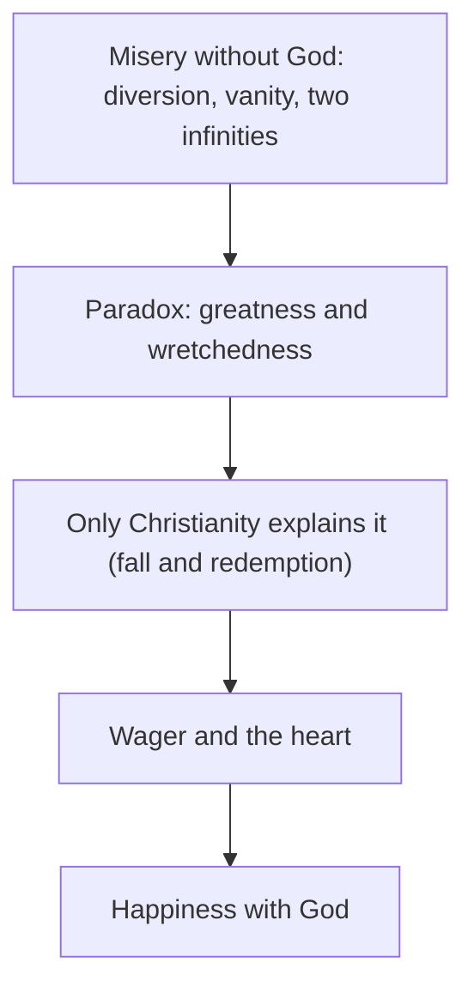

# Pascal, *Pensées*

**Prerequisites:** [[blaise-pascal|Blaise Pascal]]

@@IMG@@

## Dating and form

*Pensées* ("Thoughts") is the title given to the notes [[blaise-pascal|Pascal]] left at his death in 1662 for a planned *Apology for the Christian Religion*. He had sorted some fragments into bundles with titles; many others were unclassified. His family and Port-Royal friends published a selection in 1670, editing out what seemed obscure or dangerous. Modern editions try to reconstruct Pascal's own ordering, and the numbering differs between editions (notably Brunschvicg, Lafuma and Sellier), which is why quotations give fragment numbers with an edition.

## The plan

Pascal intended to speak to a worldly, skeptical reader like the gamblers and wits he knew. In outline:

1. **The misery of man without God.** Vanity, diversion, imagination, self-love, injustice of laws, the disproportion between man and the infinite.
2. **The happiness of man with God.** Only Christianity explains both human greatness and wretchedness, by creation and fall, and offers a remedy.

Arguments from the prophecies, miracles, the history of the Jewish people and the figure of Jesus were to complete the case.

## Famous fragments (themes)

- The **thinking reed** (man is weak, but knows it).
- **Two infinities**: lost between the infinitely large and the infinitely small.
- **Diversion**: the inability to stay quietly in a room.
- **The wager** ("Infinite — nothing"): a decision under uncertainty.
- **The heart** has reasons which reason does not know.
- **The silence of infinite spaces**.
- **Cleopatra's nose**: had it been shorter, the whole face of the earth would have changed.
- **The two spirits**: geometrical and intuitive.

## Reception

Admired as one of the masterpieces of French prose. [[voltaire|Voltaire]]'s *Letters Concerning the English Nation* ended with a critique of Pascal as a sublime misanthrope. [[soren-kierkegaard|Kierkegaard]], [[fyodor-dostoevsky|Dostoevsky]], Nietzsche (who admired and hated him) and the existentialists found in him a forerunner. The wager is a classic text of decision theory and philosophy of religion. A. J. Krailsheimer's Penguin translation (Lafuma numbering) and Honor Levi's Oxford World's Classics translation (Sellier numbering) are standard.

## Key ideas

- An unfinished apology for Christianity built on an analysis of the human condition.
- Humans are a paradox of greatness and misery; diversion hides it.
- The wager and the "reasons of the heart" address unbelievers who demand proof.

## Where this leads

- Next text: [[spinoza-ethics|Spinoza's *Ethics*]]
- Back: [[montaigne-essays|Montaigne's *Essays*]]
- Forward: [[fear-and-trembling|Kierkegaard's *Fear and Trembling*]], [[the-myth-of-sisyphus|Camus's *Myth of Sisyphus*]]
