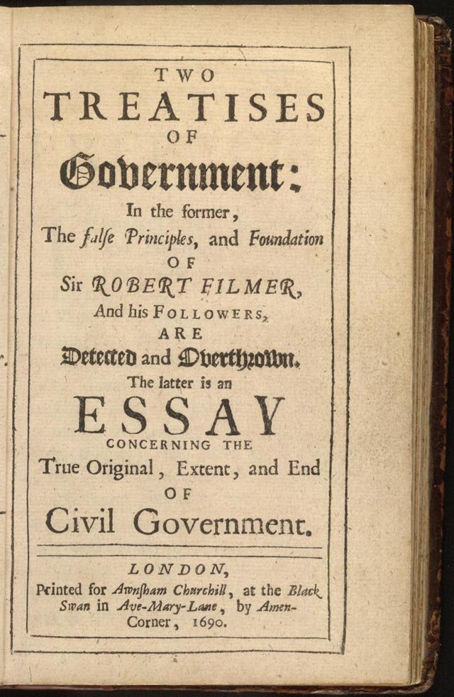
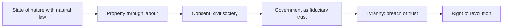

# Locke, *Second Treatise of Government*

**Prerequisites:** [John Locke](../thinkers/john-locke.md); [The social contract](../05-social-contract-and-the-state.md)

*Title page of Locke's *Two Treatises of Government* (1690). Credit: Credit as given on Wikimedia Commons. License: Public domain. Source: [File:Locke treatises of government page.jpg](https://commons.wikimedia.org/wiki/File:Locke_treatises_of_government_page.jpg).*

## Dating and context

The *Two Treatises of Government* were published anonymously in London in late 1689 (dated 1690), presented as a justification of the Glorious Revolution that put William III on the throne. Scholars, notably Peter Laslett, showed that most of the text was written earlier, around 1679–1683, during the Exclusion Crisis, when Locke's patron Shaftesbury tried to exclude the Catholic James from the succession. The *First Treatise* refutes Sir Robert Filmer's *Patriarcha*, which grounded kings' absolute power in Adam's fatherly authority. The *Second Treatise*, "An Essay Concerning the True Original, Extent, and End of Civil Government", gives Locke's positive theory. [Locke](../thinkers/john-locke.md) acknowledged authorship only in his will.

## Outline (19 chapters)

- **Ch. 2–4: the state of nature, war and slavery.** Perfect freedom and equality within the law of nature; everyone has the executive power to punish offenders.
- **Ch. 5: property.** God gave the world to mankind in common; one makes things one's own by mixing labour with them, within limits ("enough, and as good" left for others; no spoilage). Money allows accumulation beyond spoilage.
- **Ch. 6–7: paternal and political power** are different; families and political society.
- **Ch. 8: the beginning of political societies** through consent; the problem of tacit consent.
- **Ch. 9–14: ends and forms of government.** The chief end is preservation of property (life, liberty and estate). The legislative is supreme but bounded by trust; prerogative power of the executive.
- **Ch. 15–19: abuse of power.** Conquest, usurpation, tyranny; the dissolution of government. When the legislative or executive acts against its trust, the people may resist; "appeal to heaven".

## Key ideas

- Political power exists to preserve life, liberty and property, and only by consent.
- Labour creates property in what was held in common.
- Government is a trust; its breach dissolves it and returns power to the people.

## Reception

The *Second Treatise* became a classic of liberalism and constitutionalism. Its language echoes in the American Declaration of Independence. C. B. Macpherson read it as a theory of "possessive individualism" serving capitalist appropriation; James Tully and others connected the property chapter to the dispossession of Native Americans, since Locke argued that "in the beginning all the world was America" and that uncultivated land was waste. Laslett's Cambridge edition is the scholarly standard; C. B. Macpherson's Hackett edition is a good inexpensive version.

## Where this leads

- Next text: [Leibniz's *Monadology*](monadology.md)
- Back: [*Leviathan*](leviathan.md)
- Forward: [*The Social Contract*](the-social-contract.md), [Rawls's *A Theory of Justice*](../../twentieth-century/texts/a-theory-of-justice.md)
- Glossary: [natural rights](../../../../glossary/modern/natural-rights.md)
