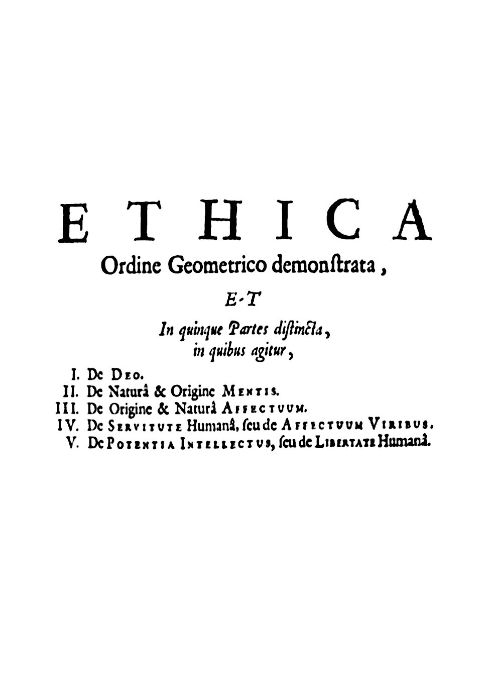

# Spinoza, *Ethics*

**Prerequisites:** [Baruch Spinoza](../thinkers/baruch-spinoza.md); [Rationalism](../03-rationalism.md)

*The opening of Spinoza's *Ethica* in the *Opera posthuma* (1677). Credit: http://www1.odn.ne.jp/gakuju/kyokai/spkLocator-e.html[dead link]. License: Public domain. Source: [File:Spinoza Ethica.jpg](https://commons.wikimedia.org/wiki/File:Spinoza_Ethica.jpg).*

## Dating and form

Written in Latin over many years (roughly 1661–1675) and published in 1677, months after [Spinoza](../thinkers/baruch-spinoza.md)'s death, in his *Opera Posthuma*, without his name on the title page. Its full title is *Ethics, Demonstrated in Geometrical Order* (*Ethica, ordine geometrico demonstrata*). Like Euclid, it proceeds by definitions, axioms, propositions, demonstrations, corollaries and scholia (explanatory notes). The scholia and appendices are often where the most vivid writing is.

## Outline (five parts)

1. **Of God.** Substance, attribute, mode. There is only one substance, God, infinite and necessary; everything is in God; nothing is contingent. The Appendix attacks the belief that nature acts for purposes, which he calls a prejudice born of ignorance.
2. **Of the nature and origin of the mind.** Thought and extension are attributes of the one substance; "the order and connection of ideas is the same as the order and connection of things" (IIP7). The mind is the idea of the body. Three kinds of knowledge: imagination (opinion), reason, intuitive knowledge.
3. **Of the origin and nature of the emotions.** Each thing strives to persevere in its being (*conatus*). The basic affects are desire, joy and sadness; all others (love, hate, hope, fear, envy, pity) are derived from them. He treats emotions as "if it were a question of lines, planes and bodies".
4. **Of human bondage, or the strength of the emotions.** Being ruled by passions is bondage. Good and bad are what we know to be useful or harmful to our striving. A free person thinks of nothing less than of death, and his wisdom is a meditation on life (IVP67).
5. **Of the power of the intellect, or human freedom.** Understanding an emotion clearly makes it less a passion. The highest good is the intellectual love of God; something of the mind is eternal. The final line: "all things excellent are as difficult as they are rare."

## Reception

The *Ethics* was banned in the Dutch Republic in 1678. It became a key text of the "radical Enlightenment", the subject of the German pantheism controversy and an inspiration for Goethe, Hegel, George Eliot (who translated it) and Einstein. Contemporary neuroscientists (Antonio Damasio, *Looking for Spinoza*) and philosophers of emotion still read it. Edwin Curley's translation (Penguin, or in *A Spinoza Reader*, Princeton) is the standard English version.

## Key ideas

- A geometrical system deriving ethics from a metaphysics of one substance.
- Mind and body are one thing under two attributes.
- Freedom is understanding; the highest happiness is the intellectual love of God.

## Where this leads

- Next text: [Locke's *Essay*](essay-concerning-human-understanding.md)
- Back: [*The Guide for the Perplexed*](../../../medieval/texts/guide-for-the-perplexed.md)
- Forward: [German idealism](../../nineteenth-century/01-german-idealism.md); [Nietzsche](../../nineteenth-century/texts/thus-spoke-zarathustra.md), who called Spinoza a precursor
- Glossary: [conatus](../../../../glossary/modern/conatus.md), [pantheism](../../../../glossary/modern/pantheism.md)
