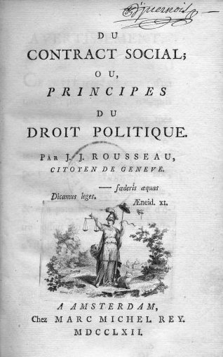
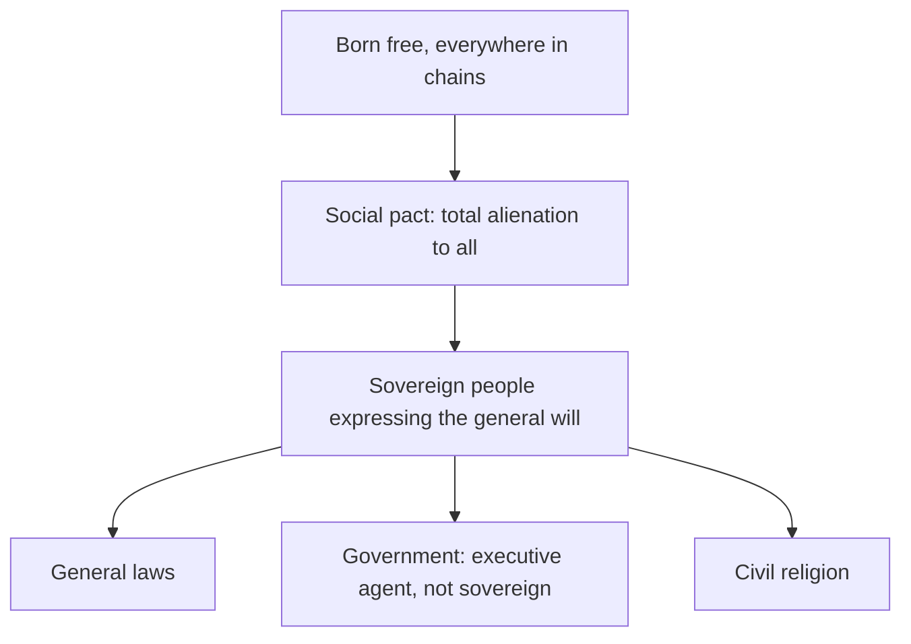

# Rousseau, *The Social Contract*

**Prerequisites:** [Jean-Jacques Rousseau](../thinkers/jean-jacques-rousseau.md); [The social contract](../05-social-contract-and-the-state.md)

*Title page of Rousseau's *Du contrat social* (1762). Credit: Credit as given on Wikimedia Commons. License: Public domain. Source: [File:Social contract rousseau page.jpg](https://commons.wikimedia.org/wiki/File:Social_contract_rousseau_page.jpg).*

## Dating and context

*Du contrat social; ou Principes du droit politique* was published in Amsterdam in April 1762, a month before *Emile*. It is a fragment of a larger planned work on political institutions. Both books were condemned in Paris and burned in Geneva, Rousseau's birthplace, whose constitution he had idealized. The book is short: four books, 48 chapters.

## Outline

- **Book I.** "Man is born free, and everywhere he is in chains." The question is not how this happened but what can make it legitimate. Force does not create right; slavery is illegitimate. The social pact: "to find a form of association that defends and protects with the whole common force the person and goods of each associate, and by which each, uniting with all, nevertheless obeys only himself and remains as free as before." Each gives himself entirely to all. Natural liberty is exchanged for civil and moral liberty. "Forced to be free" (I.7).
- **Book II.** Sovereignty is inalienable and indivisible. The general will is always right but the deliberations of the people are not always correct; the will of all (sum of private interests) differs from the general will. Laws must be general. The lawgiver, a near-superhuman figure who founds a people. Size, climate and people.
- **Book III.** Government is distinct from the sovereign: an intermediary executive. Democracy, aristocracy, monarchy; which suits which state. Representatives: the English think they are free, but are free only at elections. Sovereignty cannot be represented.
- **Book IV.** Voting; the Roman assemblies; the tribunate, dictatorship and censorship. The final chapter on **civil religion**: a simple creed (a beneficent God, an afterlife, the sanctity of the social contract and laws, no intolerance) that citizens may be banished for refusing.

## Key ideas

- Legitimacy requires that each, obeying the law, obeys only himself.
- The general will aims at the common good and differs from the sum of private wills.
- Sovereignty belongs to the people and cannot be delegated or represented.

## Reception

The book became a canonical text of the French Revolution. Liberal critics from Benjamin Constant to Isaiah Berlin feared its "forced to be free" and civil religion; republican and democratic theorists defend its account of self-government and its insistence on equality. [Kant](../thinkers/immanuel-kant.md) took from Rousseau the idea of freedom as self-legislation. Translations: Victor Gourevitch (Cambridge Texts), Christopher Betts (Oxford World's Classics), Maurice Cranston (Penguin).

## Where this leads

- Next text: [*Critique of Pure Reason*](critique-of-pure-reason.md)
- Back: [*Leviathan*](leviathan.md), [*Second Treatise*](second-treatise-of-government.md)
- Forward: [Kant's autonomy](groundwork-of-the-metaphysics-of-morals.md); [Arendt's *Origins of Totalitarianism*](../../twentieth-century/texts/the-origins-of-totalitarianism.md)
- Glossary: [general will](../../../../glossary/modern/general-will.md)
