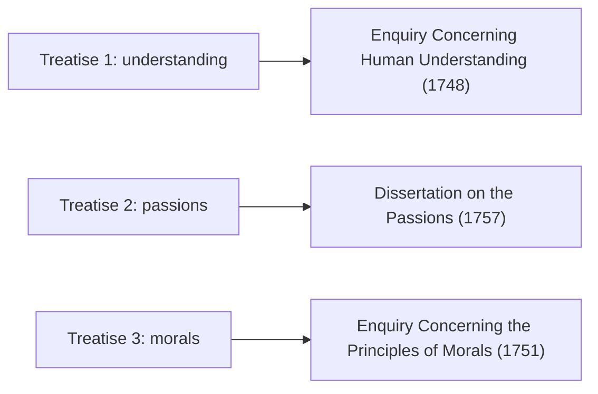

# Hume, *A Treatise of Human Nature* and the *Enquiries*

**Prerequisites:** [[david-hume|David Hume]]; [[empiricism|Empiricism]]

@@IMG@@

## Dating and versions

[[david-hume|Hume]] wrote the *Treatise* in France and published it anonymously in London: Books 1 and 2 in 1739, Book 3 in 1740, when he was in his late twenties. It sold poorly. He later recast its material in shorter, more elegant works: *An Enquiry Concerning Human Understanding* (1748, first titled *Philosophical Essays*), *A Dissertation on the Passions* (1757), and *An Enquiry Concerning the Principles of Morals* (1751), which he considered his best work. In an "Advertisement" added late in life he asked that the *Enquiries* alone be regarded as containing his philosophical principles, though most philosophers still treat the *Treatise* as his deepest work.

## Outline of the *Treatise*

- **Book 1, "Of the Understanding."** Impressions and ideas; the copy principle; association of ideas (resemblance, contiguity, cause and effect); abstract ideas (following Berkeley); space and time; knowledge and probability; causation and necessary connection; skepticism about reason and the senses; personal identity as a bundle; the conclusion, where he describes his skeptical despair cured by dinner, backgammon and friends.
- **Book 2, "Of the Passions."** Pride and humility, love and hatred; sympathy; the will and liberty; "reason is, and ought only to be the slave of the passions".
- **Book 3, "Of Morals."** Moral distinctions are not derived from reason; the is–ought paragraph (3.1.1); justice as an artificial virtue arising from convention; natural virtues; sympathy as the source of moral approval.

## The first *Enquiry*

Twelve sections, including "Sceptical Doubts Concerning the Operations of the Understanding" (the problem of induction), "Of the Idea of Necessary Connexion", "Of Liberty and Necessity" (a compatibilist account of free will), "Of Miracles" (no testimony suffices to establish a miracle unless its falsehood would be more miraculous than the fact it reports) and the closing call to commit to the flames any volume containing neither abstract reasoning about quantity or number nor experimental reasoning about matter of fact.

## Reception

Kant credited Hume with waking him from dogmatic slumber. The logical positivists took "Hume's fork" as a model for their criterion of meaning, and the problem of induction became central to [[philosophy-of-science|philosophy of science]]. Editions: David Fate Norton and Mary Norton (Oxford Philosophical Texts) for the *Treatise*; Peter Millican (Oxford World's Classics) for the first *Enquiry*; Tom Beauchamp for the second.

## Key ideas

- The project: an experimental science of human nature.
- Causation, induction and the self reduce to custom and association.
- Morality rests on sentiment; reason serves the passions.

## Where this leads

- Next text: [[candide|*Candide*]]
- Forward: [[critique-of-pure-reason|*Critique of Pure Reason*]]
- Glossary: [[g:problem-of-induction|problem of induction]], [[g:is-ought-gap|is–ought gap]]
