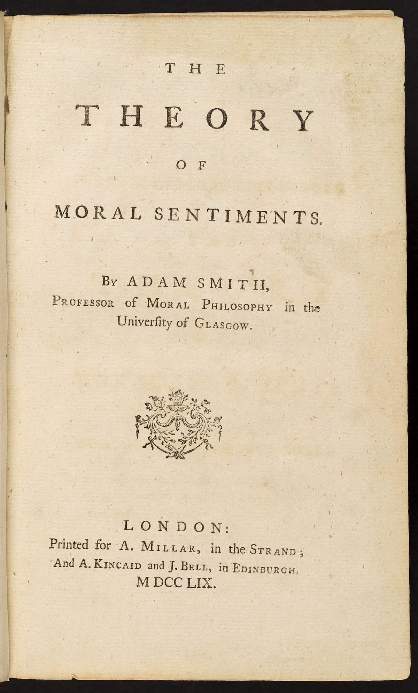
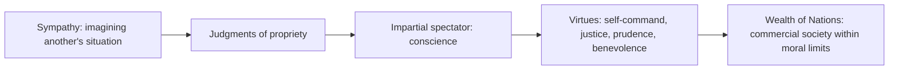

# Adam Smith as moral philosopher

**Prerequisites:** [The Enlightenment](../06-enlightenment.md), [David Hume](david-hume.md); the economics-side profile is [Adam Smith in the history of economic thought](../../../../../economics/microeconomics/10-history-of-thought/thinkers/01-adam-smith.md)

*Title page of the first edition of Adam Smith's *The Theory of Moral Sentiments* (1759). Credit: Adam Smith. License: Public domain. Source: [File:Adam Smith Moral Sentiments 1759.jpg](https://commons.wikimedia.org/wiki/File:Adam_Smith_Moral_Sentiments_1759.jpg).*

## Why Smith belongs here too

Adam Smith (1723–1790) is usually remembered as the founder of economics for *The Wealth of Nations* (1776), and the economics branch has a [full profile](../../../../../economics/microeconomics/10-history-of-thought/thinkers/01-adam-smith.md) from that angle. But Smith held the chair of moral philosophy at Glasgow, and his first book, *The Theory of Moral Sentiments* (1759), is reported to have been the one he considered his superior work. He revised it until the year of his death. To read him only as a theorist of markets misses how his economics sits inside a theory of human nature and ethics.

## Life in brief

Smith was born in Kirkcaldy, Scotland, studied at Glasgow under Francis Hutcheson and at Balliol College, Oxford, where he found the teaching neglectful. He lectured in Edinburgh, then held the chairs of logic and of moral philosophy at Glasgow (1751–1764). He resigned to tutor the young Duke of Buccleuch on a tour of France and Switzerland, meeting Voltaire, Quesnay and Turgot. Back in Kirkcaldy he wrote *The Wealth of Nations*, then became a Commissioner of Customs in Edinburgh. He was [Hume](david-hume.md)'s closest friend.

## The Theory of Moral Sentiments

**Sympathy.** The book opens with the observation that, however selfish we may be supposed, there are principles in our nature that interest us in the fortune of others. Smith's "sympathy" is our ability to imagine ourselves in another's situation and share, more faintly, what they feel.

**Propriety.** We approve of another's feelings when, imagining ourselves in their situation, we find we would feel the same; we disapprove when their feeling is out of proportion. Social life is a constant process of adjusting our emotional pitch to what spectators can enter into.

**The impartial spectator.** To judge ourselves, we imagine how an impartial, well-informed spectator would see our conduct: "the man within the breast". Conscience develops from internalizing this perspective. It allows us to resist the applause of the crowd when it is undeserved.

**Virtues.** Smith praises "amiable" virtues of sensibility and "awful" (awe-inspiring) virtues of self-command, along with prudence, justice and benevolence. Justice is a negative virtue, mostly a matter of refraining from harm, and is the pillar that holds up society.

**The invisible hand.** The phrase appears once in *Moral Sentiments* (in a passage about how the rich, in pursuing their own luxury, end up distributing the necessities of life) and once in *Wealth of Nations*. In neither is it a general theory of market perfection.

## The "Adam Smith problem"

Nineteenth-century German scholars posed the "Adam Smith problem": how can the author of a moral theory based on sympathy also have written an economics based on self-interest? Most scholars now think the problem is false. Self-interest in exchange is one part of human motivation, operating within institutions of justice; *Moral Sentiments* explains the moral framework without which markets cannot function. Smith also worried about the moral effects of commercial society, such as the mind-numbing effects of an extreme division of labour, and about our tendency to admire the rich and neglect the poor, which he called the great and most universal cause of the corruption of our moral sentiments.

## Key ideas

- Smith's moral philosophy is built on sympathy and the imagined impartial spectator.
- Conscience is the internalized perspective of an impartial observer.
- Justice is the minimal, essential virtue; self-command is the noblest.
- His economics sits within a moral theory; the "Adam Smith problem" is largely a misreading.

## Where this leads

- Economics: [Adam Smith (economics)](../../../../../economics/microeconomics/10-history-of-thought/thinkers/01-adam-smith.md), [division of labour](../../../../../economics/microeconomics/01-foundations/06-specialization-and-division-of-labour.md)
- Next thinker: [Immanuel Kant](immanuel-kant.md)
- Back: [Hume](david-hume.md) on sentiment
- Forward: [Marx](../../nineteenth-century/thinkers/karl-marx.md), [Mill](../../nineteenth-century/thinkers/john-stuart-mill.md)
