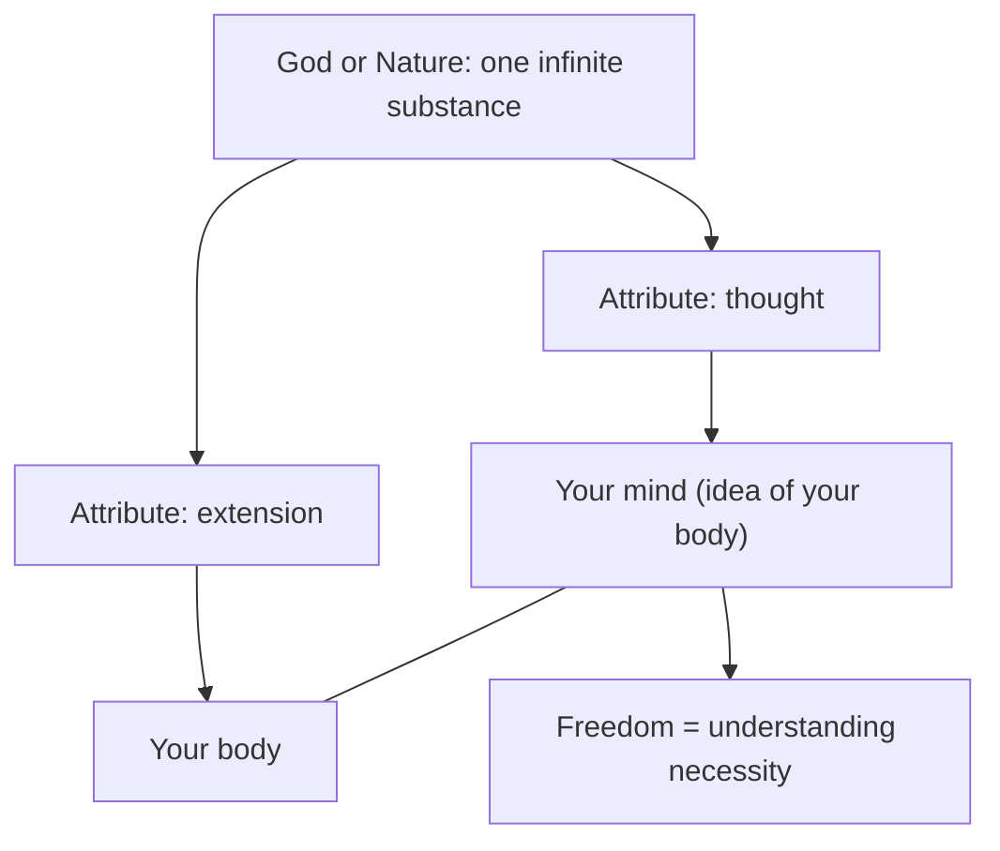

# Baruch Spinoza

**Prerequisites:** [Rationalism](../03-rationalism.md), [Descartes](rene-descartes.md)

@@IMG@@

## Life and context

Baruch (Bento, later Benedictus) de Spinoza (1632–1677) was born in Amsterdam into a community of Portuguese Jews whose families had fled the Inquisition. He was educated in the community's schools and worked in the family import business. In July 1656, aged 23, he was placed under a *herem*, a ban of excommunication, by the synagogue's leaders, in unusually severe terms, for "abominable heresies" and "monstrous deeds" that the document does not specify. He never returned. He lived modestly in and around Leiden and The Hague, earned part of his living grinding lenses for microscopes and telescopes, corresponded with scientists, and declined a professorship at Heidelberg in 1673 to keep his freedom. The *Theological-Political Treatise* (1670), published anonymously, caused a scandal. His masterpiece, the [*Ethics*](../texts/spinoza-ethics.md), appeared only after his death from a lung disease, likely worsened by glass dust, at 44.

## Core ideas

**One substance.** A substance is what exists in itself and is conceived through itself. Spinoza argues that there can be only one, which is infinite and has infinitely many attributes: God, or Nature (*Deus sive Natura*). Everything else is a "mode", a way that substance is. You and this page are modifications of God.

**Mind and body.** We know two of God's attributes: thought and extension. They are not two things but two expressions of one reality. The mind is the idea of the body. This dissolves the Cartesian interaction problem: mind and body do not interact because they are the same thing conceived in two ways (often called "parallelism" or dual-aspect monism).

**Necessity and freedom.** Everything follows necessarily from God's nature, as the properties of a triangle follow from its definition. There is no purpose in nature and no free will in the sense of uncaused choice; we think we are free because we are aware of our desires but ignorant of their causes. True freedom is acting from the necessity of one's own nature, guided by understanding.

**Emotions.** Each thing strives to persevere in its being; this striving (*conatus*) is its essence. Joy is an increase in our power, sadness a decrease. Passive emotions (passions) arise from inadequate ideas; understanding them transforms them into active ones. The highest good is the "intellectual love of God", understanding everything as following from God, which brings lasting peace of mind.

**Politics and religion.** The *Theological-Political Treatise* argued that scripture teaches obedience and charity, not philosophy; read historically, the Bible shows signs of multiple authors. The state should allow freedom of thought and speech, since the purpose of the state is really freedom.

## Influence and criticism

Spinoza was denounced for a century as an atheist. In the 1780s the "pantheism controversy" in Germany revived him; Goethe, Novalis (who called him a "God-intoxicated man") and the German idealists embraced him. Hegel told his students, in effect, that one must either be a Spinozist or not a philosopher at all. Einstein, asked about God, said he believed in "Spinoza's God". [Nietzsche](../../nineteenth-century/thinkers/friedrich-nietzsche.md) recognized a predecessor. His naturalism appeals to modern scientists and his theory of the passions to psychologists. Critics question whether his God is God in any religious sense, whether his strict necessitarianism leaves room for moral responsibility, and whether the geometrical method can deliver what it claims.

## Key ideas

- There is one substance, God or Nature, of which everything is a mode.
- Mind and body are one thing under two attributes.
- Everything is necessary; freedom is understanding and acting from one's own nature.
- Understanding transforms passions; the highest good is the intellectual love of God.

## Where this leads

- Text: [*Ethics*](../texts/spinoza-ethics.md)
- Next thinker: [John Locke](john-locke.md)
- Forward: [German idealism](../../nineteenth-century/01-german-idealism.md), [Nietzsche](../../nineteenth-century/thinkers/friedrich-nietzsche.md)
- Back: [Maimonides](../../../medieval/thinkers/maimonides.md); [the Stoic life according to nature](../../../../concepts/ethics/living-according-to-nature.md)
- Glossary: [pantheism](../../../../glossary/modern/pantheism.md), [conatus](../../../../glossary/modern/conatus.md)
