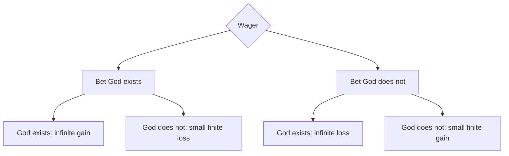

# Blaise Pascal

**Prerequisites:** [[rationalism|Rationalism]], [[michel-de-montaigne|Montaigne]]

@@IMG@@

## Life and context

Blaise Pascal (1623–1662) was born in Clermont (now Clermont-Ferrand) and educated at home by his father, a tax official with scientific interests. A prodigy, he wrote a treatise on conic sections at sixteen and built a calculating machine (the Pascaline) to help with his father's tax arithmetic. He carried out experiments on the vacuum and air pressure (his brother-in-law measured the drop in a mercury column climbing the Puy de Dôme in 1648) and, in correspondence with Pierre de Fermat in 1654, laid foundations of probability theory. His family came under the influence of Jansenism, an Augustinian movement in French Catholicism centred on the convent of Port-Royal. On the night of 23 November 1654 he had an intense religious experience, recorded on a parchment (the "Memorial") sewn into his coat and found after his death: "Fire. God of Abraham, God of Isaac, God of Jacob, not of the philosophers and scholars." He defended the Jansenists against the Jesuits in the *Provincial Letters* (1656–57) and worked on an apology for Christianity that he did not live to finish. He died at 39. The notes were published as the [[pensees|*Pensées*]].

## Core ideas

**The human condition.** Humans are a paradox: greatness and wretchedness. "Man is only a reed, the weakest in nature, but he is a thinking reed." The universe can crush us, but we know that we die, and it knows nothing. Placed between two infinities, the infinitely large and the infinitely small, we cannot grasp either end. "The eternal silence of these infinite spaces frightens me."

**Diversion.** Unable to cure death, misery and ignorance, people decide not to think about them. Hunting, gambling, war and business are valued less for their prizes than for keeping us from sitting quietly alone in a room, which, Pascal says, is the source of all human unhappiness.

**Reason and the heart.** Reason has limits. First principles (space, time, motion, number) are known by the "heart", by intuition, not demonstration. "The heart has its reasons, which reason does not know." This does not mean feelings beat thought, but that there are modes of knowing deeper than proof.

**The wager.** Reason cannot settle whether God exists. But you must wager; not choosing is itself a choice. Weigh the gain and loss: if you bet on God and God exists, you gain an infinite good; if not, you lose little. So bet that God exists, and if you cannot believe, act as believers do (take holy water, have masses said) and belief may follow.

**The esprit de géométrie and esprit de finesse.** The mathematical mind reasons from few, clear principles; the intuitive mind grasps many subtle principles at once. Both are needed.

## Influence and criticism

The wager is a founding example of decision theory, reasoning about expected value under uncertainty, and it remains heavily debated. Critics object that it applies equally to many gods (the "many gods" objection), that a God would not reward belief adopted for gain, and that one cannot believe at will (Pascal himself addressed the last point with his advice to act as if). [[voltaire|Voltaire]] attacked the *Pensées* as a gloomy misanthropy. [[soren-kierkegaard|Kierkegaard]], [[fyodor-dostoevsky|Dostoevsky]] and the existentialists recognized in him a precursor. T. S. Eliot admired him as a master of French prose.

## Key ideas

- Humans are a paradox of greatness and misery, a thinking reed between two infinities.
- People flee from their condition through diversion.
- The heart knows first principles that reason cannot prove.
- The wager argues that betting on God is the rational choice under uncertainty.

## Where this leads

- Text: [[pensees|*Pensées*]]
- Next thinker: [[baruch-spinoza|Baruch Spinoza]]
- Forward: [[soren-kierkegaard|Kierkegaard]], [[existential-beginnings|the existential beginnings]]
- Glossary: [[g:pascals-wager|Pascal's wager]]
- Related: [[fin:01-foundations|finance foundations]], where expected value reappears
