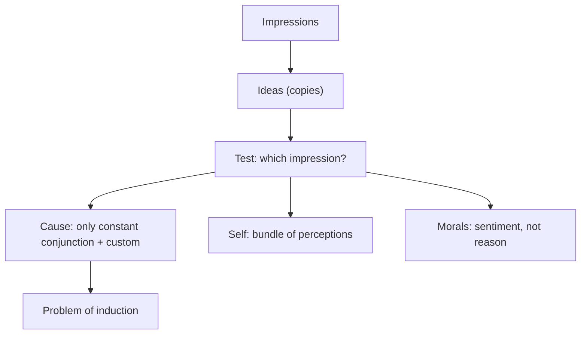

# David Hume

**Prerequisites:** [[empiricism|Empiricism]], [[john-locke|Locke]], [[george-berkeley|Berkeley]]

@@IMG@@

## Life and context

David Hume (1711–1776) was born in Edinburgh and grew up at the family estate of Ninewells in the Scottish Borders. He entered Edinburgh University very young, tried and abandoned law, suffered a period of depression, and went to France, where at La Flèche (Descartes' old school) he wrote [[treatise-of-human-nature|*A Treatise of Human Nature*]] (1739–40). It "fell dead-born from the press", he later wrote. He recast its ideas in more accessible essays and the two *Enquiries* (1748, 1751). His reputation for irreligion cost him professorships at Edinburgh and Glasgow. He worked as a tutor, secretary and diplomat, was librarian of the Advocates' Library in Edinburgh, and wrote a best-selling *History of England*. In Paris in the 1760s he was celebrated in the salons ("le bon David"). He befriended and then quarrelled with Rousseau. His close friend [[adam-smith|Adam Smith]] described his calm death, despite the visitors who expected deathbed terror from an unbeliever. *Dialogues Concerning Natural Religion* appeared posthumously in 1779.

## Core ideas

**The science of man.** Hume aimed to do for the mind what Newton did for nature: explain its operations by a few principles. The subtitle of the *Treatise* is "an attempt to introduce the experimental method of reasoning into moral subjects".

**Impressions and ideas.** All perceptions are impressions (vivid) or ideas (faint copies). To test a concept, ask from which impression it derives.

**Causation.** We observe constant conjunction, not necessary connection. After repeated experience, the mind moves by custom from cause to expected effect; the feeling of that transition is the source of our idea of necessity.

**Induction.** Reasoning from past to future presupposes that nature is uniform, which cannot be proved without circularity. "Custom, then, is the great guide of human life."

**The self.** Introspection reveals only a bundle of perceptions in flux.

**Reason and passion.** "Reason is, and ought only to be the slave of the passions" (*Treatise* 2.3.3). Reason informs us about means and facts; only desire moves us.

**Morals from sentiment.** Moral distinctions come from sentiments of approval and disapproval, rooted in sympathy, not from reason. Hume also observed that authors slide from "is" to "ought" without explanation.

**Religion.** "Of Miracles" argues that the evidence for a miracle could never outweigh the uniform experience that establishes a law of nature. The *Dialogues* subject the argument from design to devastating criticism.

## Influence and criticism

Hume woke [[immanuel-kant|Kant]] from his "dogmatic slumber". His views on causation, induction and the is–ought gap shaped logical positivism and much of analytic philosophy; his sentimentalism is a source for modern moral psychology. His friendship with Smith and his economic essays link him to [[dir:economics/microeconomics/10-history-of-thought|economic thought]]. Thomas Reid, his Scottish critic, defended common sense against his "ideal theory". Hume is also rightly criticized for a racist footnote, added in 1753 to his essay "Of National Characters", which later critics have examined in detail.

## Key ideas

- All ideas copy impressions; this test deflates causation, the self and substance.
- Causal necessity is projected custom; induction cannot be rationally justified.
- Reason serves the passions; morality rests on sentiment.
- His critiques of miracles and design reshaped philosophy of religion.

## Where this leads

- Text: [[treatise-of-human-nature|*A Treatise of Human Nature* and the *Enquiries*]]
- Next thinker: [[voltaire|Voltaire]]
- Forward: [[kants-copernican-revolution|Kant's reply]]; [[philosophy-of-science|Popper on induction]]
- Glossary: [[g:problem-of-induction|problem of induction]], [[g:is-ought-gap|is–ought gap]], [[g:bundle-theory|bundle theory]]
