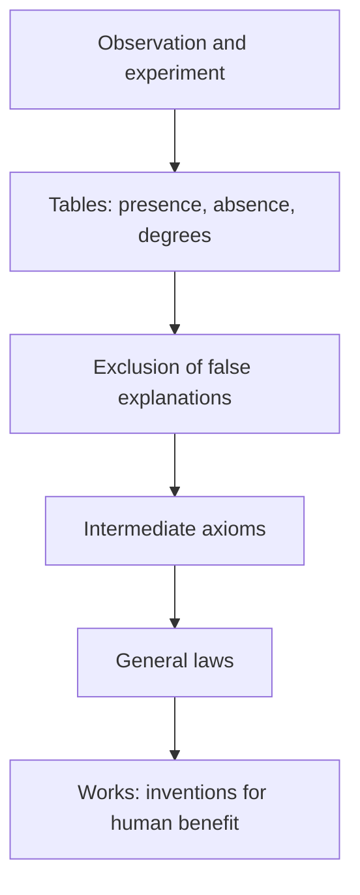

# Francis Bacon

**Prerequisites:** [The scientific revolution](../02-scientific-revolution-and-method.md); [induction](../../../../glossary/general/induction.md)

@@IMG@@

## Life and context

Francis Bacon (1561–1626) was born in London, son of Sir Nicholas Bacon, Lord Keeper of the Great Seal under Elizabeth I. He studied at Trinity College, Cambridge, where he formed a lasting dislike of the Aristotelian curriculum, and trained as a lawyer. His political career was slow under Elizabeth and rapid under James I: Solicitor General, Attorney General, Lord Keeper and in 1618 Lord Chancellor, with the titles Baron Verulam and Viscount St Alban. In 1621 Parliament charged him with accepting bribes from litigants; he admitted the charges, was fined and briefly imprisoned, and spent his last years writing. According to a story told by John Aubrey, he died after catching a chill while stuffing a chicken with snow to see whether cold would preserve it.

## The Great Instauration

Bacon planned a vast work, the *Great Instauration* ("great renewal"), to rebuild human knowledge. Only parts were completed: *The Advancement of Learning* (1605), the [*Novum Organum*](../texts/novum-organum.md) (1620), and natural histories. *New Atlantis* (published 1627) describes an imagined island ruled by a research institution, Salomon's House.

## Core ideas

**Knowledge is power.** The aim of knowledge is not disputation but works: inventions and improvements that relieve human misery. Nature to be commanded must be obeyed, that is, understood.

**The idols of the mind.** Before the mind can learn, it must be cleared of four kinds of distortion:
- **Idols of the tribe:** errors common to human nature, such as seeing more order than exists and noticing confirming cases while ignoring the rest.
- **Idols of the cave:** an individual's quirks of temperament and education.
- **Idols of the marketplace:** confusions caused by words.
- **Idols of the theatre:** the dogmas of philosophical systems, which are like stage plays.

**True induction.** Aristotelian induction, Bacon thought, leapt from a few particulars straight to the most general axioms. The new method climbs gradually. One compiles tables of presence (cases where a phenomenon occurs), absence (similar cases where it does not) and degrees, then excludes candidate explanations until the true "form" appears. Negative instances are especially important. His worked example is heat, which he concludes is a kind of motion.

## Influence and criticism

The founders of the Royal Society (1660) treated Bacon as their patron saint, and the Enlightenment *Encyclopédie* honoured him as a founder of modern knowledge. Critics point out that his method underrated mathematics and the role of bold hypotheses, which were central to Galileo, Kepler and Newton; [Karl Popper](../../twentieth-century/thinkers/karl-popper.md) in particular argued that science advances by conjecture and refutation, not by collecting instances. Twentieth-century critics such as Horkheimer and Adorno, and some environmental thinkers, saw in his language of commanding nature the roots of a domineering attitude to the natural world; others think those readings exaggerate.

## Key ideas

- The aim of knowledge is practical benefit: "knowledge is power".
- The mind must be cleared of the idols of tribe, cave, marketplace and theatre.
- Science should proceed by gradual, organized induction that pays special attention to negative instances.
- He became the emblem of experimental science, and is criticized for underrating mathematics and hypothesis.

## Where this leads

- Text: [*Novum Organum*](../texts/novum-organum.md)
- Next thinker: [René Descartes](rene-descartes.md)
- Forward: [Empiricism](../04-empiricism.md); [Popper and Kuhn](../../twentieth-century/06-philosophy-of-science.md)
- Related: [heuristics and biases](../../../../../economics/microeconomics/09-behavioural-economics/03-heuristics-and-biases.md), a modern study of the idols of the tribe
