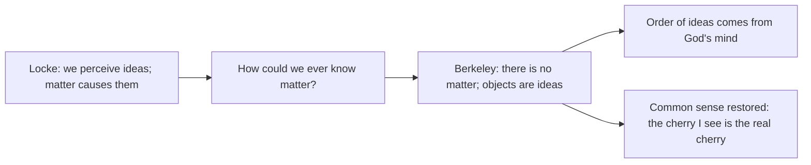

# George Berkeley

**Prerequisites:** [Empiricism](../04-empiricism.md), [Locke](john-locke.md)

@@IMG@@

## Life and context

George Berkeley (1685–1753) was born in County Kilkenny, Ireland, and educated at Trinity College Dublin, where he became a fellow. In his twenties he published his main philosophical works: *An Essay Towards a New Theory of Vision* (1709), *A Treatise Concerning the Principles of Human Knowledge* (1710) and *Three Dialogues between Hylas and Philonous* (1713). He then travelled in Europe and became Dean of Derry. In 1728 he sailed to Rhode Island to wait for promised government funding for a college in Bermuda to educate colonists' sons and Native Americans; the money never came, and he returned in 1731. During his stay he owned enslaved people, a fact now acknowledged by institutions that bear his name. From 1734 he was Bishop of Cloyne in Ireland, where he promoted tar-water as a medicine in his strange late book *Siris*. The University of California at Berkeley is named after him, after a line of his poem about America.

## Core ideas

**The target.** Berkeley thought the scientific picture of a world of unperceived material particles, accepted by Locke, led to skepticism (we can never compare our ideas with matter) and atheism (matter might seem to run itself).

**Ideas only.** What do we perceive? Colours, shapes, sounds, textures: ideas. A cherry is a collection of such ideas. The arguments Locke used to show that colours exist only in the mind (they vary with the perceiver) work equally for shape and size.

**Against abstract ideas.** Locke believed we can form an abstract idea of a triangle that is neither scalene nor isosceles. Berkeley denied it: every idea is particular; general words get their generality from standing for many particulars. Matter, an unperceivable substance without sensible qualities, is the most empty abstraction of all.

**Esse est percipi.** For unthinking things, to be is to be perceived (*esse est percipi*). Minds, which perceive, are the other kind of thing that exists (*esse est percipere*).

**God.** The ideas of sense are not produced by my will; they come in regular order. Their cause must be a mind: God. Objects persist when I leave the room because God perceives them, and the "laws of nature" are the regular way God produces ideas in us.

## Influence and criticism

Samuel Johnson famously "refuted" Berkeley by kicking a stone, as Boswell records, which misses the point, since Berkeley never denied that stones feel solid. Hume admired Berkeley's attack on abstract ideas and turned his arguments to skeptical uses. His *New Theory of Vision* was an important early work in the psychology of perception, and his critique of Newton's absolute space and of infinitesimals in calculus (*The Analyst*, 1734) was taken seriously by mathematicians and later by Ernst Mach. Critics argue that immaterialism has trouble explaining the continuity of the world without leaning heavily on God, and that the move from "we perceive ideas" to "only ideas exist" is invalid.

## Key ideas

- Objects are collections of ideas; to be is to be perceived.
- Abstract general ideas, including the idea of matter, are impossible.
- God's perception and will explain the persistence and order of the world.
- He saw immaterialism as a defence of common sense and religion.

## Where this leads

- Next thinker: [David Hume](david-hume.md)
- Glossary: [immaterialism](../../../../glossary/modern/immaterialism.md), [idealism](../../../../glossary/general/idealism.md)
- Back: [universals and nominalism](../../../medieval/04-universals-and-nominalism.md)
- Forward: [German idealism](../../nineteenth-century/01-german-idealism.md), a very different idealism
