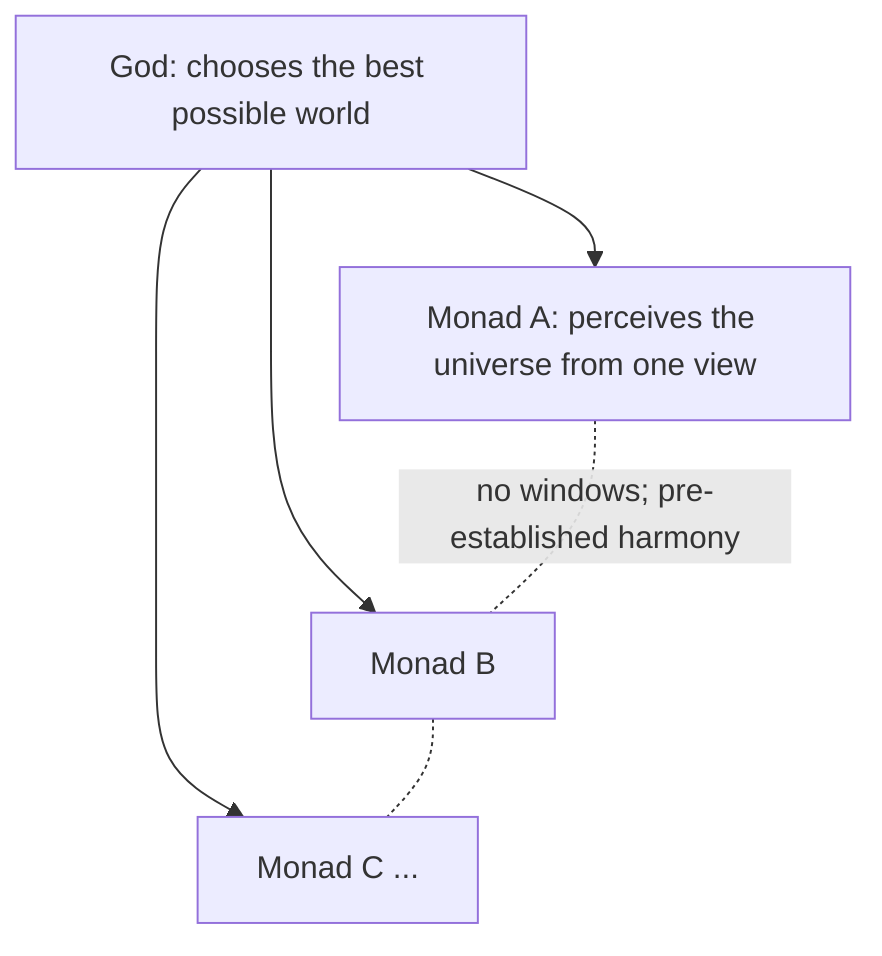

# Gottfried Wilhelm Leibniz

**Prerequisites:** [[rationalism|Rationalism]], [[baruch-spinoza|Spinoza]]

@@IMG@@

## Life and context

Gottfried Wilhelm Leibniz (1646–1716) was born in Leipzig, the son of a professor of moral philosophy. He read widely in his late father's library as a boy, took a doctorate in law at Altdorf in 1667, and declined an academic career for service at courts. From 1672 to 1676 he was in Paris on a diplomatic mission, where he learned advanced mathematics from Christiaan Huygens and developed the calculus. On his way back he visited Spinoza in The Hague. For the last forty years of his life he served the dukes of Brunswick-Lüneburg in Hanover as librarian, adviser and historian of the house. He founded the Berlin Academy of Sciences, designed a calculating machine, worked on mining pumps, pursued church reunion between Catholics and Protestants, and corresponded with hundreds of scholars. He wrote mostly in letters and short essays; his only large book published in his lifetime was the *Theodicy* (1710). A bitter dispute with Newton's supporters over who invented calculus clouded his last years. He died in Hanover with little ceremony.

## Core ideas

**Two great principles.** All reasoning rests on the **principle of contradiction** (whatever implies a contradiction is false) and the **[[g:principle-of-sufficient-reason|principle of sufficient reason]]** (nothing is so without a reason why it is so and not otherwise).

**Monads.** Bodies are infinitely divisible, so they cannot be the ultimate realities. Those must be simple, without parts, and so without extension: monads. Each monad is a centre of activity whose states are perceptions and whose tendencies to change are appetitions. Monads have "no windows": nothing enters or leaves them. Each mirrors the entire universe from its own point of view, with varying clarity. See [[monadology|*Monadology*]].

**Pre-established harmony.** If monads do not interact, why do the mind's decisions match the body's movements? Because God set them up from the start like two clocks keeping perfect time. This was his answer to the mind–body problem.

**Identity of indiscernibles.** No two things can be exactly alike; if they shared every property they would be one thing.

**Truths of reason and of fact.** Truths of reason are necessary; their opposite is impossible (mathematics, logic). Truths of fact are contingent; their opposite is possible, and they rest on sufficient reason, ultimately on God's choice.

**The best of all possible worlds.** God, being perfectly good, wise and powerful, surveyed infinitely many possible worlds and created the best. Evil exists because the best world as a whole contains it, as a painting needs shadows. This is the theodicy that [[voltaire|Voltaire]] parodied in [[candide|*Candide*]].

## Influence and criticism

Leibniz's notation for calculus (dx, ∫) is the one used today. His dream of a universal symbolic language and a "calculus of reasoning" anticipated modern logic and computing; he also worked out binary arithmetic. His metaphysics, systematized by Christian Wolff, dominated German universities in the eighteenth century and formed the background against which [[immanuel-kant|Kant]] worked. Critics have found monads strange and pre-established harmony ad hoc; Russell, who wrote a book on him, argued that his best philosophy was in his unpublished logical papers. The idea of "possible worlds" returned in twentieth-century modal logic.

## Key ideas

- The principles of contradiction and sufficient reason govern all reasoning.
- Reality consists of simple, windowless monads, each mirroring the universe.
- Mind and body agree by pre-established harmony, not interaction.
- This is the best of all possible worlds, a claim Voltaire mocked.

## Where this leads

- Text: [[monadology|*Monadology*]]
- Next thinker: [[george-berkeley|George Berkeley]]
- Forward: [[kants-copernican-revolution|Kant]], [[candide|*Candide*]]
- Glossary: [[g:monad|monad]], [[g:theodicy|theodicy]]
