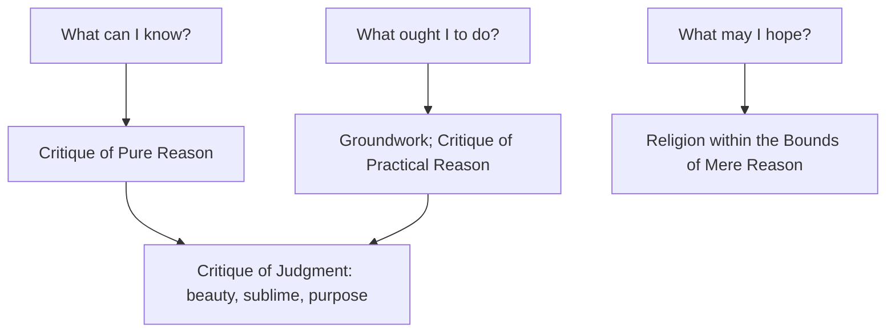

# Immanuel Kant

**Prerequisites:** [[kants-copernican-revolution|Kant's Copernican revolution]]

@@IMG@@

## Life and context

Immanuel Kant (1724–1804) was born in Königsberg, East Prussia (now Kaliningrad, Russia), to a harness-maker's family shaped by Pietism, a devout Lutheran movement. He studied at the university there, worked as a private tutor, and from 1755 taught as an unsalaried lecturer on an enormous range of subjects: logic, metaphysics, physics, geography, anthropology. In 1770, aged 46, he became professor of logic and metaphysics. He reputedly never travelled more than a few dozen miles from Königsberg, and his punctual daily walk became legendary. His early work was in natural science; his 1755 theory that the solar system formed from a rotating nebula anticipated Laplace. Then came eleven years of near silence, and from 1781 the series of works that transformed philosophy. A dispute with the Prussian censor in the 1790s over his writings on religion led him to promise not to publish further on the subject during the king's lifetime.

## The critical philosophy

Kant's three *Critiques* ask what reason can know, what it ought to do, and how judgment links the two.

**[[critique-of-pure-reason|*Critique of Pure Reason*]] (1781, revised 1787).** How is synthetic a priori knowledge possible? Space and time are forms of intuition; categories such as causality are concepts the understanding brings to experience. We know appearances, not things in themselves. Reason going beyond experience falls into illusion: proofs about the soul, the world as a whole and God fail. See [[kants-copernican-revolution|the lesson]].

**[[groundwork-of-the-metaphysics-of-morals|*Groundwork of the Metaphysics of Morals*]] (1785) and *Critique of Practical Reason* (1788).** The only thing good without qualification is a good will. An action has moral worth when done from duty, not inclination. Moral laws must be categorical (binding regardless of what you want), unlike hypothetical imperatives ("if you want X, do Y"). The categorical imperative: act only on a maxim you can will as a universal law; treat humanity always as an end and never merely as a means; act as a member of a kingdom of ends. Morality presupposes freedom, autonomy: the rational will gives itself the moral law. Though God, freedom and immortality cannot be proved, practical reason may postulate them.

**Critique of Judgment (1790).** Aesthetic judgments of beauty claim universal agreement without resting on concepts ("disinterested" pleasure); the sublime is the feeling of reason's superiority in the face of overwhelming nature. The book also treats purposiveness in living things.

## Politics and history

In "What Is Enlightenment?" (1784) Kant defined enlightenment as leaving self-incurred immaturity. In *Toward Perpetual Peace* (1795) he proposed republican constitutions, a federation of free states and a "cosmopolitan right" of hospitality, ideas later linked to the League of Nations and theories of democratic peace.

## Influence and criticism

Kant is a hinge of modern philosophy: almost everything after him reacts to him. [[german-idealism|German idealism]] tried to complete his system; [[arthur-schopenhauer|Schopenhauer]] claimed to fulfil it; neo-Kantianism dominated German universities before 1914; [[john-rawls|Rawls]] built a Kantian political philosophy. Critics have attacked the unknowable thing in itself (Jacobi: without it one cannot enter the system, with it one cannot stay), the rigour of his ethics (his claim that one may not lie even to a murderer asking where a friend is hiding), and its neglect of emotion and consequences. Scholars have also examined his writings on race, which ranked human groups hierarchically, and debated how they relate to his universalist ethics.

## Key ideas

- Experience is structured by our forms of intuition and categories; we know appearances, not things in themselves.
- Reason beyond experience produces illusion, but leaves room for faith and freedom.
- Morality is autonomy: the categorical imperative binds every rational being.
- His aesthetics, politics and cosmopolitanism remain influential.

## Where this leads

- Texts: [[critique-of-pure-reason|*Critique of Pure Reason*]], [[groundwork-of-the-metaphysics-of-morals|*Groundwork*]]
- Next era: [[german-idealism|German idealism]]
- Forward: [[arthur-schopenhauer|Schopenhauer]], [[john-rawls|Rawls]]
- Glossary: [[g:categorical-imperative|categorical imperative]], [[g:thing-in-itself|thing in itself]], [[g:transcendental-idealism|transcendental idealism]], [[g:autonomy|autonomy]]
