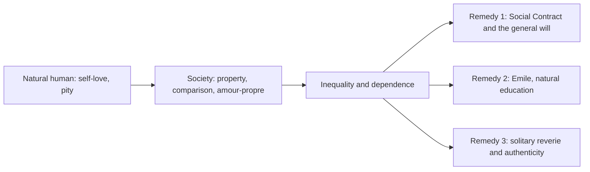

# Jean-Jacques Rousseau

**Prerequisites:** [[social-contract-and-the-state|The social contract]], [[enlightenment|The Enlightenment]]

@@IMG@@

## Life and context

Jean-Jacques Rousseau (1712–1778) was born in Geneva, a Protestant city-republic he always called his own, to a watchmaker; his mother died days after his birth. Apprenticed to an engraver, he ran away at fifteen and was taken in by Madame de Warens in Savoy, who arranged his conversion to Catholicism. He worked as a tutor, music copyist and secretary, devised a new musical notation, and in Paris became friends with Diderot. In 1749, walking to visit Diderot in prison at Vincennes, he read of an essay competition asking whether the restoration of the arts and sciences had improved morals, and, by his account, had a sudden "illumination". His *Discourse on the Sciences and Arts* (1750), answering no, won the prize and made him famous. With his companion Thérèse Levasseur he had five children, all placed in the Paris foundling hospital, a fact his enemies later publicized and he himself confessed. In 1762 both [[the-social-contract|*The Social Contract*]] and *Emile* were condemned in Paris and Geneva; he fled, spent years in exile (including a stay in England arranged by Hume that ended in a famous quarrel) and grew increasingly suspicious of plots against him. His *Confessions* and *Reveries of the Solitary Walker* appeared after his death.

## Core ideas

**Natural goodness.** In the *Discourse on the Origin of Inequality* (1755) Rousseau imagines natural humans as solitary, with few needs, moved by *amour de soi* (healthy self-preservation) and pity. Corruption begins with settled life, comparison and *amour-propre*, the self-love that depends on others' opinion. The first man who enclosed a piece of land and said "this is mine" and found people simple enough to believe him was the true founder of civil society, and of crime, war and misery.

**The general will.** *The Social Contract* (1762) asks how people can unite in a society and still remain as free as before. Answer: each gives himself entirely to the community, which then expresses a **general will** aimed at the common good, distinct from the sum of private wills. Obeying laws one has given oneself is freedom. Whoever refuses to obey the general will shall be "forced to be free", one of the most debated phrases in political philosophy.

**Education.** *Emile, or On Education* (1762) proposes an education that follows the child's natural development, learning from things rather than books, protecting the child from premature social vanity. Book IV includes "The Profession of Faith of the Savoyard Vicar", a natural religion of conscience that got the book burned. Book V's account of the education of girls, subordinate to men, was attacked by Mary Wollstonecraft.

**The self.** The *Confessions* opens by declaring an enterprise without precedent: to show a man in all the truth of nature, and that man himself.

## Influence and criticism

Rousseau inspired the French revolutionaries (Robespierre revered him), Kant (who said Rousseau taught him to honour humanity), Romanticism, modern ideas of authenticity, and progressive education. Critics from Benjamin Constant to Isaiah Berlin and Jacob Talmon have argued that the general will, with its "forced to be free", supplied a template for totalitarian democracy; defenders reply that Rousseau insisted on law, equality and small republics. His treatment of women and his own abandoned children are frequently raised against his moral authority.

## Key ideas

- Humans are naturally good; society, property and comparison corrupt them.
- Legitimate government expresses the general will, in which obeying the law is freedom.
- Education should follow nature; the self should be shown in its truth.
- He inspired revolution, Romanticism and Kant, and is accused of authoritarian implications.

## Where this leads

- Text: [[the-social-contract|*The Social Contract*]]
- Next thinker: [[adam-smith|Adam Smith]]
- Forward: [[immanuel-kant|Kant]], [[karl-marx|Marx]] on inequality
- Glossary: [[g:general-will|general will]], [[g:amour-propre|amour-propre]]
