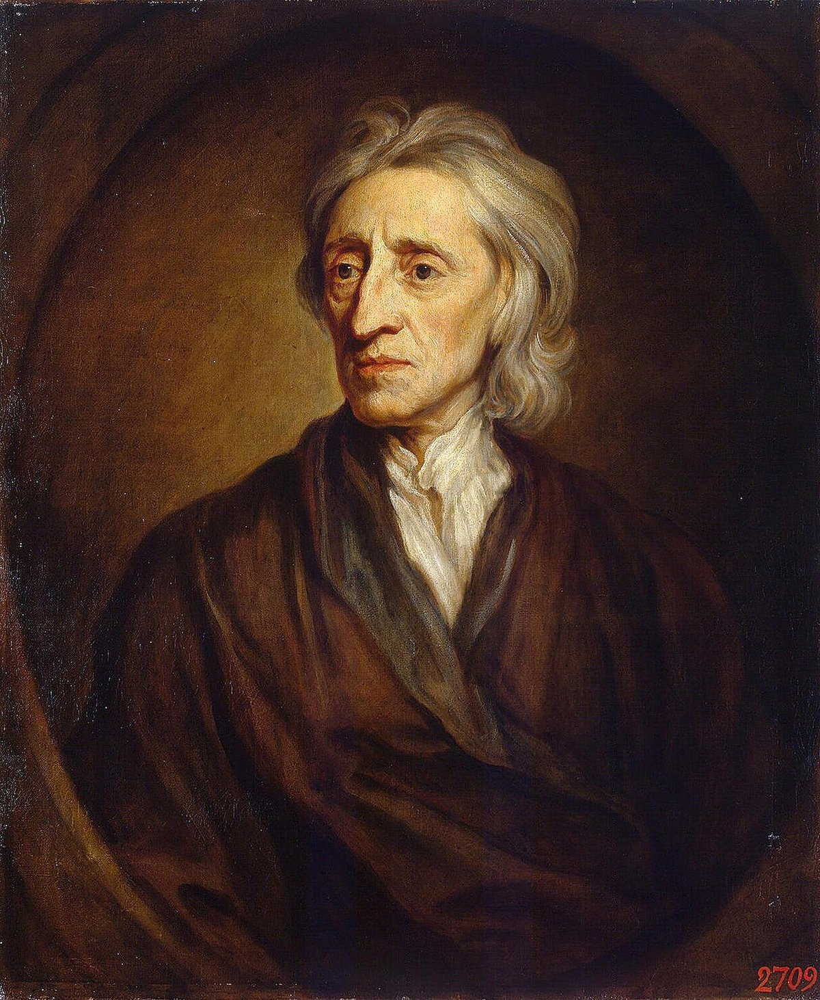
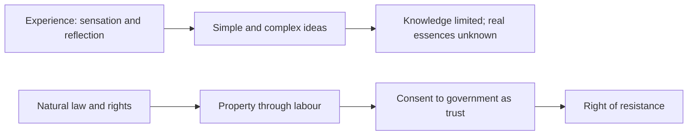

# John Locke

**Prerequisites:** [Empiricism](../04-empiricism.md), [The social contract](../05-social-contract-and-the-state.md)

*Godfrey Kneller, portrait of John Locke (1697), Hermitage Museum. Credit: Godfrey Kneller. License: Public domain. Source: [File:Godfrey Kneller - Portrait of John Locke (Hermitage).jpg](https://commons.wikimedia.org/wiki/File:Godfrey_Kneller_-_Portrait_of_John_Locke_(Hermitage).jpg).*

## Life and context

John Locke (1632–1704) was born in Wrington, Somerset, the son of a lawyer who fought on the Parliamentary side in the Civil War. He studied at Westminster School and Christ Church, Oxford, where he found scholastic philosophy tedious and turned to medicine and experimental science, working with Robert Boyle. In 1667 he joined the household of Anthony Ashley Cooper, later the first Earl of Shaftesbury, as physician and adviser, and once supervised a risky operation on Shaftesbury's liver. Shaftesbury led the opposition to the Catholic heir James; after his fall Locke went into exile in the Netherlands (1683–1689). He returned after the Glorious Revolution of 1688 and in 1689–90 published the [*Essay Concerning Human Understanding*](../texts/essay-concerning-human-understanding.md), the *Two Treatises of Government* (anonymously) and *A Letter Concerning Toleration*. He also wrote on education, money and the reasonableness of Christianity.

## Core ideas: knowledge

**Against innate ideas.** If there were innate principles, all people, including children, would assent to them. They do not.

**Ideas from experience.** All ideas come from sensation or reflection. Simple ideas are combined into complex ones (substances, modes, relations).

**Qualities.** Primary qualities (solidity, extension, shape, motion, number) are in the objects and resemble our ideas; secondary qualities (colours, sounds, tastes) are powers in objects to cause ideas that do not resemble them.

**Substance and essence.** We suppose a substratum supporting qualities, but our idea of it is only of "something, I know not what". The "real essence" of gold, its inner constitution, is unknown; we sort things by "nominal essences", the ideas we attach to words.

**Personal identity.** What makes me the same person over time is not the same soul or body but continuity of consciousness: memory reaching back to past actions. This view started the modern debate on personal identity.

## Core ideas: politics

**Natural rights.** In the state of nature people are free and equal, bound by a natural law that forbids harming another in life, health, liberty or possessions.

**Property.** Everyone owns his own person. By mixing labour with unowned things, one makes them one's own, provided "enough, and as good" is left for others and nothing spoils.

**Consent and limited government.** People form civil society to secure their property (in the broad sense of life, liberty and estate). Government holds power in trust; when it acts against that trust, the people may resist.

**Toleration.** The state's concern is civil goods; it cannot compel belief, since force cannot produce genuine faith. Locke excluded atheists and, for political reasons, Catholics from full toleration.

## Influence and criticism

Locke's *Essay* set the agenda for [Berkeley](george-berkeley.md) and [Hume](david-hume.md) and shaped the French Enlightenment through Voltaire. His political ideas influenced the American founders; the Declaration of Independence echoes "life, liberty" and the right to alter or abolish government. Critics note his investment in the Royal African Company and his involvement in drafting the *Fundamental Constitutions of Carolina*, which entrenched slavery, and they argue that his labour theory of property was used to justify colonial dispossession of Indigenous peoples. Philosophers have objected that memory cannot constitute identity without circularity (Joseph Butler) and that the primary/secondary distinction does not survive Berkeley's critique.

## Key ideas

- All ideas come from experience; the mind begins as a blank slate.
- Primary qualities resemble ideas; secondary qualities do not; substance is "something I know not what".
- Personal identity consists in continuity of consciousness.
- Government is a trust to secure natural rights, resistible when it betrays that trust; toleration is a duty of the state.

## Where this leads

- Texts: [*Essay*](../texts/essay-concerning-human-understanding.md), [*Second Treatise*](../texts/second-treatise-of-government.md)
- Next thinker: [Leibniz](gottfried-wilhelm-leibniz.md)
- Glossary: [tabula rasa](../../../../glossary/modern/tabula-rasa.md), [natural rights](../../../../glossary/modern/natural-rights.md), [primary and secondary qualities](../../../../glossary/modern/primary-and-secondary-qualities.md)
- Related: [factor markets](../../../../../economics/microeconomics/06-factor-markets/README.md), where land, labour and capital return
