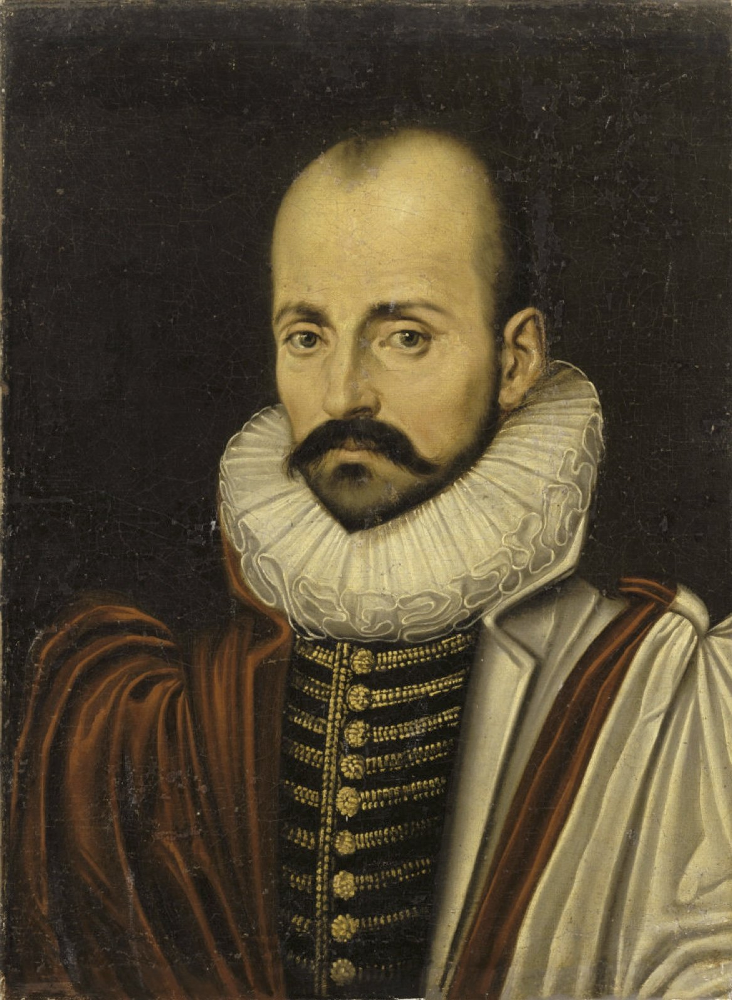
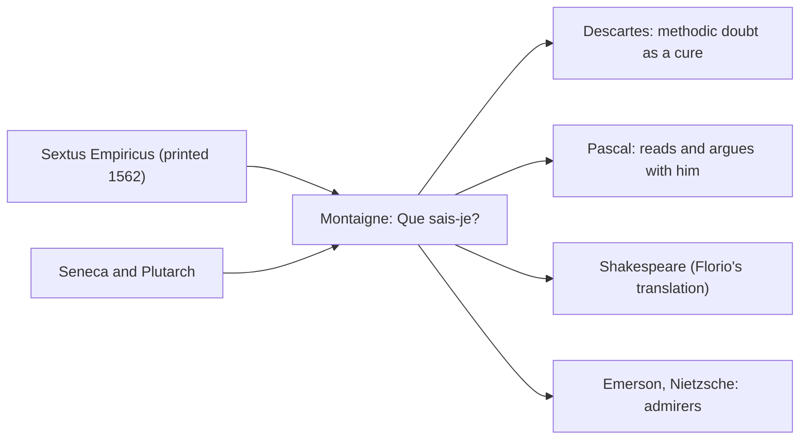

# Michel de Montaigne

**Prerequisites:** [Renaissance and humanism](../01-renaissance-and-humanism.md); [skepticism and epoché](../../../../concepts/epistemology/skepticism-and-epoche.md)

*Portrait of Michel de Montaigne. Credit: Unknown authorUnknown author. License: Public domain. Source: [File:Portrait of Michel de Montaigne, circa unknown.jpg](https://commons.wikimedia.org/wiki/File:Portrait_of_Michel_de_Montaigne,_circa_unknown.jpg).*

## Life and context

Michel Eyquem de Montaigne (1533–1592) was born at the Château de Montaigne near Bordeaux into a recently ennobled merchant family. His father had him taught Latin as his first language, by a tutor who spoke no French. He studied law, served as a magistrate in the Bordeaux parlement and formed an intense friendship with the writer Étienne de La Boétie, whose death in 1563 marked him deeply. In 1571, aged 38, he retired to his estate and his library tower, whose beams he had painted with sayings from ancient authors and scripture. There he began writing the *Essays*. He travelled through Germany and Italy in 1580–81, was twice elected mayor of Bordeaux, and acted as a go-between in the French Wars of Religion between Catholics and Protestants. He kept revising his book until his death.

## The essay

Montaigne invented a genre and named it: *essai* means "attempt" or "trial". His essays try out his judgment on any subject: cannibals, thumbs, idleness, friendship, cruelty, experience, coaches, smells. "I am myself the matter of my book," he tells the reader. Self-portrait is his method of inquiry: by studying one changeable human being honestly, he studies the human condition. See [the *Essays*](../texts/montaigne-essays.md).

## Core ideas

**Skepticism.** In the longest essay, the "Apology for Raymond Sebond", Montaigne deploys the arguments of [Pyrrho](../../../ancient/greek/thinkers/pyrrho.md) and [Sextus Empiricus](../../../ancient/greek/thinkers/sextus-empiricus.md) against human pride in reason. Animals may be wiser than we think; our senses mislead; custom varies; philosophers disagree endlessly. His motto, inscribed on a medal, was "*Que sais-je?*" ("What do I know?"). He drew from this not despair but modesty and a conservative acceptance of custom and religion, a stance later called "fideism".

**Custom and cultural relativity.** In "Of Cannibals" he describes Brazilian Tupinambá people (reported to him by a man who had lived there and some he met at Rouen) and concludes that each person calls barbarism whatever is not his own custom. He suggests that roasting enemies after death is less barbarous than the torture Europeans inflicted on living people in the name of religion.

**Cruelty.** He ranked cruelty as the extreme of all vices and wrote with unusual feeling against torture and the suffering of animals.

**Living well.** Influenced first by Stoicism ("To philosophize is to learn to die"), he moved toward a relaxed, Epicurean acceptance of ordinary life. The last essay, "Of Experience", ends in praise of living appropriately as a human being, without trying to be angels.

## Influence and criticism

The *Essays* were translated into English by John Florio in 1603, and Shakespeare used a passage from "Of Cannibals" in *The Tempest*. [Descartes](rene-descartes.md) set out to defeat the kind of doubt Montaigne entertained; [Pascal](blaise-pascal.md) read him obsessively and criticized his complacency. Emerson and Nietzsche admired his honesty. The Catholic Church placed the *Essays* on the Index in 1676. Critics have called his skepticism a recipe for political quietism; admirers see in it the roots of toleration and humane modesty.

## Key ideas

- Montaigne created the essay as a form of self-examination that tests judgment on any subject.
- He revived ancient skepticism ("What do I know?") as a cure for dogmatism, not as despair.
- He criticized ethnocentrism and cruelty and defended ordinary human life.

## Where this leads

- Text: [*Essays*](../texts/montaigne-essays.md)
- Next thinker: [Francis Bacon](francis-bacon.md)
- Forward: [Descartes](rene-descartes.md), [Pascal](blaise-pascal.md)
- Back: [Pyrrho](../../../ancient/greek/thinkers/pyrrho.md), [Seneca](../../../ancient/greek/thinkers/seneca.md)
