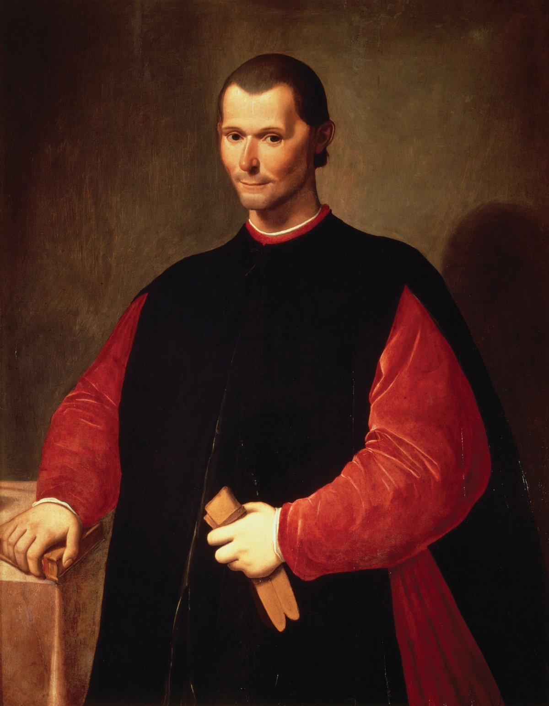
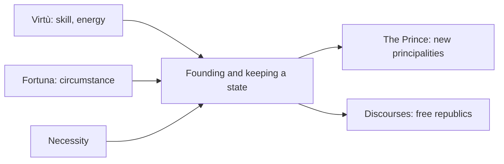

# Niccolò Machiavelli

**Prerequisites:** [Renaissance and humanism](../01-renaissance-and-humanism.md); helpful: [government by virtue](../../../../concepts/political/government-by-virtue.md), [the Legalist fa, shi, shu](../../../../concepts/political/fa-shi-shu.md)

*Santi di Tito, portrait of Niccolò Machiavelli (late 16th century). Credit: Santi di Tito. License: Public domain. Source: [File:Portrait of Niccolò Machiavelli by Santi di Tito.jpg](https://commons.wikimedia.org/wiki/File:Portrait_of_Niccolò_Machiavelli_by_Santi_di_Tito.jpg).*

## Life and context

Niccolò Machiavelli (1469–1527) was born in Florence and in 1498, after the fall of the preacher Savonarola, became secretary of the Second Chancery of the Florentine republic. For fourteen years he served on diplomatic missions to the French king, the emperor, the papal court and Cesare Borgia, whose ruthless campaign in the Romagna he watched closely. He organized a Florentine citizen militia. When the Medici returned to power in 1512, he lost his post; in 1513 he was arrested on suspicion of conspiracy, tortured, and released. In enforced retirement on his farm near San Casciano he wrote [*The Prince*](../texts/the-prince.md) (1513, published 1532) and the *Discourses on Livy*. He later wrote *The Art of War*, *Florentine Histories* and the comedy *Mandragola*.

## Core ideas

**The effectual truth.** In chapter 15 of *The Prince* he says that many have imagined republics and principalities never seen or known to exist, but he will go to the "effectual truth" of things. How one lives is so far from how one ought to live that whoever neglects what is done for what ought to be done learns his ruin rather than his preservation. This is the founding statement of political realism.

**Virtù and fortuna.** *Virtù* in Machiavelli is not moral virtue but the energy, skill and decisiveness by which a person shapes events. *Fortuna* is the play of circumstance, which he compares to a flooding river that can be prepared for with dykes and embankments. He thought fortune governs perhaps half of our actions and leaves the other half to us.

**Appearing virtuous.** A prince must learn to be able not to be good and use this according to necessity. It is good to seem merciful, faithful, humane, honest and religious, and even to be so, but to be ready to act otherwise. Whether it is better to be loved or feared: both, but if one must choose, it is safer to be feared, though the prince must avoid being hated.

**Republican liberty.** The *Discourses on Livy* show another Machiavelli: an admirer of the Roman republic, who argued that conflict between nobles and people, properly channelled, kept Rome free; that a citizen militia is better than mercenaries; and that the people are wiser and more constant than a prince.

## Influence and criticism

"Machiavellian" became a byword for cynical manipulation, and in Elizabethan drama "Machiavel" meant a scheming villain. The Catholic Church placed his works on the Index in 1559. Readings diverge sharply. Some see a teacher of evil (Leo Strauss); some a patriot calling for Italian unification, as in the final chapter of *The Prince*; some a scientist of politics; some a republican who wrote *The Prince* as satire or as a job application. Isaiah Berlin argued that his originality was to show that political and Christian values can be genuinely incompatible. Quentin Skinner and J. G. A. Pocock placed him in a tradition of civic republicanism that later influenced English and American republicans.

## Connections

Readers of Chinese philosophy will notice a resemblance to the Legalist [Han Feizi](../../../ancient/chinese/thinkers/han-feizi.md), who also separated statecraft from conventional morality. [Hobbes](thomas-hobbes.md) took up the realist view of human nature in a more systematic form.

## Key ideas

- Politics should be studied by its "effectual truth", not by imagined ideals.
- Success depends on *virtù* meeting *fortuna*; a ruler must be ready to act against conventional virtue when necessity demands.
- The *Discourses* defend republican liberty, civic conflict and citizen armies.
- His reputation ranges from teacher of evil to founder of political science and republican theorist.

## Where this leads

- Text: [*The Prince*](../texts/the-prince.md)
- Next thinker: [Montaigne](michel-de-montaigne.md)
- Forward: [Hobbes](thomas-hobbes.md), [The social contract](../05-social-contract-and-the-state.md)
- Comparison: [Han Feizi](../../../ancient/chinese/thinkers/han-feizi.md)
