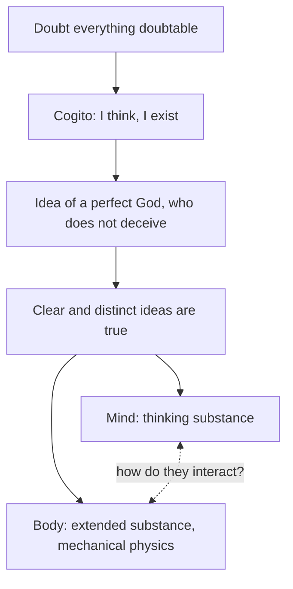

# René Descartes

**Prerequisites:** [[scientific-revolution-and-method|The scientific revolution]], [[rationalism|Rationalism]]

@@IMG@@

## Life and context

René Descartes (1596–1650) was born in La Haye, Touraine (the town is now named Descartes), and educated at the Jesuit college of La Flèche, where he learned scholastic philosophy and mathematics. After a law degree at Poitiers he joined the army of Maurice of Nassau in the Netherlands. On 10 November 1619, in a heated room in Germany, he had three dreams that he took as a call to found a unified science. He spent most of his adult life in the Dutch Republic, moving often. When he heard of Galileo's condemnation in 1633 he withheld his treatise *The World*, which defended the earth's motion. In 1649 he accepted an invitation from Queen Christina of Sweden to Stockholm, where he died of pneumonia in February 1650.

## Mathematics and science

Descartes invented analytic geometry, uniting algebra and geometry by coordinates (hence "Cartesian" coordinates), published as an appendix to the [[discourse-on-method|*Discourse on the Method*]] (1637), alongside essays on optics and meteorology. He held that the physical world is extension, matter is geometrical space, and all physical change is mechanical motion. Animals, on his view, are complex machines.

## Core ideas

**Methodic doubt.** To find a foundation for the sciences, he resolves to treat as false anything that admits the slightest doubt. The senses sometimes deceive; there are no sure signs to distinguish waking from dreaming; an all-powerful evil demon might deceive him even about arithmetic.

**The cogito.** One thing survives: if I am doubting, I am thinking, and if I am thinking I exist. In the *Discourse* this is "I think, therefore I am" (*je pense, donc je suis*); in the [[meditations-on-first-philosophy|*Meditations*]] it is "I am, I exist" is necessarily true whenever I conceive it.

**God as guarantor.** He finds in himself the idea of an infinite, perfect being, which he argues could only be caused by such a being. A perfect God would not deceive, so what I perceive clearly and distinctly is true. Critics, starting with Antoine Arnauld, objected that this is circular: clear and distinct perception proves God, and God guarantees clear and distinct perception (the "Cartesian circle").

**Mind and body.** I can clearly conceive myself as a thinking thing without a body, and body as extended without thought; God could create either without the other; so they are really distinct substances. This is **substance dualism**. Yet mind and body are closely united and interact, he said, through the pineal gland. Princess Elisabeth of Bohemia asked in their correspondence (1643) how an unextended thinking substance could move a body; his answers did not satisfy her or later readers.

## Key works

*Rules for the Direction of the Mind* (unfinished, published posthumously); [[discourse-on-method|*Discourse on the Method*]] (1637); [[meditations-on-first-philosophy|*Meditations on First Philosophy*]] (1641), with *Objections and Replies*; *Principles of Philosophy* (1644); *The Passions of the Soul* (1649).

## Influence and criticism

Descartes is often called the father of modern philosophy because he made the question "what can I know with certainty?" the starting point and the thinking subject its foundation. [[baruch-spinoza|Spinoza]] and [[gottfried-wilhelm-leibniz|Leibniz]] built on and against him. Empiricists rejected innate ideas. In the twentieth century, Gilbert Ryle mocked dualism as "the dogma of the ghost in the machine"; [[martin-heidegger|Heidegger]] and the phenomenologists argued that his split between subject and world misdescribes how we exist; [[ludwig-wittgenstein|Wittgenstein]] attacked the idea of a private inner realm. Neuroscientists such as Antonio Damasio wrote of "Descartes' error". The mind–body problem he sharpened remains open.

## Key ideas

- Doubt is a method for finding an unshakable foundation for knowledge.
- The cogito establishes the existence of the thinking self.
- God guarantees clear and distinct ideas; critics see a circle.
- Mind and body are distinct substances, raising the problem of interaction.

## Where this leads

- Texts: [[discourse-on-method|*Discourse on the Method*]], [[meditations-on-first-philosophy|*Meditations*]]
- Next thinker: [[thomas-hobbes|Thomas Hobbes]]
- Glossary: [[g:cogito|cogito]], [[g:mind-body-problem|mind–body problem]], [[g:methodic-doubt|methodic doubt]]
- Back: [[augustine|Augustine]]'s "if I am mistaken, I am"; [[avicenna|Avicenna]]'s floating man
