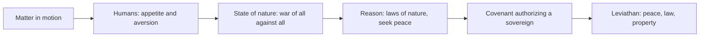

# Thomas Hobbes

**Prerequisites:** [[social-contract-and-the-state|The social contract]]; helpful: [[niccolo-machiavelli|Machiavelli]]

@@IMG@@

## Life and context

Thomas Hobbes (1588–1679) was born in Westport, near Malmesbury in Wiltshire; he later said that his mother, frightened by rumours of the Spanish Armada, gave birth to twins, himself and fear. After Oxford he became tutor and secretary to the Cavendish family, the Earls of Devonshire, an association that lasted most of his life. He translated Thucydides, met Galileo in Florence, and in Paris joined the circle of Marin Mersenne, where he wrote objections to Descartes' *Meditations*. Fearing for his safety as political conflict grew in England, he left for France in 1640 and stayed for eleven years, for a time tutoring the future Charles II in mathematics. [[leviathan|*Leviathan*]] was published in 1651, after the execution of Charles I; it offended royalists and churchmen alike, and Hobbes returned to England. He lived to 91, translating Homer in his eighties.

## Core ideas

**Materialism and mechanism.** Everything that exists is body in motion. Sensation is motion in the organs; thought is motion in the head; even God, Hobbes suggested, must be a body of some kind. He was inspired by geometry, which he discovered at about forty (Aubrey reports he was reading Euclid's proof and exclaimed it was impossible until he had traced it back to first principles).

**Human nature.** Humans are machines driven by appetite and aversion. "Good" names whatever a person desires. Three causes of quarrel are rooted in human nature: competition, diffidence (distrust) and glory.

**The state of nature.** Without a common power, the result is a war "of every man against every man", in which life is "solitary, poor, nasty, brutish, and short". There is no justice or injustice there, because there is no law; there is only the right of each to everything.

**Laws of nature and the sovereign.** Reason discovers "laws of nature", general rules of prudence: seek peace; be willing to lay down your right to all things if others do too; keep covenants. But covenants without the sword are but words. So people authorize a sovereign, one person or an assembly, with power to make law, judge, and command force. Division of sovereign power, he thought, was what had led England to civil war.

**Limits.** Subjects retain a right not to be killed or harm themselves; the sovereign's authority lasts only as long as it can protect them.

## Influence and criticism

Hobbes was widely denounced as an atheist and a corrupter; after the Great Fire of London (1666) a parliamentary committee considered investigating *Leviathan* for atheism. Yet he founded modern political philosophy in its secular, individualist, contract-based form. [[john-locke|Locke]] answered him (without naming him much); [[jean-jacques-rousseau|Rousseau]] argued that his "natural" man was really social man. Game theorists find in the state of nature a version of the prisoner's dilemma. Critics argue that his psychology is too bleak, that absolute sovereignty is more dangerous than anarchy, and that his materialism cannot account for meaning or obligation.

## Key ideas

- Everything is body in motion, including thought.
- Without government, competition, distrust and glory produce a war of all against all.
- Rational fear leads people to authorize an absolute sovereign to secure peace.
- His secular, contract-based theory founded modern political philosophy.

## Where this leads

- Text: [[leviathan|*Leviathan*]]
- Next thinker: [[blaise-pascal|Blaise Pascal]]
- Glossary: [[g:state-of-nature|state of nature]], [[g:social-contract|social contract]]
- Related: [[micro:05-market-structures|game theory in market structures]]
