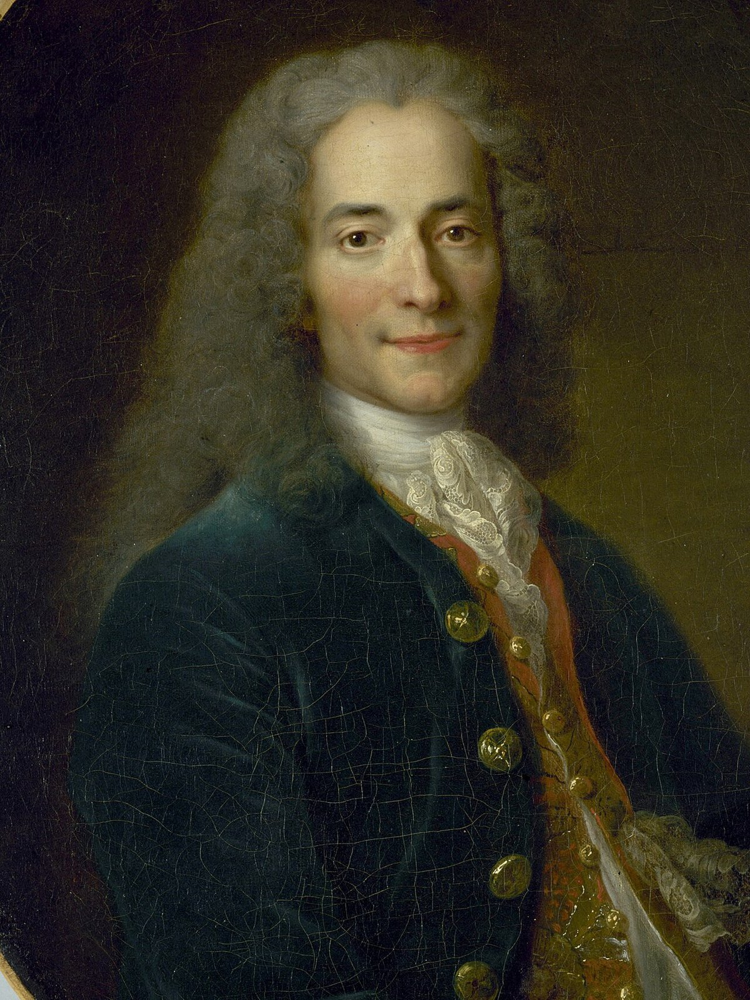
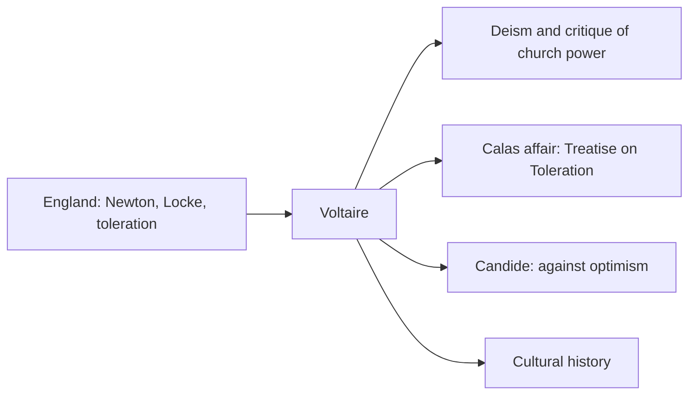

# Voltaire

**Prerequisites:** [The Enlightenment](../06-enlightenment.md)

*Workshop of Nicolas de Largillière, portrait of Voltaire at about 24 (c. 1718), Musée Carnavalet. Credit: Nicolas de Largillière. License: [CC0](http://creativecommons.org/publicdomain/zero/1.0/deed.en). Source: [File:Nicolas de Largillière - Portrait de Voltaire (1694-1778) en 1718 - P208 - musée Carnavalet - 5 (cropped).jpg](https://commons.wikimedia.org/wiki/File:Nicolas_de_Largillière_-_Portrait_de_Voltaire_(1694-1778)_en_1718_-_P208_-_musée_Carnavalet_-_5_(cropped).jpg).*

## Life and context

François-Marie Arouet (1694–1778), who wrote as Voltaire, was born in Paris to a notary's family and educated by the Jesuits at the Collège Louis-le-Grand. His satirical verses earned him eleven months in the Bastille in 1717–18, where he wrote a tragedy that made him famous. After a quarrel with a nobleman, the Chevalier de Rohan, whose servants beat him, he was again briefly imprisoned and then exiled to England (1726–1728). There he admired the relative freedom of speech and religion, Newton's science and Locke's philosophy, and wrote the *Letters Concerning the English Nation* (1733), which was condemned and burned in Paris. For years he lived at Cirey with the mathematician Émilie du Châtelet, with whom he studied Newton; she translated Newton's *Principia* into French. He spent nearly three years at the court of Frederick the Great in Prussia, ending in a quarrel, and settled at last at Ferney, near the Swiss border, where he could escape French authorities. He died in Paris weeks after a triumphant return.

## Core ideas and campaigns

Voltaire was less a systematic philosopher than a public intellectual who used wit as a weapon. His collected works run to many volumes: plays, poems, histories, tales, pamphlets and about 20,000 surviving letters.

**Newton and Locke against Descartes.** He popularized Newtonian physics and Lockean empiricism in France, against the Cartesian establishment.

**Deism.** Voltaire believed in a supreme being, the clockmaker of the universe, known by reason. He attacked revealed religion, church power and what he called "*l'infâme*" ("the infamous thing"), meaning superstition and fanaticism, especially as embodied in the Church. His letters often ended "*Écrasez l'infâme*" ("crush the infamous").

**Toleration.** In 1762 the Protestant merchant Jean Calas was tortured and executed in Toulouse for allegedly murdering his son to stop him converting to Catholicism. Voltaire campaigned for three years, wrote the *Treatise on Toleration* (1763), and won Calas's posthumous exoneration in 1765. He took up other cases, including that of the young Chevalier de La Barre, executed in 1766 partly for alleged blasphemy.

**Against optimism.** The Lisbon earthquake of 1755, which killed tens of thousands on All Saints' Day, provoked his "Poem on the Lisbon Disaster", challenging the optimism of Leibniz and Pope ("whatever is, is right"). [*Candide*](../texts/candide.md) (1759) carries the satire to its comic extreme and ends with the advice "we must cultivate our garden".

**History.** His *Age of Louis XIV* and *Essay on the Customs and Spirit of Nations* widened history beyond kings and battles to manners, arts and non-European civilizations, including China, which he admired.

## Influence and criticism

Voltaire became the symbol of the Enlightenment; his remains were moved to the Panthéon in 1791. The line "I disapprove of what you say, but I will defend to the death your right to say it" is not his: it was written by Evelyn Beatrice Hall in a 1906 biography as a summary of his attitude. Critics note his antisemitic remarks, his flattering of despots such as Frederick and Catherine the Great, and investments that profited from colonial trade. [Rousseau](jean-jacques-rousseau.md), whom he mocked, thought his wit served the rich and corrupt.

## Key ideas

- Voltaire spread Newtonian science and Lockean philosophy in France.
- He was a deist who attacked fanaticism and church power.
- His campaign for Calas made toleration a public cause.
- *Candide* satirized Leibnizian optimism after the Lisbon earthquake.

## Where this leads

- Text: [*Candide*](../texts/candide.md)
- Next thinker: [Jean-Jacques Rousseau](jean-jacques-rousseau.md)
- Back: [Leibniz](gottfried-wilhelm-leibniz.md), the target
- Glossary: [deism](../../../../glossary/modern/deism.md), [theodicy](../../../../glossary/modern/theodicy.md)
