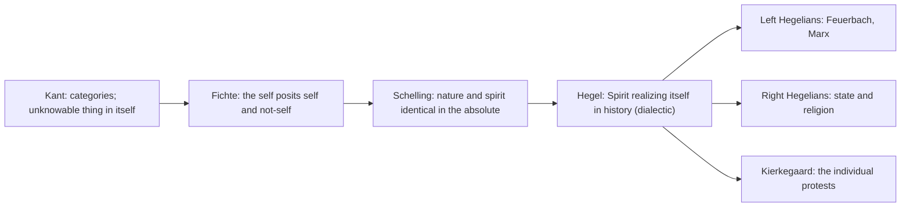

# German idealism: mind, history and the absolute

**Prerequisites:** [[kants-copernican-revolution|Kant's Copernican revolution]]; [[c:logic/contradiction-and-dialectic.md|contradiction and dialectic]]

@@IMG@@

## The problem Kant left

[[immanuel-kant|Kant]] showed, he thought, that the world we experience is shaped by the mind's forms and categories, while things in themselves remain unknowable. He also split the human being into two: a natural creature governed by causal law and a free rational will governed by moral law. Kant's successors found both results unstable.

- **The thing in itself.** If it is unknowable, how do we know it exists, or that it "affects" us? Causation is a category valid only within experience, so it cannot connect experience to what lies beyond it.
- **The split.** If nature and freedom are two separate realms, how can a free will act in the natural world? How are we one being?
- **Systematic unity.** Kant derived his categories from the forms of judgment in logic textbooks. Could they instead be derived from a single principle?

"German idealism" names the attempt, in roughly 1790–1831, to answer these questions by taking the mind's activity as the key not just to experience but to reality itself. The main figures are J. G. Fichte (1762–1814), F. W. J. Schelling (1775–1854) and [[georg-wilhelm-friedrich-hegel|G. W. F. Hegel]] (1770–1831). Their milieu was the university of Jena around 1800, together with the early Romantics (Novalis, the Schlegel brothers), and the shock of the French Revolution.

## Fichte: the self that posits

Fichte dropped the thing in itself. Philosophy must begin from the self's activity: the I "posits" itself, and in doing so posits a not-I, a limit, against which it strives. The world is, in a sense, what the free self must encounter in order to act morally. Fichte also wrote the *Addresses to the German Nation* (1808), an important text of German nationalism.

## Schelling: nature as visible spirit

Schelling objected that Fichte made nature a mere obstacle. Nature, he argued, is itself spirit in unconscious form, and spirit is nature become conscious. Behind both is an "absolute" identity. Art, he held at one point, is where the absolute shows itself most fully. He influenced the Romantic philosophy of nature and, much later, existentialist themes.

## Hegel: the rational is the real

[[georg-wilhelm-friedrich-hegel|Hegel]] criticized Schelling's absolute as "the night in which all cows are black". The absolute is not an undifferentiated identity but a process: **Spirit** (*Geist*) coming to know itself through history, nature, society, art, religion and philosophy.

Key elements:

- **Dialectic.** Concepts and forms of life, taken seriously, reveal internal tensions that force their development into richer forms which preserve what was true in them. Hegel's term is *Aufhebung*, "sublation": cancelling, preserving and lifting up at once. (The triad "thesis–antithesis–synthesis" is Fichte's vocabulary, not Hegel's, though it is often attached to him.)
- **Recognition.** Self-consciousness requires recognition by another self-consciousness; the famous "master–slave" (lordship and bondage) section of the [[phenomenology-of-spirit|*Phenomenology of Spirit*]] shows how a struggle for recognition produces domination and how the bondsman, through work, comes to a fuller self-understanding.
- **History.** World history is the progress of the consciousness of freedom: in the ancient East one was free, among the Greeks and Romans some, in the modern Germanic-Christian world all are free in principle.
- **Ethical life.** Freedom is realized not in isolated individuals but in institutions: family, civil society (the market economy) and the state.

## Why it matters

German idealism made history and society central to philosophy. Through Marx it shaped the twentieth century's politics; through Kierkegaard and Nietzsche's reactions it shaped existentialism; through the British idealists (F. H. Bradley) it provoked the revolt that started [[analytic-turn|analytic philosophy]]. Its critics in its own century included [[arthur-schopenhauer|Schopenhauer]], who despised Hegel, and [[soren-kierkegaard|Kierkegaard]], who complained in his journals that system-builders (Hegel above all) raise a vast palace of thought and then live in a shed beside it.

## Key ideas

- German idealism tried to complete Kant by removing the thing in itself and deriving everything from the mind's activity.
- Fichte started from the self, Schelling from an absolute identity of nature and spirit, Hegel from Spirit's historical self-development.
- Hegel's dialectic, recognition, philosophy of history and ethical life were enormously influential.
- Reactions against it produced Marxism, existentialism and analytic philosophy.

## Where this leads

- Next: [[pessimism-and-the-will|Schopenhauer: pessimism and the will]]
- Thinker: [[georg-wilhelm-friedrich-hegel|Hegel]]; text: [[phenomenology-of-spirit|*Phenomenology of Spirit*]]
- Forward: [[marx-and-historical-materialism|Marx and historical materialism]]
- Glossary: [[g:geist|Geist]], [[g:aufhebung|Aufhebung]], [[g:master-slave-dialectic|master–slave dialectic]]
