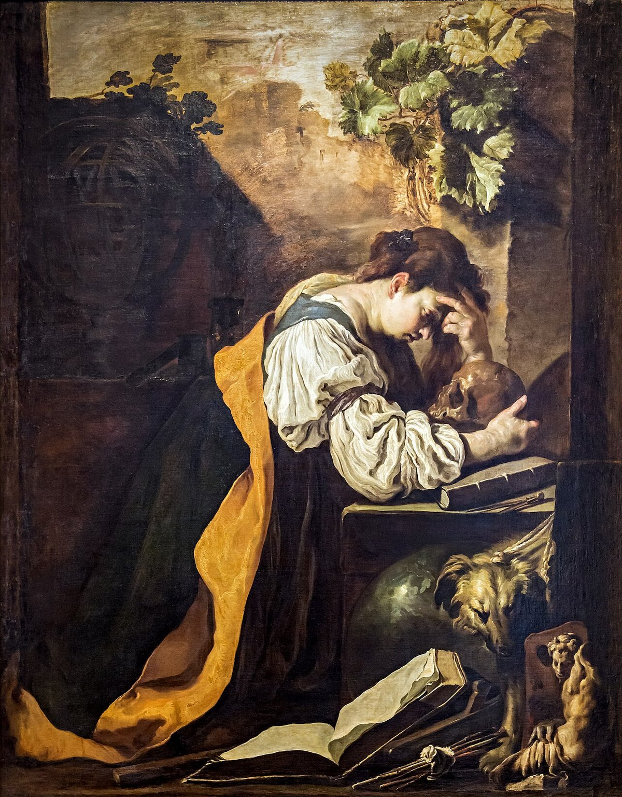
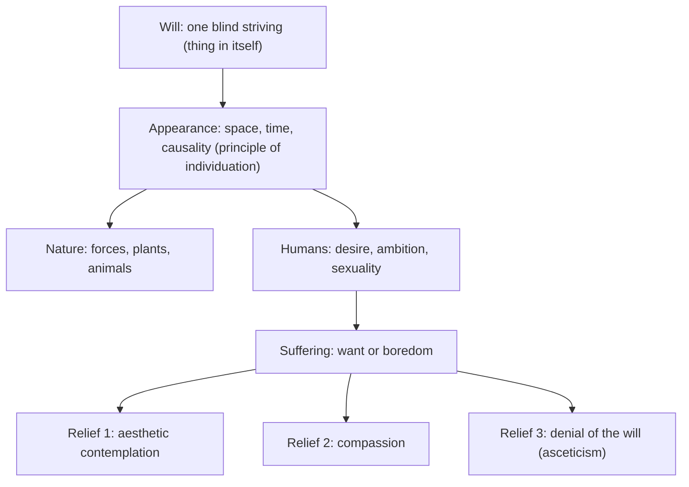

# Pessimism and the will: Schopenhauer's turn

**Prerequisites:** [Kant's Copernican revolution](../early-modern/07-kants-copernican-revolution.md), [German idealism](01-german-idealism.md); helpful: [will](../../../glossary/general/will.md)

*Domenico Fetti, *Melancholy* (*Meditation*) (c. 1618), Gallerie dell'Accademia, Venice. Credit: Didier Descouens. License: [CC BY-SA 4.0](https://creativecommons.org/licenses/by-sa/4.0). Source: [File:Accademia - La Meditazione by Domenico Fetti 1618.jpg](https://commons.wikimedia.org/wiki/File:Accademia_-_La_Meditazione_by_Domenico_Fetti_1618.jpg).*

## Starting from Kant, ending somewhere else

Take [Kant](../early-modern/thinkers/immanuel-kant.md)'s division between the world as it appears (structured by space, time and causality) and the world as it is in itself. Kant said the latter is unknowable. [Arthur Schopenhauer](thinkers/arthur-schopenhauer.md) (1788–1860) agreed that the appearing world is our representation, but claimed there is one place where we meet the thing in itself directly: in our own bodies, from inside. I know my body in two ways. From outside, it is an object among objects. From inside, I know it as willing: striving, desiring, resisting. Schopenhauer's bold step was to say that this inner nature, **will**, is the inner nature of everything.

## The world as will

On this view, everything in nature is an expression of a single, blind, purposeless striving: gravity, magnetism, the growth of plants, the instincts of animals, the sexual drive, human ambition. The will has no goal outside itself. It is not a rational spirit unfolding toward freedom, as in Hegel; it is a hungry force that feeds on itself. Individual things, separated in space and time, compete and devour each other, but this multiplicity belongs only to appearance. Underneath, all is one will.

## Why life is suffering

If our essence is endless willing, then life swings like a pendulum between pain and boredom. To want is to lack, and lack is pain. When a desire is satisfied, the satisfaction is brief; either a new desire arises or we fall into boredom. Happiness is merely negative, the temporary absence of pain. Schopenhauer filled his writing with examples: the predator and prey, the sufferings of the poor, the wars of history. This is **philosophical [pessimism](../../../glossary/modern/pessimism.md)**: not just a mood, but a thesis that existence is, on balance, something that would better not be.

## Three ways out

1. **Art.** In aesthetic contemplation we forget ourselves as willing individuals and become pure, will-less subjects of knowledge, contemplating the Ideas (in a sense he takes from Plato) that objects express. Music is supreme: it does not copy Ideas but expresses the will itself directly.
2. **Compassion.** Morality's basis is compassion (*Mitleid*). When I see through the illusion of separateness, I recognize that the suffering of another is, at bottom, my own. Schopenhauer cited the Sanskrit phrase *tat tvam asi*, "that art thou".
3. **Denial of the will.** The deepest release is the saint's or ascetic's: turning against the will to live itself, through chastity, poverty and resignation. He found this in Christian mystics, in Hinduism and in Buddhism, which he admired and was among the first major Western philosophers to engage with seriously, though his knowledge came from the limited translations available.

## Influence

Ignored for decades, Schopenhauer became famous after 1851. Wagner built *Tristan und Isolde* partly on his ideas; [Nietzsche](thinkers/friedrich-nietzsche.md) called him his "educator", then turned against his denial of life; [Tolstoy](thinkers/leo-tolstoy.md) called him the most brilliant of men for a time; [Freud](../twentieth-century/thinkers/sigmund-freud.md) acknowledged that Schopenhauer anticipated aspects of the theory of repression and the unconscious drives; [Wittgenstein](../twentieth-century/thinkers/ludwig-wittgenstein.md) read him young. Thomas Mann, Thomas Hardy, Borges and Beckett all bear his marks.

## Criticisms

How can a blind will, as thing in itself, be known by inference from our bodies when Kant said things in themselves cannot be known? If everything is will, how can the will turn against itself? Critics also note his misogynistic essay "On Women" and the gap between his ascetic ideal and his comfortable life. Nietzsche's main objection was different: Schopenhauer's pessimism was a symptom of weariness; the right response to suffering is to affirm life, not deny it.

## Key ideas

- The world as experienced is representation; its inner essence is will, a blind, purposeless striving.
- Life oscillates between the pain of want and boredom; happiness is only negative.
- Art (especially music), compassion and ascetic denial of the will offer release.
- Schopenhauer influenced Wagner, Nietzsche, Tolstoy, Freud and Wittgenstein.

## Where this leads

- Next: [Utilitarianism and liberalism](03-utilitarianism-and-liberalism.md)
- Thinker: [Arthur Schopenhauer](thinkers/arthur-schopenhauer.md); text: [*The World as Will and Representation*](texts/world-as-will-and-representation.md)
- Forward: [Nietzsche and the death of God](08-nietzsche-and-the-death-of-god.md), [psychoanalysis](../twentieth-century/05-psychoanalysis-and-depth-psychology.md)
- Back: [ataraxia and apatheia](../../../concepts/ethics/ataraxia-and-apatheia.md); [Ecclesiastes](../../../../religion/abrahamic/christianity/bible/old-testament/books/wisdom-poetry/ecclesiastes.md)
