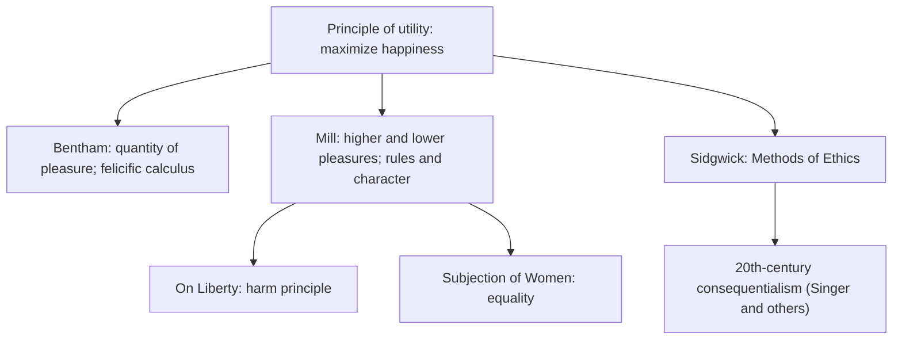

# Utilitarianism and liberalism: happiness, liberty and reform

**Prerequisites:** [[enlightenment|The Enlightenment]], [[groundwork-of-the-metaphysics-of-morals|Kant's *Groundwork*]] for contrast; [[g:pleasure|pleasure]]

@@IMG@@

## A test for laws and actions

Imagine you are drafting a law. How should you decide whether it is good? Tradition, scripture, natural law and rights talk give answers that conflict and are hard to check. The utilitarians proposed a single, public, measurable test: does it increase or decrease the total happiness of everyone affected?

That test was developed by **Jeremy Bentham** (1748–1832) and refined by **[[john-stuart-mill|John Stuart Mill]]** (1806–1873). It was not an academic hobby. Utilitarians were reformers: of prisons, poor laws, the franchise, legal codes, the status of women and the treatment of animals.

## Bentham's principle

Bentham's *Introduction to the Principles of Morals and Legislation* (printed 1780, published 1789) opens: "Nature has placed mankind under the governance of two sovereign masters, pain and pleasure." The **principle of utility** approves or disapproves of every action according to its tendency to increase or diminish the happiness of the party whose interest is in question. Bentham proposed a "felicific calculus" weighing pleasures by intensity, duration, certainty, nearness, fecundity, purity and extent. Each person counts for one and only one. Natural rights he called "nonsense upon stilts". On animals he wrote: the question is not, Can they reason? nor, Can they talk? but, Can they suffer?

## Mill's refinement

Mill was raised by his father James Mill as a test case of Benthamite education: Greek at three, logic at twelve. At twenty he had a mental crisis, recounted in his *Autobiography*, when he realized that achieving all his reforming goals would not make him happy; he recovered partly by reading Wordsworth. His mature utilitarianism is broader.

- **Higher and lower pleasures.** In his essay *Utilitarianism* (1861, as a book 1863) Mill argued that pleasures differ in quality: those who have experienced both prefer the pleasures of intellect, feeling and imagination. "It is better to be a human being dissatisfied than a pig satisfied; better to be Socrates dissatisfied than a fool satisfied."
- **Secondary principles.** We need not calculate every act; common moral rules embody humanity's experience of what tends to promote happiness.
- **Justice.** Rights are interests so important to security that society should protect them; justice is the most important part of utility.

## Liberalism: the harm principle

In [[on-liberty|*On Liberty*]] (1859), written with his wife Harriet Taylor Mill (whose contribution he credited generously), Mill argued that the only purpose for which power can rightfully be exercised over any member of a civilized community, against his will, is to prevent harm to others. His own good, physical or moral, is not a sufficient warrant. This is the **[[g:harm-principle|harm principle]]**. He defended near-absolute freedom of thought and discussion (even false opinions help us hold truths as living convictions rather than dead dogma) and "experiments in living". He feared not just state tyranny but the "tyranny of the majority" exercised through social conformity, a theme he took from Tocqueville.

In *The Subjection of Women* (1869) Mill argued for full legal equality of the sexes. As an MP he proposed in 1867 an amendment to give women the vote.

## Criticisms

Utilitarianism faces classic objections. Could it justify punishing an innocent person to calm a mob, if that maximized happiness? Does it respect the separateness of persons (Rawls)? Can pleasures be measured and compared? Is it too demanding? Is Mill's quality distinction consistent with hedonism? Liberalism's critics ask whether the harm principle can be applied without a contested idea of harm, and whether it presupposes an individualism that ignores community. Defenders have developed rule utilitarianism, preference utilitarianism and other refinements in response.

## Key ideas

- Utilitarianism judges actions and laws by their effect on the total happiness of all affected, each counting equally.
- Bentham quantified pleasure; Mill distinguished higher from lower pleasures.
- Mill's harm principle limits society's power over the individual to preventing harm to others.
- Utilitarians were practical reformers; their theory faces lasting objections about justice and rights.

## Where this leads

- Next: [[marx-and-historical-materialism|Marx and historical materialism]]
- Thinker: [[john-stuart-mill|John Stuart Mill]]; text: [[on-liberty|*On Liberty*]]
- Economics: [[eco:03-john-stuart-mill.md|Mill in economics]], [[micro:08-welfare-economics|welfare economics]]
- Forward: [[political-philosophy-after-catastrophe|Rawls's critique]]
- Back: [[gk:epicurus.md|Epicurus]] on pleasure
